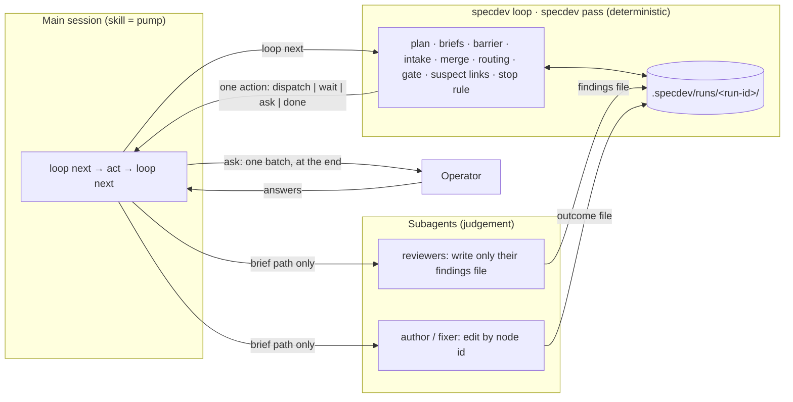
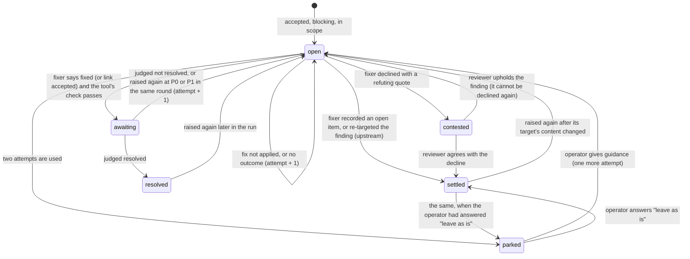
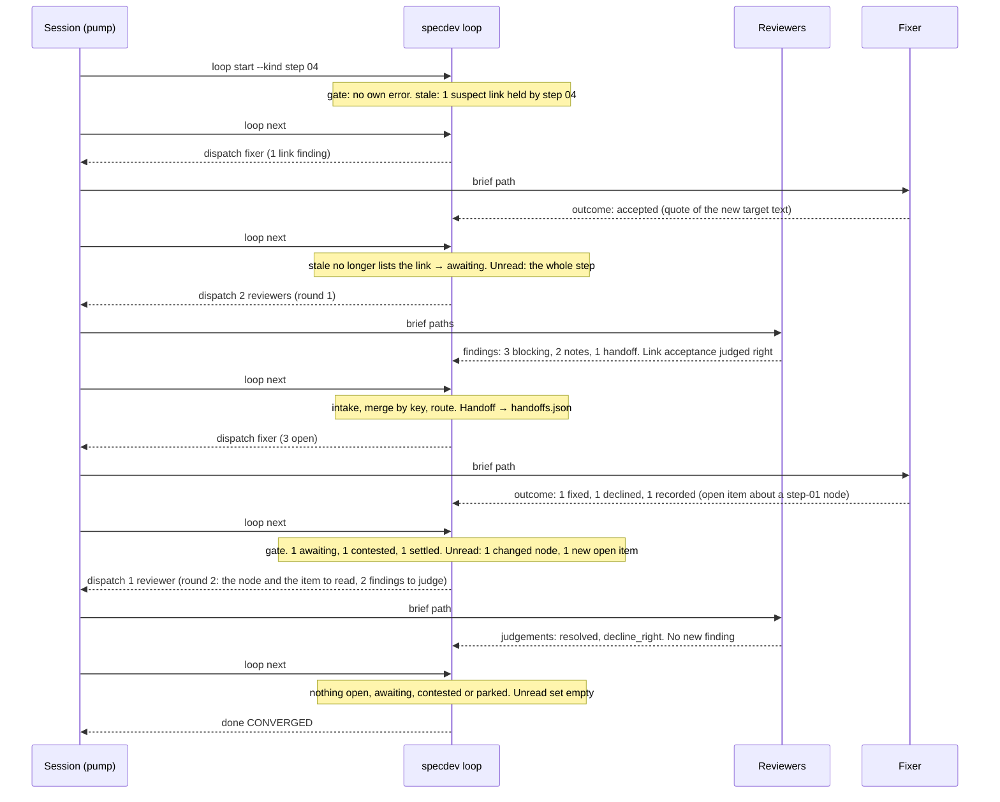
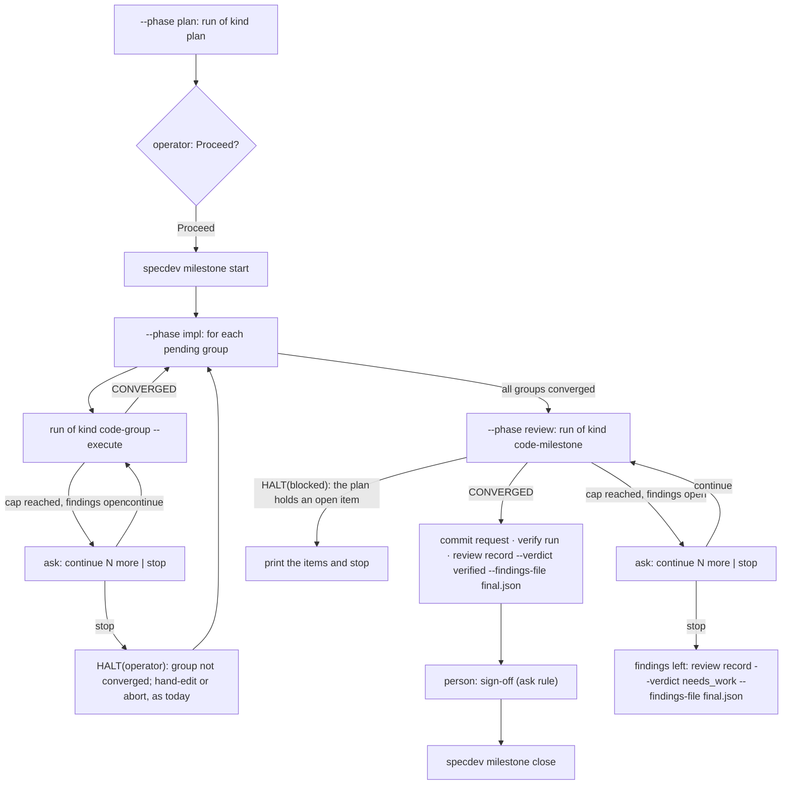
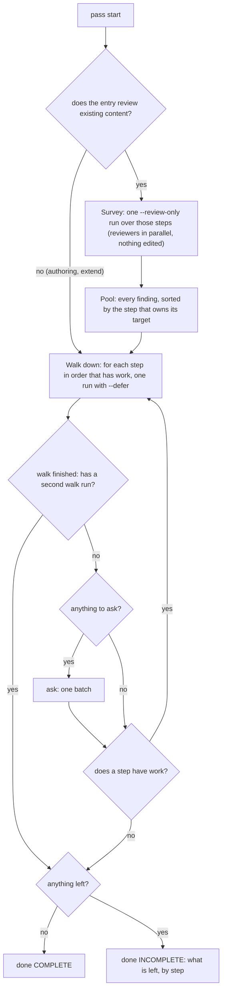

# Agent harness design

Status: **v10, built.** The code is on branch `feat/1.2.0-agent-harness-impl` (`tools/specdev_tools/loop/`, the `specdev-*` skills and agents); section 13 lists where it differs from the text below. The review history that follows is of the design text, before the build.
Review: ten rounds, not converged. Rounds 9 and 10 read version 10 and found 22 blocking and 53 lesser points, nearly
all in the pass machine (section 8.3) and the link findings; all are applied here, and the last fixes have not been
reviewed. The run machine of section 6.3 walked clean for a single step in both rounds.

"As built" means the working tree on 2026-11-25. That tree includes the uncommitted 1.2.0 hardening work (milestone H
of `feat/1.2.0-spec-graph`), which was still changing skills, agents and prompts while this was written. Re-check each
As built statement before building on it.

The two rule tables (sections 6.3 and 8.3) exist as code: `tools/specdev_tools/loop/machine.py` and
`pass_machine.py`, with the scenarios of the review rounds and seeded simulations as tests (`tests/unit/loop/`). Where
this document and that code disagree, the code and its tests are right and this document is to be corrected.

## 1. How to read this

| Label | Meaning |
|---|---|
| **As built** | Exists on this branch today; checked at the file or command named |
| **Proposed** | New in this design |
| **Decided** | A choice the design could not derive. Made under the operator's delegation of 2026-11-25 ("use your best judgement"); listed in section 11 with what it costs and how to overturn it |

Scope: the agent workflows of the toolkit: `/specdev-step`, `/specdev-review`, `/specdev-trinity`, their five
agents, and a new `/specdev-pass` that drives several steps (DEVSPEC-220). Out of scope: the `pr-audit-*` agents and
the `devspec_pr_audit` skill; the spec graph itself (`docs/architecture/spec-graph/spec_graph_design.md`, called "the
graph design" below).

Trust boundary (graph design, principle Z0): `specdev` is a correctness tool, not a security boundary. The harness
makes the correct path the cheap path and makes a wrong verdict impossible to produce through the tool. It does not
stop a session that ignores the tool. A way around the tool is not a finding against this design.

Terms:

| Term | Meaning |
|---|---|
| Run | One review-fix loop over one scope, from `loop start` to a verdict |
| Pass | Several runs over several steps, in step order, driven by `specdev pass` (section 8.3) |
| Round | One review dispatch. A fix pass is not a round |
| Read-record | Per in-scope node (or file): the content hash that a reviewer of this run, or of the run it carries, last read. Two modes start it filled, because they do not review what was already there: `--extend` and the `--about` scope (section 5) |
| Unread set | The in-scope nodes whose current content differs from their read-record. A round reads exactly this set. In the first round of a plain review it is the whole scope |
| Target | What a finding is about: the part of its `location` before the `#` (a node id, or a file path) |
| Key | A finding's identity: its `kind` and its whole `location` |
| Status | Where a blocking finding stands in the run: one of the six below |
| `open` | To be fixed: it goes to the fixer |
| `awaiting` | The fixer says it is fixed and the content changed; the next reviewer judges it |
| `contested` | The fixer declined it; the next reviewer judges the decline |
| `parked` | Two attempts failed. Only the operator can move it |
| `resolved` | Fixed and confirmed |
| `settled` | Closed without an edit. Opened again only if its target's content changes |
| Link finding | A suspect link (E763) held by an in-scope node, taken from `specdev stale`. It is fixed by editing the holder or by accepting the link with `specdev attest` |
| Handoff | In a spec run, a P0 or P1 finding about a node of a step outside the run's scope, or about a seed. It never blocks the run |
| Pool | In a pass: the handoffs and the unfinished findings (those in a `final.json`) of its runs, sorted by the step that owns the target; reviewer findings only, never gate or link findings. A pool finding is **closed** when a run whose scope holds its target gave it the status `resolved` or `settled` or refused it because the target no longer exists (read from the `run.json` files), or when the operator closed it in the batch |
| Note | A P2 finding: listed, never fixed by the loop |
| Open item | An entry of an artifact's `ambiguities` list (graph design section 7): a question no step could settle in its own turn. The only form a question to the operator takes in spec work |
| Attempt | A fix of a finding that failed: the fix pass left it `open`, the next reviewer judged it not resolved, or (a gate or link finding) the error is still there. An upheld decline is not an attempt. A link that is listed again after its target's content changed again is a new finding and starts at zero; listed again with the target unchanged, it is an attempt. After two, the finding is parked |
| Try | One dispatch of an agent for one file. An entry gets two |

## 2. The problem

64 open tickets describe the agent workflows (section 9 maps each one). They reduce to six causes.

| Cause | What was observed | Tickets (examples) |
|---|---|---|
| The loop's bookkeeping is done by an LLM | Round counting, the wave barrier, the `jq` merge and the "converged" test are prose in three skills. Orchestrators dispatched fixes before reviewers finished in at least four rounds; orchestrator-class agents were about 19% of study tokens | 228, 177, 134, 205, 216 |
| The stop rule cannot be met | CONVERGED needs zero findings at every severity. 9 of 10 runs ended in HALT at round 5, and round-5 fixes were never re-reviewed. The first review-fix loops and their re-runs were about 44% of study tokens | 172, 227, 239, 229 |
| A finding has no checked identity or evidence | The dedup key includes an LLM-made hash; locations were array indexes; quotes are unchecked; reviewers finish with undisclosed gaps | 133, 159, 260, 197, 196 |
| Nothing is remembered inside a run | Round-5 findings were 22% repeats and 22% rejected-then-re-raised. One cross-step reviewer produced 45% of all findings, and they blocked the step in scope | 174, 173, 180 |
| The step contract does not reach the agent | 14 of 94 `specdev-impl` runs (78 fix, 16 author-extend) opened their step prompt; 0 of the 61 whose brief did not name it | 209, 214, 215, 221 |
| Operator answers and run state live in the session's context | Answers were re-asked; a stalled run restarts at round 1; a waiting orchestrator reads as finished | 169, 286, 190, 206 |

The observations are the tickets' own, most of them made on toolkit 1.1.1. This branch already carries text-level
fixes for some of them (label **F** in section 9): a finding's `location` is the node id, the review skill removes a
round's old findings files first, the fix agent returns a record per finding, `/specdev-review --review-only` exists.
Each of those is an instruction an LLM is asked to follow. None has a check behind it, and the loop, the merge and the
verdict are still prose. This design keeps those rules and gives them a mechanism.

## 3. Constraints

| Source | What it says | Effect on this design |
|---|---|---|
| Graph design Z0 (Ruled) | Correctness tool, not a security boundary | No hooks, keys or enforcement machinery |
| Graph design R-orch (Ruled) | "Orchestration is out of scope" of the spec-graph release; tooling comes first | This design is the follow-on, on its own branch; it changes no graph rule |
| Graph design P10 (Ruled) | Checkable rules become checks | Merge, barrier, evidence, coverage and the verdict move into the tool |
| Graph design P13 (Ruled) | A position is never identity | A finding names a node id, never an array index |
| Graph design P9, section 8.5 (Ruled) | The trinity loop never writes spec; missing spec becomes an open item in the plan | Unchanged, and still done by `specdev-trinity-impl` |
| Graph design section 7 (Ruled) | Open items live in the artifact that raised them; an answer a step does not own becomes an open item | Unchanged, and still done by the fixing agent with today's commands. **The loop tool itself never writes spec**. A question an agent cannot settle is an open item, as ruled. **Changed**: the agent no longer puts it to the operator first (the Clarify turn; decision 6, which needs the operator's confirmation) |
| Graph design R-severity (Ruled) | Fix every defect that affects consistency, completeness or drift, or that leaves an assumption, ambiguity or hallucination, however small | It defines what is blocking (section 6.6) |
| Graph design Appendix B (retired idea) | "A decisions seed; durable rulings stores" are retired: decisions go into the seed they concern (D10) | The harness keeps run state only (decision 2) |
| Graph design section 8.4 (Ruled) | A person decides sign-off, defer, release, `verify attest` | Unchanged; the loop ends before them |
| Graph design R-simple (Ruled) | Favour simplicity | Two small command groups, one folder per run |
| `WIP/1.2.0/DECISIONS.md` X1, X3 | A findings merge/verdict CLI and the default stop rule are **on hold pending an orchestration design** | This document is that design; it proposes both |
| `WIP/1.2.0/DECISIONS.md` X3 | Operator principle 2026-10-16: no finding may remain that leads to an incorrect, ambiguous or hallucinated spec or an incorrect implementation; cosmetic or preference findings do not block | Section 6.6 |
| `WIP/1.2.0/DECISIONS.md` X4 (open), X5 (reframed, awaiting confirmation) | Whether each round starts fresh; whether any record of declines exists | Decision 2 |
| Operator 2026-10-15 (DEVSPEC-172, 195); a candidate under X3, which is on hold, not yet a ruling | "The final fresh full round has no confirmed new P0 or P1"; re-raised declines are checked against a rulings record; cross-step findings become handoffs; P2 logged | Section 6.6 adopts the severity gate, the handoffs and the logged P2. Section 6.3 replaces "a final fresh full round" by "every node read in its current content" (decision 8). No rulings record (decision 2) |
| Operator 2026-11-25 | Use best judgement for a deterministic result; no unnecessary or redundant loops; severity by tag alone is wrong; autonomous once seeds are in place, with the least human input | Section 11: the nine decisions |
| DEVSPEC-229 | No hard cap on trinity code loops is deliberate | Code runs ask at the cap instead of halting |

## 4. The design in one page

**The tool keeps the loop. Agents judge. The session only pumps.**

- One new command group, `specdev loop`, owns every piece of loop bookkeeping: the fan-out plan, the briefs, the
  barrier, intake checks, merge, routing, the gate, the suspect links, the stop rule and the run state on disk.
- A second small group, `specdev pass`, decides which run comes next when several steps are involved: a new feature,
  a review of one feature, a replay after upstream findings, or a range of steps.
- Claude Code stays the agent runtime. The skill in the main session runs a short pump: ask the tool what is next, do
  exactly that, ask again.
- An agent receives one thing: the path of a brief the tool wrote. It writes one file, at the path the brief names. The
  session never reads or rewrites findings.
- The tool reads spec and writes only inside its run and pass folders, with one exception: the copy of a code run's
  result that `milestone-state` reads (section 8.2). Every edit of a spec file or of code is made by an agent, through
  the commands that exist today.

Four rules give fast convergence without a gap:

| Rule | Effect |
|---|---|
| Every node is read in its current content; nothing is read twice | A round reads only the unread set. There is no "final full round" that re-reads unchanged content (decision 8) |
| Severity follows impact, not the finding's kind | Only defects open a fix or a round. Wording is listed (decision 1) |
| Spec work asks nothing in the middle | A question an agent cannot settle becomes an open item, as the graph design rules. The operator gets one batch at the end of a pass (decision 6) |
| Upstream is changed once | A pass surveys first (read-only), then walks down the steps once with every known finding in hand (decision 7) |


*Figure 1. Who holds what. State is only in the run folder; the session and the agents are replaceable.*

What this is not: a second agent runtime, a model client, a scheduler, a dashboard or a durable ledger (section 10).

## 5. Commands

All **Proposed**. They take the three root flags (`--repo-root`, `--spec-root`, `--git-root`). Every command exits 0
when it prints an action, whatever the verdict; a non-zero exit means the command itself failed.

| Command | Does |
|---|---|
| `specdev loop start --kind K <scope> [mode] [--readers N] [--carry RUN] [--defer] [--cap N] [--base-ref REF] [--pass ID]` | Creates a run: resolves the scope, hashes the in-scope content, computes the fan-out plan. Prints the run id. If an unfinished run exists for the same kind and scope, it creates nothing. Called with that run's own mode and argument, or with no mode flag when the run is not `--review-only`, it prints the run's id. Called with another mode or argument, it exits non-zero and names the run and `loop next <id> --stop`, so an `--extend` intent, a worklist or a read-only request is never silently dropped |
| `specdev loop next <run-id> [--answers FILE] [--redispatch] [--stop]` | The only command that advances a run. Reads the files on disk, runs the checks, applies the rule of section 6.3 and prints exactly one action as JSON |
| `specdev loop status [<run-id>] [--pass ID]` | Read-only: the runs and the passes, and for one run its rounds used, findings by status, files expected and received, questions, verdict |
| `specdev pass start <entry>` | Creates a pass (section 8.3) and prints its id; when an unfinished pass with the same entry exists, it prints that pass's id instead. The entries: a step range; `--extend TEXT [--seed PATH] [--from NN]`; `--review --about NODE`; `--replay` |
| `specdev pass next <pass-id> [--answers FILE] [--retry] [--stop]` | The only command that advances a pass. Prints one action: `run` (the arguments of the next `loop start`), `ask` or `done` |

Kinds:

| `--kind` | Scope | Used by | Gate | At the cap |
|---|---|---|---|---|
| `step` | A step `NN`, a range, a list of steps, `all`, or one non-step file of `spec/common/` (today's scope forms, **As built**, `specdev-review/SKILL.md`; the last is today's `manifest_artifact` scope kind). **Proposed**: `NN --about NODE` limits what is read, not what may be fixed: the scope is step NN, and the read-record starts filled for every node outside the set. The set is NODE and every node that links to it, directly or through other nodes, as `specdev trace NODE --down` walks today (it follows parent and child too, and reaches plan items; the pass uses steps 00 to 15 only) | `/specdev-step`, `/specdev-review`, `/specdev-pass` | The tool runs `spec-check --step NN` for each step (section 6.8). A `spec/common/` file has no step gate, and for it alone the reviewer keeps the `seed-lint` and `spec-check` runs it does today (**As built**, `specdev-reviewer.md`). Such a run is `--review-only`: the file's entries are in scope, but the fix agent has no command that edits them (it edits by node id, and seeds are edited by a person), so the findings go to the operator | HALT |
| `plan` | One milestone plan | `/specdev-trinity --phase plan` | The tool runs `spec-check --step 16a` | HALT |
| `code-group` | One group of a milestone plan (the unit `/specdev-trinity --phase impl` executes today) | `/specdev-trinity --phase impl` | None by the tool; the reviewer keeps the `spec-check` run it does today (**As built**, `specdev-trinity-reviewer.md`) | Ask |
| `code-milestone` | A milestone's code | `/specdev-trinity --phase review` | None by the tool; the reviewer keeps today's `spec-check` and `verify run --no-record` | Ask |

Modes (one at most):

| Mode flag | The run begins with | The first unread set | Purpose |
|---|---|---|---|
| (none) | The gate, then a round | The whole scope | Review and fix an existing artifact |
| `--author` | An author dispatch, then the gate and a round | The whole scope | First authoring of a step or a plan |
| `--extend TEXT` | An author-extend dispatch carrying the operator's intent (and, with `--seed PATH`, the seed file today's `--extend … --seed` passes), then the gate and a round | What the dispatch changed: the read-record starts as the content at `loop start` | Adding content to an existing step. The content that was already there is not reviewed again; that is `/specdev-review` |
| `--execute` | An execute dispatch, then a round | The whole group | A `code-group` run |
| `--review-only` | The gate and one round, then a verdict | The whole scope (with `--about`, the set) | Read-only review. The flag exists today on `/specdev-review` (**As built**): one round, nothing fixed |
| `--worklist FILE` | The findings of FILE, so a fix pass comes first. They enter as `open`, except those that were `awaiting` or `contested` when a `final.json` was written: these keep their status and are judged by the first round. Status, the fixer's outcome and the attempts are read from the `run.json` beside that `final.json` | The nodes that differ from the carried read-record (see `--carry`); with nothing carried, the whole scope | Applying a known worklist (DEVSPEC-227); taking handoffs (section 6.9) |

Other flags:

| Flag | Meaning |
|---|---|
| `--readers N` | How many reviewers a cluster gets in a round when it holds a node with no read-record entry at all, its own or carried: a node nobody has read. A cluster of re-read nodes only gets one. Default 2 for kind `step`, 1 for `plan` and the code kinds (decision 3). They run in the same wave, so a second reader costs tokens, not time |
| `--carry RUN` | Start with the read-record of an earlier run: a node whose content still equals its entry in that run's read-record counts as read. Set by the pass tool (the latest run of the pass that read the step: the survey, or a run of an earlier walk; none when there is none), and implied by `--worklist` when the file is a `final.json` or a `handoffs.json` (each names its run). A hand edit made between the two runs changes the hash, so the node is read again |
| `--defer` | Never ask the operator: a run that would ask about parked findings ends `HALT(stuck)` instead (section 6.3, row 9). Set by the pass tool, which asks once, at the end |

A worklist file is a findings file. Each of its findings passes the Target check of section 6.6; a finding whose
target no longer exists, or is outside this run's scope, is listed in a `rejected.json` at the top of the run folder
and skipped. The Evidence check is not repeated when the file was written by the tool (a `final.json`, a
`handoffs.json`, the pool findings of a pass): each finding passed it at intake in its own run, and the text it quotes may have been
edited since. If the defect is gone, the fixer declines the finding as no longer applying and the next reviewer
judges that. A file from elsewhere is checked for Evidence too. A finding that carries an instruction (guidance, or a
decision from the batch of a pass) enters the run with it. After that the run follows section 6.3 like any other.

## 6. How a run works

### 6.1 The run folder

```
.specdev/runs/<run-id>/           <kind>-<scope>-<UTC timestamp>; never reused, never overwritten
  run.json                        mode, cap, rounds used, roots, plan, the read-record, every finding with its key,
                                  status and attempts, dispatch entries handed out, questions and answers, verdict
  briefs/<name>.md                one per dispatch, written by the tool
  d<M>/                           one folder per dispatch, numbered through the run (a second fix pass is a new
                                  dispatch)
    <entry>.t<k>.json             the file of one entry, try k: a reviewer's findings, or an author's or fixer's outcome
    merged.json, rejected.json    review dispatches only: accepted findings with their bucket; refused findings with the reason
    hashes.json                   content hash per in-scope node or file: for a review dispatch, taken when it is
                                  handed out (what the reviewers were given); otherwise when its outcome arrives
  final.json                      the findings not closed: open, parked, awaiting or contested; empty when the
                                  verdict is CONVERGED
  rejected.json                   worklist runs only: the worklist findings that were refused
  handoffs.json                   every handoff of a spec run: a valid findings file, usable as a worklist
  report.md                       verdict, rounds, counts by severity per round, notes, handoffs, settled and parked
                                  findings, the step gate's own summary, sizes of the files agents wrote
```

- `.specdev/` is already untracked in hosts (**As built**: `host_install.py`, the `.specdev/` ignore line).
- There is no index file: `loop status` reads the `run.json` files.
- A run id in the path replaces today's shared `.specdev/findings/findings_<scope>_<round>_r*.json` glob. Today the
  skill is told to delete a round's old files before dispatching (DEVSPEC-159); with a folder per run there is nothing
  to delete.
- An agent writes its file under a temporary name and renames it when complete; the tool ignores temporary names.
- Gate and link findings are not written to `final.json`: the gate and `specdev stale` report them again in any later
  run, and the report lists them.
- `final.json` and `handoffs.json` are valid `vc:infra:findings` documents that carry `$schema`, with one description per key
  (the first reviewer's), so `review record` and `--worklist` accept them as they are. Their `scope` is the scope
  identifier the skills write today (a step or range, a group id, the milestone id; a slug for a file path, since the
  schema allows no `/`) and their `round` the last round. `handoffs.json` repeats findings that are
  also in a round's `merged.json`, with the existing kinds; it is not a new class of output (today's `--review-only`
  rule: "there are no sibling documents" with their own finding classes).
- **Content hash.** For a node: a plain hash of its own JSON together with the ids of its child nodes, so adding or
  removing a child changes the parent. For a file-level target or code: the file. In a code run the execution records of
  the group's actions count as content too, so a fix that is a `specdev plan record` is seen as a change. Open items
  (the `ambiguities` lists) are part of the content: an agent that records one has changed the artifact, and the next
  round reads it. This is **not** the trace-lock content hash,
  which covers only the fields each kind declares as its contract (`graph/contract.py`; `status`, `notes`, `tags` and `owner` are among those left out) and would miss a fix to the rest.

### 6.2 The status of a finding

`run.json` holds one entry per key for the whole run. Rounds add to it; nothing is counted "per round".


*Figure 2. A reviewer finding's life inside one run. Only `open` findings go to the fixer. A finding reaches the
operator only after two failed attempts. Attempts carry over when a finding is opened again.*

A decline that the next reviewer upholds goes back to the fixer with the reviewer's reason as its instruction; the
operator is not asked (decision 5). A key the operator settled with "Leave as is" and that is raised again after its
target changed goes to `parked`, not `open`, and the question shows the earlier answer.

A **gate finding** (section 6.8) has a shorter life, and only the gate moves it: after a fix pass it is `resolved` when
the gate no longer reports the error as blocking, and otherwise stays `open` with one more attempt, whatever outcome
the fixer wrote for it. Recording an open item closes a gate finding only through the gate: the error leaves `blocking`
when its node lies below the item's `about` node, and is then listed as waiting. A gate finding
that was `resolved` and is reported again is `open` with one more attempt, so two fixes that undo each other end at the
operator. It is never `awaiting`, never judged by a reviewer, never declined; after two attempts it is `parked`, and
the operator can only give guidance or stop the run.

A **link finding** is moved first by the tool and then by a reviewer: after a fix pass it is `awaiting` when
`specdev stale` no longer lists the link (and, for `fixed`, the holder's hash changed), and otherwise stays `open` with
one more attempt. The next reviewer then
judges whether the edit, or the acceptance, was right (section 6.8).

### 6.3 The next action

After taking in whatever arrived, `loop next` applies the first row that fits. This table is the whole machine.

| # | Condition | Action |
|---|---|---|
| 1 | `--stop` was given | `done HALT(operator)`. Files that arrive after a verdict are ignored |
| 2 | A dispatch is in flight | A handed-out entry's file is missing: `wait` (lists what is missing); with `--redispatch`, `dispatch` those entries for their second try, and for an entry already tried twice `done HALT(agent_failed)`. All handed-out files have arrived and the dispatch has entries not yet handed out: `dispatch` the next wave. An author's or executor's outcome that arrives carrying a refusal (for an executor E820 or E821): `done HALT(agent_failed)`, and the report prints the refusal, as the skill stops on it today |
| 3 | A `code-group` run: the executor returned manual-verification actions whose confirmation is not answered | `ask` the operator (section 6.9) |
| 4 | The run's mode is `--author`, `--extend` or `--execute`, and no outcome of that dispatch has arrived | `dispatch` the author or executor. An outcome that cannot be read, or names neither a result nor a refusal, is a failed try (row 2); a refusal ends the run at once (row 2). "Nothing to add" with a reason is a result of an `--extend` dispatch. Once an outcome with a result has arrived this row never fits again |
| 5 | Mode `--review-only` | No round yet: `dispatch` a round on the unread set. Round merged: `done` with verdict `CLEAN` (no P0 or P1 finding in scope, no gate error the scope owns, no suspect link the scope holds; handoffs and notes are listed) or `FINDINGS` |
| 6 | A finding is `open` and the rounds used equal the cap | Spec kinds: `done HALT(cap)`. Code kinds: `ask` "continue N more rounds, or stop" (section 6.9) |
| 7 | A finding is `open` | `dispatch` the fixer with every `open` finding. When its outcome arrives the tool updates the statuses |
| 8 | A finding is `awaiting` or `contested`, or the unread set is not empty | `dispatch` a round on the unread set if one fits under the cap; if none fits, as row 6. An unread set of more than one cluster gets one reviewer per cluster (section 6.10) |
| 9 | A finding is `parked` | Without `--defer`: `ask` the operator, one batch with every parked finding. With `--defer`: `done HALT(stuck)` |
| 10 | Otherwise | `done CONVERGED`. In a code run, `done HALT(blocked)` instead when an open item of the plan is in the way: for a `code-group`, the executor left actions unrecorded because of one, or the fixer recorded one in this run; for a `code-milestone`, the plan holds one |

Properties that follow from the table:

- **CONVERGED means**: nothing is open, awaiting, contested or parked; the gate reports no blocking error the scope owns; no
  link the scope holds is suspect and could be re-read (section 6.8); and every in-scope node has been read by a
  reviewer of this run, or of the run it carries, in the content it has now (content that an `--extend` run found at its
  start, and nodes outside an `--about` set, count as read).
- **Nothing is read twice.** A node that a reviewer read and that has not changed since is never dispatched again.
  After a fix, the next round reads the nodes the fix changed and judges the findings that wait. That round is the
  "re-review of the touched pointers" DEVSPEC-172 names as sufficient.
- **A fix is always reviewed.** A fix pass (row 7) runs only below the cap (row 6 comes first), so a round always fits
  after it. Row 8 finds no room only after a change made outside a fix pass (a hand edit at the cap).
- **Fix before review.** Row 7 is above row 8: reviewers are not dispatched while a finding the fixer can still work
  on is open. That includes gate errors and link findings, so a deterministic check always runs before an LLM review
  is spent.
- **The operator comes last.** Row 9 is below every row that can make progress, and a pass removes it altogether
  (`--defer`). In spec work nothing else asks: an author or a fixer that cannot settle a question records an open item
  and goes on (section 6.7).
- **Nothing loops without progress.** A finding gets two attempts and is then parked; an entry gets two tries; rounds
  are bounded by the cap. At most three fix passes run between two rounds: after the third, whatever is still open is
  parked, gate and link findings included. The attempts alone do not bound this, because a fix can itself raise a new
  gate or link finding, which starts at zero (found by the model's simulation, not by review).

Verdicts: `CONVERGED`; `HALT(cap | stuck | agent_failed | operator | blocked)`; for `--review-only`, `CLEAN` or
`FINDINGS`.

Caps: 5 rounds for spec kinds, as today; 5 for code kinds, then ask. `--cap` overrides. Shortest run: one round with
nothing blocking. Typical: a round on the whole scope, a fix pass, a round on what the fix changed. A third round
exists only when the second found the fix wrong or found a new defect in the changed nodes.

### 6.4 Actions and the pump

| `action.type` | Payload | What the session does |
|---|---|---|
| `dispatch` | `entries[]`: `{agent, brief, expect}`, at most the wave width | Starts one subagent per entry in one message; each prompt is `Read and follow <brief>`. When all have returned, calls `loop next` |
| `wait` | The files still missing | If a subagent of this session is still running, waits for it and calls `loop next`. If all have returned, or this is a new session, calls `loop next --redispatch` |
| `ask` | `questions[]` in the `AskUserQuestion` shape, `answers_path` | Asks the operator, four questions per call at most. When a chosen option carries a command, runs that command first. After each call writes the answers so far, `{question id: chosen label, notes}`, to `answers_path` and calls `loop next --answers`, which stores them and returns `ask` with the questions left. Stored answers take effect only when every question of the batch is answered, so a batch is never applied in part. If the operator dismisses a question, the session stops; the run stays at `ask` and can be resumed |
| `done` | `verdict`, `reason`, `report`, `final` | Prints the report summary and continues with the skill's hand-off |

The wave width is `SPECDEV_REVIEW_CONCURRENCY` (default 6). Today only skill text mentions that variable; the tool will
read it. A round with more reviewers than the width is handed out one wave at a time by row 2. The barrier is also row
2: no merge and no verdict exist until every entry of the round has arrived and passed intake (DEVSPEC-177). An entry is
handed out at most twice. When the tool checks, it uses the passing file with the lowest try number; a file that
arrives after the merge is ignored.

### 6.5 Briefs: what an agent is told

The tool writes each brief from the run state, so every dispatch carries the same fields (DEVSPEC-214, 221):

| Section | Content |
|---|---|
| Role and round | Reviewer, author or fixer; the round number; run id |
| Scope | The node ids (or files) to read: the unread set, or this reviewer's cluster of it. As context, not to be reviewed again: the nodes they link to and the targets of the findings to judge |
| Contract | Absolute paths of the step's `prompts/prompt_NN_*.md`, its schema and `docs/prompts/shared_expectations.md`, to be read first; "where a finding or a habit disagrees with the contract, the contract wins" |
| Roots and commands | The three root flags written out; the commands this role may run (for a fixer that may record an open item, `specdev node candidates --kind ambiguity-item --field about`, as today) |
| Inputs | What today's dispatches carry for the role: the seed path of an `--extend --seed` run; the plan path and the base ref for code reviewers and fixers; for link findings, the diffs of each link's roots from `specdev stale --diff`, which the tool saved when it made them (after an acceptance the diff is gone) |
| To judge | Each `awaiting` finding (its text and what the fixer did) and each `contested` finding (the fixer's reason). Every such finding is listed in exactly one brief of the round: the reviewer whose assignment contains its target (the first of two readers), and the first reviewer when none does (the target was deleted, or is a file) |
| Already known | Findings settled in this run, with the reason; open items already raised about the in-scope nodes and seeds (`upstream-backlog`); the handoffs this run has recorded; in a pass, the findings of the pool about the in-scope nodes and the nodes they link to. "Raise again only if the text changed". In a `/specdev-step` run during the 1.2.0 migration: the `audience: agent` items of `specdev align triage spec --step NN`, which today's skill gives the agent as input |
| Output | The exact path and shape of the file to write; "return one line: the path" |
| Limits | A tool-call budget and an output size limit for the role |

Paths are absolute, so a subagent in a worktree cannot resolve them against another checkout (DEVSPEC-138).

### 6.6 Intake, merge and routing

**Intake**, on every reviewer file. The tool first sets each finding's `signature` to its key, then checks. The Shape
check replaces the `specdev validate` self-check the reviewer agents run today:

| Check | Rule | On failure |
|---|---|---|
| Shape | Valid against `vc:infra:findings`; `round` and `scope` match the run. In a `code-milestone` run also what `review record` requires of a finding: a message of at most 600 characters, and every `upstream_refs` entry written as a plan-item id names an item of the plan (**As built**, `lifecycle/review_record.py`) | The entry counts as missing: row 2 |
| Coverage | `coverage.read` contains every assigned node id (or file) and every contract path of the brief; `coverage.not_run` is empty | Same |
| Judgements | One `judgements[]` entry for every finding the brief listed to judge | Same |
| Target | The finding's target (its `location` before the `#`) is valid for the kind (table below) | The finding goes to `rejected.json` |
| Evidence | Each `evidence_quotes[]` entry names a source (a node id or a file) and its text occurs there | The finding goes to `rejected.json` |

Rejected findings are counted in the report; none is dropped silently (DEVSPEC-197). The `coverage.read` list is the
agent's own statement, not proof that it read; it makes a skipped contract visible and attributable (DEVSPEC-215).

**What the target may be.** The form of `location` is today's (**As built**, both reviewer agents): a node id or a file
path, then optionally `#` and a place in it. The loop's intake accepts these forms and no other:

| About | `location` |
|---|---|
| A node, or one field of it | `fr-password-reset` or `fr-password-reset#description` |
| No node (a top-level field, a missing collection) | The artifact file, or the file with a JSON pointer that has no array index: `spec/04_functional_requirements.json#/owner` |
| Code | The file, or the file with a symbol: `src/routes/confirm.ts#confirmPasswordReset` |

A line number or an array index after the `#` is refused: each is a position (P13) and would make the key move. This
narrows today's text in one place, which changes to match: `specdev-reviewer.md` allows any JSON pointer for a finding
about no node. The shared schema's description is left as it is, because pr-audit writes line ranges.

| Kind of run | Target | In scope |
|---|---|---|
| `step`, `plan` | A node id | When the node belongs to a step (or the plan) of the run; otherwise a handoff |
| `step`, `plan`: something is missing | The in-scope node that should contain it, or the artifact file when a whole top-level collection lacks it (graph design section 7, "Silent spec") | Yes |
| `step`, `plan`: a relation between two nodes | The in-scope node that holds the link field | Yes |
| `step`, `plan`: a seed | The seed's id or path | No: a handoff. In scope when the run's scope is the `spec/common/` file that lists it |
| `code-group` | A file that an action of the group targets, existing or not; or, for an action not carried out or a stale record, the plan-item id or the plan file, as the group reviewer writes it today. The item ids go in `upstream_refs` | Yes. A missing record is fixed by carrying out the action or by `specdev plan record` |
| `code-milestone` | A file that matches the plan's `target_file_patterns` or is listed in its `milestone_supporting_files`, existing or not | Yes |
| `code-group`, `code-milestone` | Any other file, or a spec node id | Outside what the code agent may edit in that mode (**As built**, `specdev-trinity-impl.md`, "Target-file-patterns discipline"): `open`, with the instruction to record it as an open item of the plan (section 6.9) |

**Findings contract changes** (**Proposed**; `schema/infra/findings.schema.json`, shared with pr-audit). Only optional
additions; no required field changes:

| Addition | Level | Purpose |
|---|---|---|
| `evidence_quotes[]` `{source, text}` | Finding | Checkable evidence. For an absence, the quote is from the contract, seed or upstream node that requires the missing thing |
| `coverage` `{assigned[], read[], not_run[]}` | File | What the reviewer was given and what it read |
| `judgements[]` `{key, verdict, quote}` | File | `resolved` or `not_resolved` for an awaiting finding (for an accepted link: the acceptance was right, or not); `decline_right` or `finding_right` for a contested one |

- `signature` stays required. Loop reviewers leave it out and the tool sets it to the key before validating, so no LLM
  computes a hash (today `specdev-reviewer.md` asks for a SHA-1). The pr-audit agents and scripts, which write and
  read `signature` themselves, are unaffected.
- `location` is unchanged, required as today. No `target` field is added: the target is read from `location`, which
  `review record` also keeps reading.
- The loop's intake requires the additions; the schema does not.

**Merge.** The key is `kind` + `location`, always (for a gate finding: the error code + target). Two reviewers who
name the same node and field with the same kind become one entry that keeps both descriptions, all quotes and the higher severity in
`merged.json`; two defects in different fields of one node stay two findings (DEVSPEC-133, 159).

**Routing.** Each merged finding goes to the first bucket that fits:

| Bucket | Rule | Effect |
|---|---|---|
| Already known | Its key is `settled` and the target's hash is unchanged; or its key is `parked`; or its key is already a handoff of this run | Not counted again; a parked entry keeps the new text |
| Judged by raising | Its key is `awaiting` or `contested`, and it is raised at P0 or P1 | Counts as the judgement `not_resolved` or `finding_right`, whatever a `judgements[]` entry says |
| Note | Severity P2 | Listed in the report. Never sent to the fixer, never opens a round, never a handoff |
| Handoff | A spec run, and its target is outside the scope | Section 6.9. Never blocks |
| Open | Severity P0 or P1 | Status `open`. A `resolved` key, or a `settled` key whose target changed, is opened again; a key the operator settled with "Leave as is" goes to `parked` instead, and the question shows the earlier answer |

**Severity** (**Decided 1**). A finding is P0 or P1 when it is a defect in the sense of R-severity, however
small: it affects consistency, completeness or drift, or leaves an assumption, an ambiguity or a hallucination, in the
spec or in the implementation. It is also P0 or P1 when the artifact breaks a rule of its own contract and the finding
quotes that rule from the step's prompt or schema (a length limit, a negative constraint, an excluded kind of
content). No class of finding has a fixed severity any more; today's fixed P2 for `near-duplicate:` findings goes too, since a
duplicated obligation is a consistency defect. It is P2 when it is a matter of wording or preference: the spec would say the same thing and the build would
be the same without the change. The finding's kind no longer sets the severity. The contract clause exists because a
length-limit breach changes no behaviour, yet it is the finding orchestrators dismissed as "stylistic" nine times
(DEVSPEC-216).

### 6.7 The fix pass

The fixer's brief lists every `open` finding, with its instruction where one exists (an operator's guidance, or the
reason of a reviewer who upheld it). It writes one outcome per key. This extends what the fix agent returns today, a
`findings_closed` and a `findings_open` record per finding (**As built**, `specdev-impl.md`); the read-back of each
closed finding, which the skill today asks the session to do by hand, becomes the tool's hash check:

| Outcome | Meaning | The tool then |
|---|---|---|
| `fixed` | Edited; names what it changed: node ids, files, or the execution record of an action. When the fix chose between options or changed normative strength (MUST, SHOULD, MAY), it also carries `basis`: a quote that settles the choice, from the step's contract, an upstream node or seed, or the finding's instruction | Checks that the hash of a named thing changed, and that a `basis` quote occurs in its source. Both hold: `awaiting`. Otherwise: stays `open`, attempt + 1 (DEVSPEC-170) |
| `accepted` | Link findings only: the holder still follows from its changed target, so the link was accepted with `specdev attest <holder> --field F --target T --yes`. Carries a quote of the target's new text and one sentence of reason. (A link finding answered `fixed` means: the holder was edited to follow the target, and the link was then accepted the same way) | Checks that `specdev stale` no longer lists the link: `awaiting`. Still listed: stays `open`, attempt + 1 |
| `declined` | The finding is wrong, or demands content the contract excludes; gives the reason and a quote that refutes it, from the artifact or the contract | `contested`. A finding that carries an instruction cannot be declined: it stays `open`, attempt + 1 |
| `recorded` | The fix needs an answer that neither the contract nor anything upstream gives. The fixer recorded an open item instead of editing (**As built**, `specdev-impl.md`; graph design section 7). `about` names the upstream node or seed that is silent or unclear: an item about its own step's node, or about a later step's node, is refused (E767 carrying E702). The item carries the agent's `proposed_assumption` when it has one. Names the open item's id | Checks that the open item exists. It does: `settled`. The item itself now carries the question; when it is answered, the pass gives the step that holds the item the work that waited (section 8.3). It does not: stays `open`, attempt + 1 |
| `upstream` | The in-scope node is right and the node it links to is wrong; names that node | The old key is `settled`. The finding is re-targeted to the named node, as a new finding: a handoff when that node is outside the scope, `open` on it otherwise. If the named key was itself re-targeted earlier in this run, the finding is `parked` instead, so two fixers that send it back and forth end at the operator. This replaces today's advice to the reviewer to record an open item about the upstream node, so the same defect is routed the same way wherever the reviewer located it (decision 7) |
| (no outcome for a key) | — | Stays `open`, attempt + 1 |

- **No silent choice, and no prompt.** Today's fix agent may put a question to the operator. Here it has two ways
  only. If the contract or an upstream node settles the choice, it fixes and quotes that source (`basis`), and the
  tool checks the quote. If nothing settles it, the question belongs upstream by the graph design's own rule ("Only
  when step N cannot settle a question in its own turn"; "Silent spec"), and it records an open item. A fix that
  picks an option with no source is therefore not expressible as an outcome (DEVSPEC-191).
- A finding that is `awaiting` or `contested` is judged once, by the next round's reviewer (section 6.5, "To judge").
  A finding answered `fixed`, `accepted` or `declined` is never closed on the fixer's word alone, and a fix is confirmed
  finding by finding, not only by "the text changed". `recorded` and `upstream` close nothing: the question, or the
  defect, is still on record for whoever owns it.
- A finding whose attempts reach two is `parked`. Guidance from the operator allows one more.
- For a gate finding the outcome is ignored: the gate alone sets its status (section 6.2).
- If a fix pass changes no status that needs a review and no content, no round is spent: section 6.3 is simply
  applied again.

Three duties of today's fix agent change, and the rewrite must say so. Its blocker protocol (questions to the
operator before the first edit) goes: see above. A contradiction it notices in a node it edited and does not fix
(today a `drift` entry in `errors_remaining`) goes in the outcome file and is given to the next reviewer. It keeps
running the step gate after an edit batch and `canon-accept --update` after a glossary edit; the brief lists both.

Fixer rules carried in every fix brief (agent text, not checks): edit only the targets of the listed findings; remove
or shorten before adding; provenance and citations go in the outcome file, never into spec text; take link findings
upward first, in the order `specdev stale` lists them, because a node cannot be accepted while a node it links to is
itself suspect (E764); after deleting a node or a link, run `specdev attest --prune`, which removes the lock entries
the delete orphaned (E762) (DEVSPEC-175, 188, 222). The report lists every in-scope node or file whose hash changed without
being a finding's target; this tool-computed list replaces the `edits_outside_cited` return that DEVSPEC-222 names.

**Authors.** An author writes the same kind of outcome file: it names what was written. Today an author may return
questions, and the skill asks the operator and dispatches it again (**As built**, `specdev-step/SKILL.md`). Here the
author follows the same two ways as the fixer (**Decided 6**): what the step owns it decides, from its contract and
its upstream; what nothing upstream answers it records as an open item in the artifact it writes, with `about` naming
the seed or node that is silent, and it writes no content that depends on the missing answer. The gate then shows what
waits on that item, and the operator answers it in the batch of the pass. When a seed is quoted from, the brief's
limits apply: no quote longer than the contract allows, and no file-and-line reference in spec text (DEVSPEC-209).
A blocker that is not a question (a prerequisite is missing, the artifact already exists) is returned as a refusal,
and the run ends `HALT(agent_failed)` with it at once (row 2).

**Executors.** An executor asks no questions either: when an item is ambiguous it writes an open item into the plan
and stops on that item (**As built**, `specdev-trinity-impl.md`, "Ambiguity gate"; P9). Its outcome carries what its
return carries today: what it recorded, `awaiting_confirmation`, `skipped_at_deploy`, any refusal, and the open items
it raised. It is dispatched once per run. Actions it left unrecorded because an open item holds their item are listed
in the report and are not findings: the open item is what blocks, and it is the operator's to answer.

### 6.8 The gate

Spec kinds only. The tool runs `spec-check --step NN` for each step of the scope at `loop start` (when the artifact
exists), after every author dispatch and every fix pass, and in any `loop next` that finds an in-scope file changed
since the last gate run (a hand edit). The trigger is the file, not the content hash, because recording an open item
changes the gate's result. It reads the step gate's own buckets (**As built**,
`validation/step_gate.py`):

| Step-gate bucket | In the loop |
|---|---|
| `blocking.own` | Each error is a gate finding (the gate's JSON lists `blocking` errors together; the tool splits them by each error's `owner` step): status `open`; its target is the error's node id, or the artifact file when the error names no node |
| `blocking.new_upstream`, owner step inside the run's scope | The same: the fixer may edit that step. It is the same error as that step's own, and has the same key |
| `blocking.new_upstream`, owner step outside the scope | Listed in the report as "blocked by step NN"; not a finding, and it does not stop the run. **Proposed**: today the reviewer agent requires this bucket to be empty before it converges, so a step can be held by an error only another step can fix. The step is still not finished: the report says `blocked` |
| `waiting`, `upstream_debt`, `pending`, `gate_owned`, warnings | Listed in the report; never block. Suspect links, which the gate puts in `gate_owned`, are taken from `specdev stale` instead (below) |

The report always ends with the step gate's own result (`clear` or `blocked`), exactly as the skills print it today,
so a CONVERGED run on a step that an earlier step still blocks says so. The gate's baseline is the one
`spec-check --step` already uses (`--base-ref`, else `SPECDEV_REPLAY_BASE_REF`); the loop adds none of its own, and no
brief asks an agent to compare gate output (DEVSPEC-207).

**Suspect links** (**Proposed**). Whenever it runs the gate, the tool also reads
`specdev stale --json` for the steps of the scope. Today a suspect link does not block the step gate (it refuses
`step ready` for the steps below, `milestone start` and the close gate, and fails the merge check), and the skills
print `specdev stale` and leave the re-reading to the operator. Here, for kind `step` (the links of a plan stay with
the trinity skill, graph design section 8.5):

| Suspect link | In the loop |
|---|---|
| Held by an in-scope node, where no node above it (the nodes it links to, the nodes those link to, and so on) holds a suspect link in a step outside the scope | A link finding: status `open`, key `E763` + the holder, the field and the target (one field can hold several links). The tool saves the diffs of its roots. The fixer edits the holder or accepts the link (section 6.7); the next reviewer judges that |
| Any other link held by an in-scope node | Not a finding: `attest` would refuse it (E764). Listed in the report as "waits for the replay of step NN". A pass meets this case only below a step whose run ended in a HALT, because it walks top down |
| A link of a closed milestone | Not listed by `specdev stale` (**As built**) |

Coverage gaps, which `specdev stale` also lists (E740, E742, E743), need nothing extra: each is a role error in the
gate of the step that owns it, so it is already a gate finding of that step.

### 6.9 Handoffs, open items and the operator

**Handoffs** (spec runs). A handoff never blocks the run. It is written to `handoffs.json` and listed in the report
under the step, or seed, that owns its target. Nothing is fixed outside the run's scope. What takes the handoffs is a
pass: `/specdev-pass --replay` collects the handoffs of every finished run that are not closed (it reads the
`run.json` files), surveys the steps involved, and walks down once (section 8.3). A single handoff can also be taken by
hand: `/specdev-review <NN> --worklist <handoffs.json>`. A seed handoff is for the operator: seeds are edited by a
person.

**Code runs have no handoffs.** What the code agent may not edit is handled as it is today (**As built**,
`specdev-trinity-impl.md`, "Target-file-patterns discipline"; P9):

| Target | What happens |
|---|---|
| A file outside the plan's patterns, or a spec node (missing or wrong spec found while coding) | Status `open`, with the fixed instruction "record this as an open item of the plan". `specdev-trinity-impl` records it and returns `recorded`; the finding is then `settled` |
| An open item the plan already holds | Listed in the report; nothing to do in the loop |
| A manual-verification action the operator answered "No" to | In the reviewer's brief as already known, not to be raised: no agent can carry it out |

An open item of the plan blocks its group and the milestone close, as today. So a code run that would converge with an
open item in the way ends `HALT(blocked)` instead (row 10): the tool reads the plan's two open-item lists, the report
prints the items, no copy is written for `milestone-state`, and no `verified` review is recorded over an open item.
The group, or the review, is run again when the operator has answered. This replaces the rule of today's milestone
reviewer that every open item must be named by a finding. One visible difference from today: such a group reads
`pending` in `milestone-state`, not `blocked`.

**Open items.** The loop tool writes no open item itself; agents do, with today's commands. An open item about a node
moves the errors below that node into the step gate's `waiting` bucket and fails the merge check, and a link to a
later step is refused (E702). Those are the right effects for a question: the work that depends on the answer waits,
the rest goes on, and the merge check will not pass until someone answers. They are the wrong effects for every
cross-step remark a reviewer makes, which is why a finding about another step is a handoff and not an open item.

**What the operator is asked.** Three kinds of question exist, each with a fixed set of options. Each question shows
the label and one-line text of each node it is about, from `specdev node show`, never bare internal ids or
run-internal numbering (DEVSPEC-204).

| Source | Asked by | Options | Effect of the answer |
|---|---|---|---|
| A parked finding: two attempts used | The run (row 9), or the pass at its end for runs started with `--defer` | "Try once more" (guidance in the notes) / "Leave as is". For a gate or link finding, and for a P0 finding of a code run, the second option is "Stop the run" instead | `open` with one more attempt and the guidance as instruction / `settled` / `HALT(operator)` |
| The executor returned a manual-verification action as `awaiting_confirmation` (row 3). This is a person's decision today, and stays one | The `code-group` run | "Yes, it was carried out" / "No". Not asked for an action that already has a record | Yes: the option carries the command `specdev plan record <group>/<action> --outcome done --note "operator confirmed"`, which the session runs before it writes the answer, as the skill does today. No: the action stays unrecorded and the report says the item is not executed |
| The cap of a code run is reached (rows 6 and 8) | The code run | "Continue 2 more rounds" / "Continue 5 more rounds" / "Stop" | The number is added to the stored cap / `HALT(operator)` |

Open items are not asked by a run. They are answered in the batch of a pass (section 8.3) or, outside a pass, the way
they are today: `specdev upstream-backlog` lists them and the operator answers at the step that owns the node.

- "Leave as is" findings are listed in the report as accepted by the operator.
- If guidance makes a finding `open` when the rounds used already equal the cap, row 6 ends a spec run `HALT(cap)`.
  The answer is not lost: in `final.json` the finding's `suggested_fix` carries the guidance, and a new run with
  `--worklist final.json` takes that as the finding's instruction, so the operator is not asked again.
- The guidance travels in `final.json` the same way after any HALT, and the finding then enters the new run with one
  attempt left. Guidance about a gate or link finding does not travel this way (they are not in `final.json`): a
  later run asks again if the error is still there. Inside a pass, the pass keeps it (section 8.3).
- In a code run "Leave as is" is not offered for a P0 finding, because the review verdict cannot be `verified` over a
  blocking finding (**As built**, `prompts/prompt_16c_impl_reviewer.md`).
- To stop a run at any point the operator tells the session, which calls `loop next --stop`.
- Answers are stored in `run.json` when given, so a resumed run does not ask again. They do not outlive the run as a
  rule: a later run may raise the same point if the text still invites it (decision 2).

### 6.10 The fan-out plan

Computed by `loop start`. Today a Haiku agent, `specdev-scope`, applies these rules from prose
(`.claude/agents/specdev-scope.md`); the thresholds are unchanged.

| Condition | Plan |
|---|---|
| A step's changed share is 80% or more, or the scope has more than 3 steps | Clusters of up to 6 consecutive steps in `tools/step_order.json` order, one reviewer each |
| Otherwise | One reviewer for the whole scope. (Today's text defines "under 30%" and "80% or more" and leaves 30 to 80% undefined; the tool treats it as one reviewer) |
| `--readers N`, for a cluster that holds a node nobody has read | N reviewers for that cluster, with the same brief and separate output files. A node counts as read when each of them lists it in `coverage.read` |
| A cluster of re-read nodes only | One reviewer. The unread set is always split by the same cluster borders |
| `plan`, `code-group`, `code-milestone` | One cluster |

A new, untracked file counts as 100% changed (today the rule has no branch for an empty `git diff`).

### 6.11 Resume and interruption

| Event | What happens |
|---|---|
| The session stalls or is closed mid-round | A new session runs `specdev loop status`, then `loop next <run-id>`. Row 2 answers `wait` with what is missing; `--redispatch` hands out only those entries. Files that already arrived are kept |
| The session calls `loop next` while reviewers are still running | `wait`. Nothing is dispatched twice |
| A subagent dies part-way | Its temporary file is ignored; the entry is still missing |
| A skill is started again for a scope with an unfinished run | `loop start` prints the unfinished run's id when the skill passes the run's own mode, or no mode and the run is not `--review-only`; the skill continues it. Otherwise it refuses and names the run. (For a `spec/common/` scope the skill passes `--review-only` itself) |
| The operator does not answer | The run stays at `ask`; `loop next` prints the same questions |
| The operator edits by hand mid-run | The next `loop next` sees the change: the gate runs again, the changed nodes are unread, and row 8 has them reviewed if a round still fits |
| A check that ran before must run again (a close-gate failure, an upstream change) | A new run. A run that has a verdict is never reopened |

### 6.12 Cost controls

| Control | Mechanism |
|---|---|
| The session carries no spec, findings or briefs | It passes paths; its context grows by one small JSON action per step |
| Nothing is read twice | A round reads the unread set only; a run in a pass carries the survey's read-record |
| The second reader costs no time | `--readers 2` reviewers run in the same wave. `--readers 1` halves the tokens of a first read |
| No rediscovery of a known worklist | `--worklist`: a fix pass, then a round on what it changed |
| No loop for cosmetics | Notes never open a round and are not fixed |
| No round for a declined finding the reviewer upholds, and none for a question | The first goes straight back to the fixer; the second is an open item |
| Upstream is changed once | Survey, then one walk down; a second walk only for what the first one raised, then stop (section 8.3) |
| Steps with nothing to do are not run | A pass starts a run for a step only when it has pool findings, link findings, an own gate error or content to author |
| Bounded work | The cap; two attempts per finding; two tries per entry; two walks per pass |
| Smaller agent files | Per-run specifics live in the brief; agent files keep the role and its invariants |
| One fewer agent per run | The fan-out plan is computed; `milestone-state` is called directly; `specdev-scope` is retired |
| Budgets | Each brief states a tool-call budget and an output size limit (agent text); the report gives the size of every file agents wrote |

## 7. Agent framework

### 7.1 Roster

| Agent | Role | Writes | Change from today |
|---|---|---|---|
| `specdev-reviewer` | Reviews spec nodes and plans; judges awaiting and contested findings, and accepted links | Its findings file only | Loses the gate run (except for a `spec/common/` file), the hash, its `specdev validate` self-check, the severity-by-kind table and the stop predicate; gains quotes, coverage, judgements |
| `specdev-impl` | Authors a step (`author`, `author-extend`) or fixes findings (`fix`) | Spec through `step create` and `json … --id` only, including open items as today; its outcome file | Every mode returns the outcome file; no free-form return. Its blocker questions become open items (section 6.7); it accepts links with `specdev attest`. Author mode gains step 16a, the milestone plan (section 7.3), and with it three things its file lacks today: the `step create 16a <batch_id> --from <draft>` form, the plan draft path, `specdev trace <ms-id> --down --kinds task` and `specdev trace --recipe 16a` |
| `specdev-trinity-impl` | Executes a plan group; fixes code findings | Code inside the plan's `target_file_patterns`; `plan record`; open items of the plan as today; its outcome file | Same outcome contract |
| `specdev-trinity-reviewer` | Reviews the code of a group or a milestone | Its findings file only | Same findings contract; keeps its `verify run --no-record` and `spec-check` duties; loses its stop predicate |
| `specdev-scope` | — | — | **Retired**: its two modes become `loop start` and a direct call of `specdev milestone-state` |

Unchanged role rules: a reviewer edits nothing; one agent writes one file; fresh agents every round.

### 7.2 The pump (the orchestration text of every skill)

```
1. run = specdev loop start --kind <K> <scope> [mode flags]         # prints the run id, new or unfinished
2. a = specdev loop next <run>
     dispatch → one subagent per entry, all in one message, prompt = "Read and follow <entry.brief>".
                When all have returned: go to 2.
     wait     → a subagent of this session is still running: wait for it, then go to 2.
                None is running (all returned, or this is a new session): specdev loop next <run> --redispatch.
     ask      → AskUserQuestion with the first 4 of a.questions, as given.
                If a chosen option carries a command, run it now.
                Write {question id: chosen label, notes} to a.answers_path.
                specdev loop next <run> --answers <a.answers_path>, and treat the result as in 2.
                If the operator dismisses a question: stop here. The run can be resumed.
     done     → print a.report; continue with the skill's hand-off for a.verdict.
3. If the operator asks to stop: specdev loop next <run> --stop.
4. If a specdev loop command exits non-zero: print its message and stop. Do not work around it.
5. Apart from the commands its skill's preflight and hand-off name, the session does not read spec files, findings or briefs, edits no spec, code or findings file, and passes an
   agent nothing but the brief path.
```

The loop body exists once, in the tool. The skills keep only their own preflight and hand-off (DEVSPEC-134).

### 7.3 Skills

| Skill | Preflight (**As built** commands) | Loop | Hand-off |
|---|---|---|---|
| `/specdev-step NN` | `specdev loop status`: an unfinished run of the step is continued, whatever the artifact's state. While `spec/extras/migration/worklist.json` exists: `specdev align triage spec --step NN`, as today (it puts the `audience: operator` items to the operator; a migration matter, section 8.4). Before authoring a missing artifact: `specdev step ready NN`, as today | `--kind step NN --author` when the artifact is missing; `--extend "<intent>"` or `--worklist FILE` when the operator gave one. An existing artifact with neither: the skill stops with today's message (`specdev stale --step NN`, then `/specdev-review NN`) | Prints the report, which ends with the step gate result and the open items the run recorded; then `specdev stale`, and when it lists steps below or the run recorded handoffs, the one command that takes them: `/specdev-pass --replay` |
| `/specdev-review SCOPE` | — | `--kind step SCOPE`; `--review-only` for read-only; `--worklist FILE` when the operator gave one (a `final.json` or a `handoffs.json`) | As `/specdev-step` |
| `/specdev-trinity --phase plan` | Does the plan file exist (`specdev json structure`, as today)? If not: the anchor file and the milestone's row in `spec/16_impl_context.json` when missing, added by the skill with today's commands; then `step ready 16a`, which needs step 16. The row comes before authoring because `prompts/prompt_16a_impl_planner.md` tells the author to stop without it | `--kind plan --author` when the plan is missing, else `--kind plan` | Proceed / Replay / Abort; `milestone start` on Proceed |
| `/specdev-trinity --phase impl` | `specdev status --milestone`, `specdev milestone-state` | Per pending group, in order: `--kind code-group --execute --base-ref <ref>`; without `--execute` when an earlier run of the group already holds an executor's outcome with no refusal and no action held by an open item. `--soft-warn-rounds` becomes `--cap` | As today: the pause between groups (unless `--auto-advance`); a halted group is marked not converged and the next group follows; blocked groups are listed with their open items; exit at `impl_complete` |
| `/specdev-trinity --phase review` | `specdev status --milestone`, `specdev milestone-state` | `--kind code-milestone --base-ref <ref>` | On `HALT(blocked)`: print the open items and stop. On CONVERGED: commit request, `verify run`, `review record --findings-file <final.json>`, then the person decisions (unchanged). On a HALT: `review record --verdict needs_work` when `final.json` holds findings, else nothing is recorded |
| `/specdev-pass ENTRY` (new, DEVSPEC-220) | On macOS, for a pass of more than three steps: print `pmset -g batt` and the lid state, and say that `caffeinate -s` holds only on AC power (DEVSPEC-190). Then `specdev pass start ENTRY` | The pass pump: `specdev pass next`; for a `run` action, `loop start` with the given arguments and the pump of section 7.2 to its verdict; again | Prints the pass report (section 8.3) |

On any HALT the skills offer what they offer today (for a plan: Proceed, Replay or Abort; for code: hand-edit and
start again, or abort). Every trinity phase keeps its stop when `specdev milestone-state` returns no milestone.

`--base-ref` carries the commit the skill computes today with `git rev-parse HEAD` at the start of each phase; kept in
`run.json`, it survives a resume.

`--with-backlog` of today's `/specdev-review` is retired. Under its two triggers it added a reviewer for cross-step relations and gave it the
output of `specdev stale` and `upstream-backlog`. Both inputs are now handled in every spec run: suspect links are
link findings (section 6.8), and the open items about in-scope nodes are in every brief (section 6.5).

One change of who does what (**Proposed**): today the session itself drafts a missing milestone plan from
`prompts/prompt_16a_impl_planner.md` and runs `specdev step create 16a` (`specdev-trinity/SKILL.md`, plan phase, step
1). With `--kind plan --author` that work is dispatched to `specdev-impl` in author mode, which gains step 16a (its
brief names the 16a prompt, the packs from `specdev trace --recipe 16a` and the batch id). The `spec-check --step 16a` check of the same skill step becomes the run's gate. The anchor row is a step-16 edit
and stays with the skill. Only first authoring moves. After a re-plan, the
skill still runs `specdev attest` for new and changed items and `plan record --prune`, as the graph design assigns
(section 8.5, "Plan re-attest"): both write tool-owned records, not spec content.

### 7.4 What this relies on in Claude Code

| Reliance | If it does not hold |
|---|---|
| Several subagents can be started in one message, and the session continues when all have returned (today's skills do this) | The pump dispatches entries one at a time; slower, same result |
| A subagent's prompt can be one sentence naming a file | None known; the brief is an ordinary file |
| Reviewer agents keep the Write tool for their findings file (they have it today) | — |
| A subagent's final message enters the session's context | Briefs demand a one-line return, so this stays small |
| Subagents may not survive their session | Handled: a new session uses `--redispatch` |
| A file write is not atomic | Handled: temporary name, then rename |

## 8. Orchestration flows

### 8.1 Review and fix of one step


*Figure 3. One step from start to verdict: two rounds, the second on one node. The operator is not asked. The open
item and the handoff are in the report, for the pass that takes them.*

### 8.2 A milestone through trinity


*Figure 4. The milestone loop. Everything from `verify run` down is unchanged from the graph design, section 8.*

How the existing consumers keep working, with no change to their code:

| Existing consumer | What it reads today | What the loop gives it |
|---|---|---|
| `specdev milestone-state` (`context/milestone_state.py`): group converged; phase position | `.specdev/findings/findings_<group>_<N>.json` and `findings_<batch>_review_<N>.json`; an **empty** findings list means converged | When a code run ends CONVERGED, the tool writes a copy of the (empty) `final.json` under that name, with the next number N. When it ends in a HALT with findings left, it writes the copy too, so the newest review file is not an older empty one. A HALT with nothing left (an agent failed, the operator stopped early) writes no copy: the group stays pending. No change to `milestone_state.py`; its `reviewer_rounds` field counts per-reviewer files and will read 0, which `docs/developers/reference.md` must say |
| `review record --findings-file` (`lifecycle/review_record.py`) | Records every finding that is not `verified`; refuses more than 50, or a message over 600 characters | `final.json`: only what is not closed (open, parked, awaiting, contested), one description each. Notes, handoffs and settled findings stay in `report.md` |
| The manual 16c path (`prompts/prompt_16c_impl_reviewer.md` names the findings files) | Writes the same file names | Unchanged; both paths write the names `milestone-state` reads |
| A failed close-gate step that sends work back to the review loop | Re-enters the skill's loop | A new `code-milestone` run; its file carries a higher number, which is the one `milestone-state` reads for the phase |
| A group whose run is unfinished or halted | No converged file, so the group is still pending. A group that converged once stays converged for the probe, whatever a later file says (**As built**: it takes the newest empty file) | The same, unchanged |

### 8.3 A pass: several steps, top down, once

`/specdev-pass` is the layer that takes the spec through its steps without a person in between. It is a second, much
smaller machine, `specdev pass`, whose only job is to name the next run. State is in `.specdev/passes/<pass-id>/`
(`pass.json`, `pool.json`, `report.md`); a pass is resumed like a run.

| Entry | For | Starts at | The steps it walks |
|---|---|---|---|
| `/specdev-pass 00-15` (a range, or `all`) | Authoring a spec from its seeds, or reviewing a range | The first step of the range | Every step of the range, in `step_order.json` order: `--author` where the artifact is missing, else what the survey leaves to do |
| `/specdev-pass --extend "<intent>" --seed PATH` | A new feature or a new seed. The seed is written by a person first (**As built**, `workflow_feature_extension.md`) | Step 00, or `--from NN` when no seed is given | Every step from there to 15, each with an `--extend` run carrying the intent. A step the intent does not touch ends after the author's dispatch: its outcome says "nothing to add" with a reason, nothing changed, so no round is spent (unless the step holds a suspect link or an own gate error, which the run then works) |
| `/specdev-pass --review --about NODE` | Reviewing one feature or aspect | The step of NODE | The steps 00 to 15 that hold a node of the set (section 5); in each, only those nodes are read |
| `/specdev-pass --replay` | Taking upstream findings and suspect links | The topmost step with something to take | Everything left behind by earlier runs: handoffs and `final.json` findings that are not closed (read from the `run.json` files), suspect links, and open items (the step that holds each, and the step of its `about` node). The steps of the pass run from the topmost to the lowest step so named, and the lower end is computed again at every `pass next`, because a fix above makes links below suspect |


*Figure 5. A pass. The survey makes every upstream finding known before the first edit; the walk changes each step
once.*

**A step has work** when one of these holds. It is computed from the state of the spec and of the run folders, not
from a list the pass keeps:

| Work | Read from |
|---|---|
| Its artifact is missing | The spec folder |
| The pass is `--extend` and this is its first walk | `pass.json` |
| A pool finding about one of its nodes is not closed | The pool and the `run.json` files |
| It holds a suspect link that would be a link finding (section 6.8), and the operator has not kept that link for themselves | `specdev stale --json` |
| Its gate reports an own blocking error, and the operator has not kept that error for themselves | `spec-check --step NN --json` |
| It holds an open item that has a `decision`, or one of its nodes is the `about` of such an item | `specdev upstream-backlog --json` |

The rule of `pass next`, first row that fits:

| # | Condition | Action |
|---|---|---|
| 1 | `--stop` was given | `done HALT(operator)` |
| 2 | A run of the pass has no verdict, or ended `HALT(agent_failed)` or `HALT(operator)` | No verdict: `run`, that run again (it resumes). Otherwise `done` with the same HALT; `pass next --retry` starts that step's run anew and the pass goes on from there |
| 3 | Decided once, before the first walk: the entry is a range, `--review` or `--replay`, and at least one of its steps has an artifact | `run`: `loop start --kind step <those steps> --review-only` (a list; for `--about`, with that set). Every finding goes to the pool, whatever step it is about. For `--replay` the pool also takes what earlier runs left: their handoffs and `final.json` findings that are not closed. An artifact authored later in the pass is not surveyed: its own run reads it |
| 4 | In the current walk, a step after the last one this walk ran has work | `run` for the next such step, with `--defer --pass ID` and `--carry`. One mode, the first that applies: `--author` when the artifact is missing; `--extend` in the first walk of an `--extend` pass; else `--worklist` with the pool findings about the step that are not closed (the list may be empty), each with its instruction if it has one. Before an `--author` run the tool runs `specdev step ready NN`; if that refuses, the walk ends at this step. Each step is run at most once per walk |
| 5 | The walk is finished; it was the first walk; and there is something to ask (the batch table below) | `ask`: one batch |
| 6 | The walk is finished; it was the first walk; and a step of the pass has work | Start the second walk at the topmost such step: row 4 |
| 7 | Otherwise | `done`: `COMPLETE` when every step of the pass has its artifact, no step of the pass has work, no pool finding is left unclosed, no open item held by a step of the pass is left, and no step of the pass holds a suspect link; else `INCOMPLETE`, with what is left listed by step, and the command that goes on: `/specdev-pass --replay` |

A pass stays inside its steps. A finding or an open item about a step above the first step of the pass is listed in
the report as outside the pass; `/specdev-pass --replay` takes it, because its steps start at the topmost step named.
A range pass also reports suspect links in steps below its range, without working them.

What makes this one round of upstream changes:

- **The survey comes before any edit.** When step 05's reviewers find a defect in step 03, step 04 has been read in
  the same survey, so its own defects and what it says about step 03 are in the pool too. Step 03 is fixed once, with
  all of it.
- **A run that walks does not stop for a finding about a step above it.** It records the handoff and finishes. The
  finding goes to the pool for the second walk. The second walk is the last: what it leaves is reported, not chased.
- **A step that did not converge does not stop the walk** (except a missing artifact that could not be authored). Its
  unfinished findings stay in the pool, not closed, and are in every later brief as known. What is built on a node
  that changes later is found again by the suspect links, and only those links are re-read.
- **Suspect links name what to re-read.** After step 03 changes, every link that points at a changed node, and every
  link below those, is suspect (the trace lock's chain stamp). Each becomes a link finding in the run of the step that
  holds it. A step with no work is not run.
- **The operator is asked once, between the walks.** Questions raised in the second walk are reported with
  `INCOMPLETE`. A later `/specdev-pass --replay` finds them in the spec and in the run folders, asks them in its own
  batch and applies the answers.

**The batch** (row 5), the one place a pass asks. It lists the open items held by a step of the pass that have no
`decision`, the handoffs about a seed, and the parked findings of the walk's runs:

| Item | Options | Effect |
|---|---|---|
| An open item about a spec node | "Accept the proposal" when the item carries a `proposed_assumption`; free text; "Leave open" | An answer: the session runs the command the option carries, which writes the answer into the item's `decision` field (`specdev json patch --id <item-id> .decision …`). That gives two steps work for the second walk. The step of the `about` node, which comes first, gets the instruction "apply this decision". The step that holds the item gets "the item is answered: do what waited on it, then delete the item"; the errors that waited are back in its gate once the item is gone. If the `about` node's step is above the pass, neither is done: the item keeps its decision and is reported as outside the pass. "Leave open": nothing is written; the item is reported with `INCOMPLETE` |
| An open item about a seed | "I have edited the seed" / "Leave open" | A seed is a product decision and is edited by a person (graph design section 7). The edit makes the links below it suspect; the second walk re-reads them. The session writes "seed edited" into the item's `decision`, so the step that holds the item gets the same work as above. "Leave open": as above |
| A handoff about a seed | "I have edited the seed" / "Leave as is" | Either answer closes the handoff. After an edit, the suspect links do the rest |
| A parked reviewer finding | "Try once more" (guidance in the notes) / "Leave as is" | Guidance: the finding stays in the pool with the guidance as its instruction, and enters the second walk's run with one attempt left. "Leave as is": closed |
| A parked gate or link finding | "Try once more" (guidance in the notes) / "Leave it to me" | Guidance: `pass.json` keeps it under the finding's key; the second walk's run of that step meets the error again and gives the guidance to the fixer. "Leave it to me": the operator keeps it, the step has no work from it, and the pass ends `INCOMPLETE` |

What the suspect links cover, and what they do not:

| Change upstream | Found by | Computed by the tool |
|---|---|---|
| A node's contract fields changed | The links to it, and all links below, are suspect (E763) | Yes |
| A node was added | A coverage gap (E740, E742, E743), listed by `specdev stale` under the step that owns it and counted by `step ready`; the other role errors (E741, E744, E745) by the gate only | Yes |
| A node was removed | A broken link (E700) in the gate of the holder's step. The lock entries it orphans (E762) fail the merge check until `specdev attest --prune` is run, which the fixer does after a delete (section 6.7) | Yes |
| Order of re-reading | `attest` refuses a node while a node it links to is suspect (E764) | Yes |
| A field outside the kind's contract list changed (`status`, `notes`, `tags`, `owner` among them) | Not suspect, by the graph design | By design |
| A dependency written only in prose, with no link | Nothing. `--review --about` or a range review reads it | No |
| An agent accepts a link it should have edited | The next round's reviewer judges every acceptance, with the old and the new text of the link's roots | Judgement, checked by a second agent |

### 8.4 What a person still does

With seeds in place, a spec is authored, reviewed and replayed without a prompt until the batch. The whole list:

| When | What | Why it stays |
|---|---|---|
| Before a pass | Write or edit a seed | A seed is a product decision (graph design section 7) |
| End of a pass, once | The batch: open items and parked findings | The spec was silent, or two fixes failed |
| While a 1.2.0 migration worklist exists | The `audience: operator` items of `specdev align triage` | **As built** in `/specdev-step`; ends with the migration |
| Plan phase of a milestone | Proceed / Replay / Abort | **As built** in `/specdev-trinity`; unchanged |
| Code phase | Confirm a manual-verification action; continue or stop at the cap of a code run | Person decisions today; DEVSPEC-229 |
| End of a milestone | Sign-off, defer; later `verify attest`, release | Ruled person decisions (graph design section 8.4) |

## 9. Ticket map

How each of the 64 in-scope tickets is treated.

| Label | Meaning |
|---|---|
| **K** | Closed by the loop commands as specified here |
| **T** | Closed by the agent and skill text this design specifies |
| **P** | Partly; the part left open is named |
| **W** | A 1.2.0 work-item ticket lists it under "Resolves or advances" (the ticket is named). Not checked by this design; to be confirmed from the code when tickets are closed |
| **F** | This branch already carries work for it: a test or a 1.2.0 changelog entry names the ticket, or the defect was checked gone at source. Confirm from the code and close, or close the part that is done |
| **C** | Closed by a CLI addition of slice 4 (section 12), specified by the ticket itself |
| **N** | Not addressed here |

| Ticket | Label | Mechanism, or what stays open |
|---|---|---|
| 228 | K + C | The loop as code; the session is a pump. The compact section view of `specdev json read` is slice 4. The ticket's test "merged file identical to the `jq` output" no longer applies, because the key changes |
| 227 | K | Later rounds read only what changed; `--worklist`; a parked finding does not stop the rest of the run |
| 134 | F + K | The branch has tests for "the step skill invokes `/specdev-review`". Here the loop body exists once, in the tool |
| 217 | N | A session log; the source of other tickets, nothing to close |
| 171 | P | Umbrella ticket; closes when its children do |
| 172 | K | Section 6.3: the verdict needs every node read in its current content; every fix is reviewed (the ticket's "re-review of only the final batch's touched pointers"); two attempts per finding; the cap |
| 239 | P | Severity-gated verdict; two readers on a first read and `--readers` for more (decision 3); every fixed or declined finding gets a second judgement. Not adopted: three readers by default, and a verifier pass on each P0/P1 |
| 195 | K | `--review-only`: one round, verdict CLEAN or FINDINGS (decision 4) |
| 229 | K | The cap is stored; "continue N" adds N. A code finding the agent may not fix is recorded as an open item of the plan, as today; the run then ends `HALT(blocked)` for the operator instead of going round again |
| 203 | P | A folder per run, never overwritten, with counts by severity per round. Open: it is untracked (decision 9) |
| 177 | K | Row 2: no merge until every entry has arrived and passed intake; temporary names |
| 159 | F + K (also W: 302) | On the branch: old findings files are removed before a round, and `location` is the node id. Here: a folder per run, and the key is computed by the tool |
| 160 | F | The changelog names it: the findings schema declares `$schema`, so a findings file passes `specdev validate` and a plain JSON Schema check |
| 133 | F + K | On the branch: the fix agent's per-finding record ("N findings closed by M edits"). Here: key = kind + location, with no LLM-made signature in it |
| 260 | K (also W: 297) | The target is a node id and the tool checks that it resolves; fixes are by `--id` |
| 173 | K | Handoff bucket: findings about other steps do not block |
| 174 | K | Statuses inside the run: contested, settled, parked; nothing durable (decision 2) |
| 180 | P (also W: 299) | Handoffs go to the pool of a pass and are fixed at the owning step in one walk; later briefs list them. No seed-defect registry; a seed handoff is the operator's to act on |
| 162 | P | A brief carries no exclusion list, only settled findings, open items and handoffs. Cleaning a host's own exclusion lists is host work |
| 166 | W (297, 300) | — |
| 161 | P (also W: 298) | An absence has a defined target; reviewers are given whole steps. A "required entries" scope form is not added |
| 194 | F | `/specdev-review --review-only` exists on the branch, with a test. The mode is kept under the same name |
| 169 | F + P (also W: 298) | On the branch: a question an open item already asks is not asked again. Here: a question is an open item, answered once in the batch of a pass and applied by the next walk. Open: a "leave as is" answer on a finding is not remembered by later runs (decision 2) |
| 165 | N | Earlier rulings belong in the seeds they concern (D10); moving a host's old ledger there is host work |
| 286 | F (also W: 298) + T | The rule is in today's skills and the 1.2.0 changelog; the fix brief carries it and the tool checks the open item was recorded |
| 204 | K | Questions rendered with node labels |
| 214, 215 | K | Tool-written briefs name prompt, schema, roots and output path; the agent states what it read |
| 209 | K + T (also W: 296) | As 214, plus `declined` for a finding the contract excludes; the author brief carries the limits on quoting a seed |
| 221 | K + C | Uniform dispatch through briefs. Missing and broken `.claude` links are handled by `specdev update` today (W930, `--force-claude`); a host link whose name the toolkit no longer offers is slice 4 |
| 211 | F + P | The branch has tests and a changelog entry for `specdev json schema` and for agents probing the schema. Here: the brief names the schema |
| 210 | P | Contract conformance is a reviewer duty and a contract breach is blocking (decision 1). No new finding kinds are added |
| 220 | K | `/specdev-pass`: author, review and fix, extend, and replay, in step order. To note when closing: the ticket's closing test names inputs this design does not have (`rulings_path`, `findings_dir`, `stop_rule`), and its replay reads `forward-replay-check`, which `specdev stale` replaced |
| 223 | F + T | The branch has tests that the agent documents describe the agents that exist. They are rewritten again for this design, under the same tests |
| 261 | F (also W: 300) | No `K_agentification` citation remains in the specdev skills or agents (checked by grep; no test or changelog entry names the ticket) |
| 300, 302 | W | The work items themselves |
| 175, 188 | T (188 also W: 300) | Fix-brief rules: remove before add; provenance outside spec text |
| 192 | P | Contract breaches, including length limits the prompt states, are blocking. Prose length limits the prompt does not state are tooling tickets (176, 212) |
| 198 | N | Third-party version pins are a graph matter (graph design section 9) |
| 205 | K + T | The pump; the session has nothing to read |
| 216 | K | The session never handles a finding; a contract breach cannot be dismissed as a note |
| 189 | P | Any findings file entering a run passes the evidence check; investigations outside a run are not covered |
| 191 | K + T | A fix that chooses between options or changes normative strength carries a quoted `basis`, which the tool checks; with no source, the question is recorded as an open item |
| 222 | T | `specdev-impl` fix mode rewritten around the outcome file; the tool lists edits outside the findings' targets |
| 170 | F + K | On the branch: the fix agent reads each fix back and returns a record per finding. Here: the tool's hash check on every `fixed`, and each fixed finding is judged resolved or not by the next reviewer |
| 197 | K | Evidence check |
| 219 | N | Verifying prose claims in the spec is not a harness matter |
| 196 | K | Coverage check |
| 179 | K | Severity by impact (decision 1) |
| 190 | K + T | Resume from the run and pass folders; a run stopped by a usage limit resumes like any other. The macOS power preflight is `/specdev-pass` skill text. The ticket's triage rule for stalls is not a harness matter |
| 206 | P | `wait` and `--redispatch`. Listing live children is a Claude Code matter, as the ticket says |
| 138 | F + T | On the branch: a "Worktree dispatch" section in the trinity agents. Here: absolute paths in every brief |
| 230, 231, 278 | W (302) | — |
| 235 | F (also W: 298, 300, 302) | The branch has tests and changelog entries for it; not a harness matter |
| 315 | N | 1.1.1 text drift in prompts, skills and agents; the rewritten skill and agent files remove part of it |
| 139 | F | The `manifest_artifact` scope kind exists on the branch, with a test. Kept: a `step` run's scope may be one file of `spec/common/` |
| 265 | W (296, 297) | CLI ticket |
| 178 | F (also W: 296) | CLI ticket; the branch has tests for `specdev json … --ref` |
| 240 | F | CLI ticket; the branch has tests for scripting `specdev json` |
| 207 | K + C | No brief hand-specifies a gate comparison any more: the tool runs the step gate, which has its own base. The ticket's `--baseline FILE` was dropped in 1.2.0 for `--base-ref`; its two open parts (own-step warnings compared with the base; a list of what the base had and the tree no longer has) are slice 4 |

## 10. What is deliberately not built

| Idea (source) | Why not |
|---|---|
| A Python runtime that calls the model and executes tools (`origin/trinity_agent`: `trinity_runtime.py`, 6,459 lines; 13 schemas) | Claude Code is the runtime. That branch rebuilt it and was never merged |
| Hibernate and resume of parent processes, scratchpad flush, token-budget manager (trinity design) | `loop next` over files on disk is the resume |
| Hash-chained session logs, eval export, replay, a dashboard (trinity branch) | The run folder is the record |
| Utility agents (researcher, summarizer, tool user) and a draft/audit/refine loop at every level (trinity design) | One loop, four agents |
| A canonical/working artifact split with a typed BLOCKED registry (orchestrator spec, 2026-03) | Edits go through `json … --id` on the real artifact; the gate and the next round check them |
| A shared protocol document that the skills cite, keeping `jq` (DECISIONS X1 option c) | Removes the copies, not the unchecked merge |
| A durable ledger of declines and rulings (DEVSPEC-174 as first written) | Graph design Appendix B. Run state only |
| A verifier agent on every P0/P1; three or more reviewers by default (DEVSPEC-239) | Cost. Two readers on a first read, and `--readers` raises it; the evidence check and the next round's judgement stand in for a verifier |
| A fresh full round after every fix | It re-reads content that was read and has not changed. Every node is still read in its current content |
| Prompts to the operator in the middle of spec work | A question a step cannot settle is an open item by the graph design; the pass asks one batch |
| Stopping a step's run at the first finding about a step above it | Each upstream change would start its own review cycle. The survey collects them first |
| The tool writing open items for cross-step findings | It would change gate results (`waiting`, the merge check) as a side effect of a review. A worklist for the owning step has no side effect |
| A run index file, a gate baseline of the loop's own, a stagnation count, a HALT on upstream errors, a change to `milestone-state` | Each duplicated or overrode something that exists: the `run.json` files, the step gate's base, the two-attempt rule, the gate summary at hand-off, the findings file names |
| Hooks that block the session from reading or editing | Z0 |
| Claude Code workflow scripts as the orchestrator | State and rules would live outside the toolkit and bind it to one host feature |

Kept from the earlier prototypes: one owner per state and pointer-only handoff (orchestrator spec); a deterministic
gate before any LLM review (orchestrator spec, trinity); findings as records with a code-computed open count
(orchestrator spec); bounded loops with a typed end state (all); operator questions batched after the loop
(`vc_agent` skills); reviewers that edit nothing and a write allowlist (trinity); a small state machine in one file
(trinity).

## 11. Decisions

The operator delegated these on 2026-11-25 ("use your best judgement which ensures a deterministic speccing and
implementation … efficiently in terms of tokens and time … autonomously with least amount of human input"). Each is
one setting or one rule, so each can be overturned without touching the rest.

| # | Scenario | Decided | Cost, and how to overturn |
|---|---|---|---|
| 1 | A reviewer marks a missing citation P0 because its kind is `gap`. In the SEO pass 124 of 193 surviving P0/P1 were judged over-severe (DEVSPEC-179) | Severity by impact, in R-severity's own terms, plus: a quoted breach of the step's own prompt or schema rule is always blocking. Wording and preference are P2: listed, never fixed by the loop, never a reason for a round. Operator, 2026-11-25: "Severity just based on tags seems wrong" | A real defect misjudged as wording is listed, not fixed. The notes are in every report |
| 2 | Round 3's reviewer re-raises what round 1's fixer declined and round 2's reviewer agreed was wrong (22% of round-5 findings, DEVSPEC-174) | Within one run, reviewers are told what is settled, and finished reviewer files are reused on resume (DECISIONS X4 option b). Nothing persists after the run (X5 as reframed; graph design Appendix B) | A "leave as is" answer is not remembered by a later run |
| 3 | One reviewer finds no P0 or P1 in a step. Measured miss rate of such a claim: 49 to 67% with one reviewer, 24 to 45% with two, 11 to 30% with three (DEVSPEC-239; one glossary artifact, toolkit 1.1.1) | Two readers for the first read of a node of a step, in the same wave; one reader for every later round, for a plan and for code, which has its tests and the milestone review as a second read | About twice the review tokens of a first round. `--readers 1` or `--readers 3` |
| 4 | A read-only review (`--review-only`) of steps 00-16 | One round per scope; the verdict is CLEAN or FINDINGS | — |
| 5 | The fixer says a P1 finding is wrong; the next reviewer upholds it | The reviewer's judgement stands: the finding goes back to the fixer with the reviewer's reason and cannot be declined again. The operator sees it only if two attempts then fail | Two agents agreeing against one is taken as right without a person |
| 6 | An author or fixer meets a choice that its contract and its upstream do not settle | It asks nobody. It records an open item about the upstream node or seed that is silent, with its proposed assumption, writes nothing that depends on the answer, and goes on. Open items are answered once, in the batch of the pass. **This changes Ruled text and needs the operator's confirmation**: the graph design defines Clarify as a "question-then-emit turn" and has the operator answer before the step emits; its rule for the answers (section 7, "Clarify answers") and its batch (Figure 18) are kept as they are. Operator, 2026-11-25: "autonomously with least amount of human input … once seeds are in place" | Work below an open item waits until the batch. A step run outside a pass leaves its open items for `upstream-backlog`. If not confirmed: authors and fixers return questions as today, a run asks them before its first round, and a pass stops at each step that asks |
| 7 | Reviewing step 05, a reviewer finds a P1 defect in a step-03 node | A handoff. A pass surveys the steps involved before any edit, then walks down once; a second walk takes what the first one raised; then it stops. The loop writes nothing into the spec for a handoff | A defect found only during the second walk is reported, not fixed, by that pass |
| 8 | A step's fix pass changed 3 of 60 nodes. The candidate rule of 2026-10-15 (on hold under X3) ends a run on "a final fresh full round" | A round reads the unread set. The run converges when every node has been read in its current content and nothing blocking is left. DEVSPEC-172 itself names "a re-review of only the final batch's touched pointers" as sufficient | The 57 unchanged nodes get no second look in this run; decision 3's second reader is the second look |
| 9 | Three weeks later someone asks why step 03 was called converged | The run folder stays untracked under `.specdev/`; for milestones the verdict is already in the plan (`review record`) | No tracked record of a spec run. A tracked summary would need a home in the host repo |

## 12. Build order

Five slices, each usable alone. All five are built (section 13 says where the code differs).

| Slice | Contains | Depends on |
|---|---|---|
| 1 | `loop start/next/status` for `--kind step`: run folder, briefs, intake, merge, routing, gate, link findings, the read-record, the next-action rule. Findings schema additions. `/specdev-review` and `/specdev-step` reduced to the pump. `specdev-reviewer` and `specdev-impl` rewritten | — |
| 2 | `plan`, `code-group`, `code-milestone` kinds; the copy of `final.json` under the names `milestone-state` reads; `/specdev-trinity` reduced to the pump; the two trinity agents rewritten; `specdev-scope` retired | Slice 1 |
| 3 | `--worklist`, `--review-only`, `--carry`, `--defer`, the `--about` scope; `specdev pass` and `/specdev-pass` | Slice 1 |
| 4 | CLI additions that tickets ask for and no loop replaces: the two open parts of DEVSPEC-207 (own-step warnings compared with the base; a list of what the base had and the tree no longer has), the compact section view of `specdev json read` (DEVSPEC-228), a report by `specdev update` of a host `.claude` link whose name the toolkit no longer offers (DEVSPEC-221). Each is specified by its ticket | — |
| 5 | `docs/agents/agents.md` and `manifest.json` rewritten; changelog; ticket closure reviewed from the code | Slices 1 to 4 |

Files a build would touch:

| Area | Files |
|---|---|
| New code | A `tools/specdev_tools/loop/` package (the run machine and the pass machine); `tools/specdev_tools/cli.py` (the two new groups, and its existing help and step-guidance text that names `.specdev/findings/`) |
| Changed code | `tools/specdev_tools/host_install.py` (`KNOWN_SKILLS` gains `specdev-pass`; a host's link to the retired `specdev-scope.md` must be reported as stale); the slice 4 additions |
| Schema | `schema/infra/findings.schema.json`: the optional additions, and its top-level, `scope` and `round` descriptions (they describe the old dedup key and `.specdev/findings`) |
| Skills and agents | The four `specdev-*` skills, a new `specdev-pass` skill, the five `specdev-*` agent files |
| Prompts and docs | `prompts/prompt_16c_impl_reviewer.md` (it names the per-reviewer findings path and "the skill copies"); for decision 6, every text that states the Clarify turn: `docs/agents/agents.md`, `docs/prompts/shared_expectations.md`, the Clarify sentence of each `prompts/prompt_NN_*.md`, `docs/developers/workflows/discovery.md`, `getting_started.md`, `README.md`, and the graph design's glossary line; `docs/developers/reference.md`; `docs/developers/workflows/spec_to_impl.md` and `workflow_feature_extension.md`; `CLAUDE.md` |
| Generated | `tools/cli_commands.json`, through `specdev registry-generate` |
| Tests that pin today's skill, agent and prompt text | About fifteen files, most under `tests/unit/generation/` (`test_trinity_contracts_*.py`, `test_loop_text_*.py`, `test_review_skill_review_only.py`, `test_step_skill_migration_worklist.py`, `test_reviewer_taxonomy_text.py` and neighbours), plus `test_prompt_16c_no_line_pin.py`, `test_agent_docs.py`, `test_host_install_symlinks.py`, `test_findings_scope_schema.py`, `test_milestone_state_docs.py`. The list is made at build time by running the suite against the rewritten files. Each pins a rule that the rewrite must keep, in the brief or in the tool, and each test moves with its rule |

Not touched: `context/milestone_state.py`, `lifecycle/review_record.py`, `validation/step_gate.py`, the pr-audit skill
and agents.

Open points for planning (behaviour is settled; the mechanics are not): the exact JSON of an action, a brief and an
outcome file; the budget numbers in briefs; the number N the tool gives the copy of `final.json` when files from the
manual path exist; the layout of `pool.json` and `pass.json`; the exact command that writes an answer into an open item's `decision`.

## 13. As built: where the code differs from the text above

The build followed sections 4 to 12. Where a review of the code or a run on a real spec changed something, the code is right and this table says what it does. Sections above are not rewritten for these.

| Area | The text above | As built |
|---|---|---|
| Pass | The pass names runs for the session to start | `pass next` creates each run itself (`loop start --pass`) and returns `run` with its id; it writes the operator's decisions on open items itself |
| Pass state | One state file | One file, `pass.json`. `pass next` copies the state in memory before it decides and saves that copy back when a run cannot be created, so a refused step leaves the pass as it was |
| Pass order | Steps reached by position | Steps reached by rank (the waterfall order of `step_order.json`); a step is `kept` when the operator answers `Leave open` for one of its open items or `Leave it to me` for one of its gate findings, and the pass is not `COMPLETE` while one is kept |
| Pass questions | Asked once | Asked again until answered (`record_answered`); a finding no step owns is asked with "I have edited it" and "Leave as is" |
| Run end | `final.json`, `handoffs.json`, `report.md` | Also `summary.json` (the verdict, the counts of each round, and every finding with its source, status and attempts; `report.md` has the counts by status); writing them is idempotent (`meta.done`) |
| Gate findings | Owned by the step of the node | Owned by the step the gate names as owner, which is not always the node's step |
| Plan runs | `--author` | `--author --batch <batch_id>`: the plan file is created by the author with `specdev step create 16a` |
| Code-group runs | Every run starts with execute | A second run of the same group skips execute and starts with a review |
| Answers | All or none | A partial answers file is held (`meta.answers_held`) and the ask repeats for the rest |
| Operator guidance | A field of its own | Carried as `suggested_fix` starting `The operator: ` |
| Suspect links | Open until the fixer answers | A link `specdev stale` no longer lists after a fix goes to `awaiting` when it was handed to that fix (a reviewer judges it), else it is `resolved` (accepted or edited by hand); a link still listed after its fix is a failed attempt |
| Link outcome `recorded` | Not stated | Settles the link finding; the open item carries the question (accepted limit: the link stays suspect in `specdev stale` until the item is decided) |
| Outside the scope in a code run | A handoff | Refused with `OUTSIDE_INSTRUCTION`: a code run has no handoffs (section 6.9) |
| Retired links | `specdev update` reports them | The installer removes the links it wrote whose toolkit target is gone, and says so; a link the host made is not touched (DEVSPEC-221) |
| Slice 4 | "Specified by its ticket" | `spec-check --step` marks own warnings `(new since the base)` and lists `NO LONGER PRESENT`; neither blocks (the exit-code ratchet of DEVSPEC-207 ask 3 is not built: warnings do not block by the ruled gate design). `json read --compact` is the section view (DEVSPEC-228) |
| Refusals | E850 for a bad scope | Also for a spec root that is not a folder |
| `wait` | `missing` only | Also `refused` (entry id to reason) when a file arrived and failed its checks; the reasons are cleared when the next dispatch starts, since entry ids repeat |
| Compact read | Not specified | A string keeps its JSON quotes where it would read as another value (`"1"`, `"true"`, a text with a comma or a bracket) |
