# Spec graph design, release 1.2.0

Supersedes `GRAPH_STUDY_SYNTHESIS_v1.md` and `GRAPH_STUDY_SYNTHESIS_v2.md`.

## 1. How to read this

### 1.1 Sources and labels

Authority: `DESIGN_STATE.md` v3 (final, round 22; clarified in round 23, 2026-11-15), then `DECISIONS.md`. Older pages (v2, `QA_V2.md`, `REVIEW2.md`,
`REVIEW3.md`) are superseded. Numbers come only from a study (S1–S16) or its verifier (V1–V5), named beside them.

| Label | Meaning |
|---|---|
| **Ruled** | The operator decided it. The source is `DECISIONS.md`. |
| **Definition** | A detail filled in so that a ruling can be built. It needs no new ruling. |
| **Problem filed** | A defect in today's toolkit, tracked as a YouTrack ticket. |
| *illustrative* | An example value or key name. Exact key names, flags, output formats and error codes are settled in planning. |
| **As built** | Changed after the build of 1.2.0 to say what the toolkit does, where the build decided differently from the earlier wording. Appendix C lists every such change with the earlier wording and the reason. |

**Host data** validates the design; it never defines what a step is for.

| Short name | Repo and snapshot |
|---|---|
| W | A larger host spec, read at one snapshot ("W history" means its commit history) |
| P | A smaller host spec, read at one snapshot |
| T | `devspec_toolkit` at 55de053, the toolkit snapshot the studies read |

### 1.2 Main terms

**The graph**

| Term | Meaning |
|---|---|
| node | One spec item that has its own id and can be linked: an FR, one acceptance criterion, an API, one API error, a task criterion, a plan item. |
| kind | What a node is. A schema collection whose items carry an id and either hold a link or are the target of one, declared once by `x-node`. |
| content | Everything inside a node that is not itself a node. No id, never linked, counted in the node's hash. |
| contract, contract fields | The fields of a node that state what it requires, named in `x-node.contract`. The content hash covers them. |
| id | A node's name, unique across the spec. Per-kind prefixes (`fr-`, `api-`, `tc-`) are a suggested convention, except where 1.1.1 already required one: an FR, invariant, NFR or fixture id without its prefix is still refused (**As built**). |
| containment | The JSON tree: an FR contains its criteria, a task contains its task criteria. Never stored as a link. |
| link, verb | A field on a node holding the ids of nodes upstream (or in the same step, where declared). The field is named after its verb, the relation it states. |
| `x-node`, `x-link` | Schema annotations. `x-node` marks a collection as a kind; `x-link` marks a field as a link field and lists the kinds it may hold. |
| kind registry | A generated list of which file and collection hold each kind. |
| role | What a kind is for: obligation (system or delivery), verifier, plan, context or record. |
| obligation | Something the built system (system obligation) or its delivery (delivery obligation: a 02a environment, gate or secret) must do. It must be built and proven. |
| coarse obligation | A 00 scope item, risk or constraint, or a 01 capability. Built and proven through the obligations derived from it. |
| cross-cutting obligation | An obligation that applies to many tasks (an invariant over a capability, say). Every task it applies to refines it. |
| verifier | An 08 fixture or a 12 CI job: something that proves an obligation. |
| enforcer | What makes a step-10 rule hold: a 12 job that `realises` it, a toolkit command named in `cli_command`, or `review` (attested at release with `verify attest`, a person decision). |
| use | Anything below a node that needs it: a stored or computed link, use by label (terms), use by a deferred or `scope: later` node. Use by a `scope: out` node does not count. |
| no-dangling | Every node must have a use. |
| out of play | A node with `lifecycle: not_applicable` or `scope: later`/`out`, or a verifier whose bindings are all retired. Exempt from no-dangling and "must be built"; links to it still resolve. |
| built | Refined by a closed milestone's task criterion with a matching content hash, or all in-scope children built (section 5.3). |
| proven | The verifiers the spec declares for an obligation have valid evidence. |
| coverage | Whether each obligation is refined and verified; computed from links and lock hashes. |
| seed, route, distil | A seed is a natural-language document a person writes. A route is a (seed, step) pair in the manifest's `step_requirements`. To distil is to turn one aspect of a seed into a node, once, at its step. |
| D10, D11 | The seed rulings: decisions go into seeds (D10); seeds are distilled per step through routes (D11, revised). |
| third-party node, pin | A step-02 node for one separately versioned or contracted outside thing; its pin is the exact version, or the API version of an unversioned SaaS. |

**Change and checking**

| Term | Meaning |
|---|---|
| trace lock | `spec/extras/trace.lock.json`: tool-owned, committed, one entry per link. |
| content hash | In a lock entry: the target's contract as the link's author last saw it. Used for coverage and realisation status. |
| chain stamp | In a lock entry: a hash over the target's whole upstream chain as the author last saw it. Used for suspicion. |
| closure, full closure | Every node below a node, following links downward to the end. |
| suspect | A link whose stored chain stamp differs from its target's current one. |
| re-attest | Confirm, after checking, that a suspect link still holds; the tool updates its lock entry. |
| replay | Working through suspects and coverage gaps step by step, re-attesting or editing each. |
| baseline | A lock-entry marker written by the migration. |
| live, historical | Live: present in the files. Historical: a closed milestone's step-14 nodes and frozen plans. |
| chain (of a milestone) | Every link from its plan items up through task criteria to obligations and verifiers. |
| upstream debt, pending, waiting on | Step-gate reports: earlier steps' old errors; later steps' errors; N's errors below an open item. |
| open item | An ambiguity item: a question a step cannot settle in its own turn. Kept only while open. |
| Clarify | The agent operating protocol's question-then-emit turn; a question it cannot settle becomes an open item. |
| batch pass | One pass that applies every open item's answer, then replays the suspects. |
| `about` | The link a record uses to name what it concerns. |
| merge-base | The commit where a branch left its target branch. |
| code tree | Everything except `spec/`, the manifest's seed paths and a host-declared list. Evidence is tied to it. |
| release-prep PR | A PR whose `specdev` step runs every dev- and CI-stage binding and commits the evidence for its code tree, before a release. |
| "at deploy" action | A plan action the deploy job records after deploy (`plan record --at-deploy`); it does not hold up close. |

**Trinity, proof and release**

| Term | Meaning |
|---|---|
| trinity loop | Step 16: 16a plans, 16b codes, 16c reviews, one milestone at a time. |
| plan-phase gate, "Proceed" | The person's approval of a 16a plan, after which the milestone starts. |
| anchor row | The status record for one 14 milestone, in the step-16 anchor file. |
| plan item | One unit of 16a work. It stores one link: `realises` to task criteria. |
| executed | Every action of a plan item naming a verifier has passing evidence; every other action has a recorded execution. |
| review record | 16c's verdict, in the plan's review block. |
| sign-off | The record `specdev milestone sign-off` writes, approving a milestone's close for a named tree, with its git author. It replaces today's C3 Y/N question in the trinity skill. |
| person decision, ask rule | Sign-off, defer, release and `verify attest`: the agent runs them only after the operator approves the Claude Code `ask` rule the toolkit installs into the host's local settings (section 8.4). A convenience, not a guarantee. |
| closed milestone, frozen plan | A milestone whose anchor status is `done`; its plan then changes only through recorded migrations. |
| change milestone, removal task | A new milestone that rebuilds or removes work after a built node changed or was deleted; a removal task's criterion `removes` the deleted id. |
| realisation status | Computed per closed milestone: current, outdated, removed or superseded. |
| verification record | Binds a command (or a short list) to what it proves: the typed fixture → test link. |
| evidence record | Written only by `specdev verify run`, or by `specdev verify attest` (type `attestation`): exit code, guard result, output hash, tested tree, stage, installed third-party versions. |
| output guard | A pattern the run's output must match; it catches a command that exits 0 having run nothing. |
| stage | Where evidence is produced: `dev` < `ci` < `staging` < `prod`. Each test binding declares its stage (section 8.2). |
| manual check | A fixture with mode `manual`, proven by evidence recorded with `verify attest`, a person decision. |
| context pack, recipe | The nodes the tool renders for an agent role (16a, 16b, 16c) by following links; the recipe is the per-role rule for which links to follow. |
| release, candidate tag | A release is an annotated tag matching the host's release-tag pattern, cut by `specdev release` (a person decision) on the merge commit of a release-prep PR; the tag push triggers deploy. Other tags are candidates, outside the release gate. |
| legacy close, triage list | How the migration marks milestones finished before 1.2.0; the list of things only the operator can settle. |

## 2. Principles and decisions

### 2.1 Principles

All **Ruled**.

**Z0. `specdev` is a correctness tool, not a security boundary.** It reports whether the spec and the proof are in
order, and asks the operator at the few points where a person decides. It does not try to stop a determined agent or a
hand-made tag; that is trust and team process, outside the toolkit.

| Id | Principle | What it means in practice |
|---|---|---|
| P1 | Links make speccing deterministic | Tooling checks everything mechanical: ids resolve, links are typed and point upstream, coverage, no copies, hashes current. Review judges meaning: is a refinement correct, is a link meaningful. |
| P2 | Every node is justified upstream and used downstream | Each node links to what it came from, and something below uses it (section 5). |
| P3 | Links are declared in the schema and stored by id | The schema says which fields are links and what they may hold; a spec file stores only ids. |
| P4 | Strict waterfall | Links point upstream, or within a step where declared (same-step: Definition). |
| P5 | A generic model | It fits any software system; host data only validates it. |
| P6 | Seeds are natural language | No structure is imposed on seeds. |
| P7 | No unnecessary or duplicate links | One relation is stored once; a computable link set is not stored. |
| P8 | No copies | Nothing restates another node; everything is found through links. |
| P9 | The trinity loop never writes spec | Defined field by field (section 8.5). Missing spec becomes an open item. |
| P10 | Checkable rules become checks | A rule tooling can check moves out of prompt prose into a check. |
| P11 | Lifecycle is honoured everywhere | Every tool respects a node's lifecycle. |
| P12 | A defined system-change process | Change, retirement, closed work and releases each have a path (sections 8 and 13). |
| P13 | A position is never identity | Line numbers and array indexes are never stored as identity. |
| R-simple | Favour simplicity | No hardcoded per-repo rules. |
| R-orch | Orchestration is out of scope | Tooling and toolkit hardening come first. |
| R-tickets | File real problems as found | Problems only, graph work under DEVSPEC-40; design tickets come from planning. |
| R-severity | "Whatever is necessary" | Fix every defect that affects consistency, completeness or drift, or that leaves an assumption, ambiguity or hallucination, however small. |
| R-test-binding | Fixture → test is a typed link | Not a naming convention, and a prose citation is not a link. Met by the verification record. |

### 2.2 Decision register

**Ruled** unless marked.

| Topic | Decisions | Section |
|---|---|---|
| Ids | Unique across the spec; reuse allowed; every node has an id; tool-minted slugs for sub-items | 3 |
| Links | Bare ids in verb-named fields; one vocabulary; no ids in prose; four-test dependency rule; step order generated; same-step links where declared (Definition) | 4, 10 |
| Trace lock | One committed lock; content hash and chain stamp per link; `baseline` for migrated links | 4.5 |
| Roles | One role per kind; no-dangling for every non-plan node, owned by the furthest step that can use the kind | 5 |
| Built | Refined directly with a matching hash, or all in-scope children built; threats and edge cases through their mitigations | 5.3 |
| Exemption | `scope: in \| later \| out` on every obligation; charter scope items in one list (Definition) | 5.4 |
| Change | Full-closure suspicion; retirement is deletion plus `replaces`; removal through `removes`; closed work outside replay; realisation status computed | 3, 13 |
| Gates | Every error has one owner: a step, the merge check, the close gate or the release gate; errors from day one; merge only after a complete waterfall pass | 8.1 |
| Proof | Computed per obligation; each binding declares its stage; staging and production gated at the production deploy and the next release; merge proof is the merge-check run; release CI evidence comes from a release-prep PR; "at deploy" actions recorded after deploy | 8.1, 8.2 |
| Seeds | D10; revised D11; seed-edit cost accepted | 6 |
| Ambiguities | One shape, in the raising artifact, open only, `about` the highest cause, batch resolution | 7 |
| Trinity | P9 by field; one status store; milestone commands; no plan-item dispositions; packs per role; an agent may close | 8 |
| Person decisions | Sign-off, defer, release and `verify attest` run by the agent after the operator approves an ask rule installed by `init` and `specdev update`; a convenience, not a guarantee | 8.4 |
| Release | An approved `specdev release` runs the release gate as a state check on the current commit and cuts an annotated tag; the production deploy job runs `release check --stage prod`; candidate tags stay outside | 8.1 |
| Third parties | One node per versioned thing at 02; exact pins; merge and deploy checks | 9 |
| Structure | Step 13 kept, 13a retired; 14 → 09 computed; 05 → 04 `derives_from`; cross-cutting obligations explicit | 10 |
| Tooling | The commands of section 11; flags and formats settled in planning | 11 |
| Migration | Legacy close; legacy work linked through `refines`; triage list; frozen plans read-only | 14 |
| Scope | Orchestration out of scope (R-orch); problem tickets only, under DEVSPEC-40 | 2.1, Appendix A |

## 3. The model

### 3.1 Nodes, kinds and ids

The spec is a set of nodes, each with an id unique across the whole spec, holding links to nodes above it (**Ruled**).

| Item | Design | Status |
|---|---|---|
| What makes a kind | A schema collection whose items carry their own id and either hold a declared link or are the target of one. Declared once, by `x-node`. Everything else is content of its parent | Definition |
| Map-keyed kinds | `x-node` also covers map-keyed collections; the key is the id. 02a environments are `dev`, `ci`, `staging`, `prod` | Definition |
| Every node has an id | Including today's string lists: charter scope items, risks, assumptions, stakeholders, stakeholder needs and the new `constraints` list (00), 02a gates and secrets, 05 errors, step-10 rules | Ruled |
| Content, not nodes | 12 job steps (their ids are dropped) and 01 capability `error_states` | Definition |
| Uniqueness | Unique among live nodes, whatever their lifecycle. Checked by the tool. The migration renames only real collisions: about 46 (43 on W, 3 on P), mostly 04 criterion ids that 14 minted again for different text (V2) | Ruled |
| Reuse | Allowed. Re-adding an id with a new meaning shows up as content drift in the lock | Ruled |
| Sub-item ids | Minted by the tool as a readable slug, once, never re-derived | Ruled |
| Gate, secret and rule ids | Gates keep their kebab name. Secrets get a minted id; the env-var name is content. Step-10 rules get minted ids apart from gate names (`rule-…`). A second branch minting the same id gets a numeric suffix at merge | Definition |
| Plan-item ids | Keep their uppercase form | Ruled |
| Containment | The JSON tree. Never stored as a link | Ruled |
| Anchor rows | Status records with an `about` link to their 14 milestone; they do not reuse its id | Ruled |

Why ids had to change: a shared 04/14 id pointed at the right 04 criterion in only 15 of 30 cases at W, and tools
silently kept the first definition (V3; DEVSPEC-247).

### 3.2 Status fields

Six fields say where a node or milestone stands. Only the first four are stored.

| Field | On | Values | Stored or computed | Written by | Status |
|---|---|---|---|---|---|
| `lifecycle` | Every node | `active` (default), `deprecated`, `not_applicable` | Stored | `specdev node status` | Ruled (command: Definition) |
| `scope` | Every obligation | `in`, `later`, `out` (reason required for `later`, `out`) | Stored | Step authors | Ruled |
| `disposition` | 14 tasks | `deferred`, `wont_do`, with a reason | Stored, outside the hash | Step-14 authors | Ruled (field name: Definition) |
| Milestone status | Anchor row | `pending`, `in_progress`, `deferred`, `done` | Stored | `specdev milestone start\|defer\|close` only | Ruled |
| Realisation status | Each closed milestone | current, outdated, removed, superseded | Computed from lock content hashes | — | Ruled |
| Release status | Each release | released, verified in production (or rolled back) | Computed from the tag and production evidence | — | Ruled |

**Lifecycle values** (**Ruled**):

| Value | Meaning | Gated? |
|---|---|---|
| `active` | The default | Yes |
| `deprecated` | Live, binding, fully gated; new links to it get a warning | Yes |
| `not_applicable` | Only for a closed milestone's historical step-14 nodes whose built target was deleted | No: gates skip only this value |

A node is retired by deleting it; there is no retire command (section 13.3).

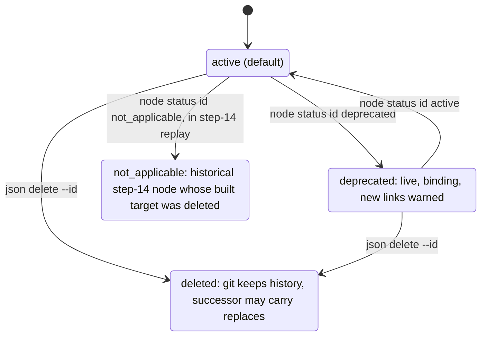
*Figure 1. Node lifecycle. Deletion leaves no tombstone.*

### 3.3 The layers

Four layers, plus code outside them. Links point up, or within a step where declared.

| Layer | What lives there | Who writes it |
|---|---|---|
| Seed | Natural-language seed files, listed and routed in `spec/common/seed_manifest.json` | People |
| Spec, steps 00 to 15 | All spec nodes | The waterfall steps, through the tool's write commands |
| Implementation, step 16 | Anchor rows, 16a plans and plan items, 16b execution records, 16c review records, the plans' open items | Step-16 authoring (anchor rows), the trinity loop and the milestone commands; never spec |
| Verification and evidence | Verification and evidence records in `spec/extras/verification/` | `specdev verify …` only |
| Outside the graph | Code and tests | 16b |

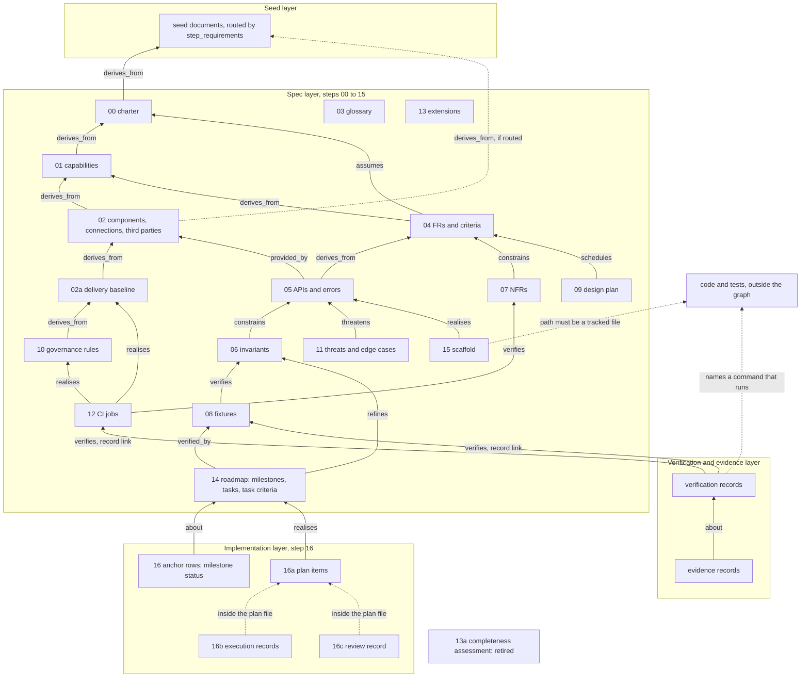
*Figure 2. The layers, with one representative link per step pair, in storage direction (the holder points at the
target). The full set is the per-step link table (section 4.3). 03 terms are used by label. 13 extensions get links
when they become first-class. 16b execution records and the 16c review record are blocks inside the plan file.*

Two walks follow from the storage direction: **lineage** follows links upward; **impact and coverage** follow them in
reverse, through a reverse index the tool builds when needed.

## 4. Links

### 4.1 Rules in the schema, data in the spec

The schema holds the rules; a spec file holds only data; the tool joins them. (Think of stickers on toy boxes saying
what may be tied to what, and toys that carry only the name tag of the toy their string is tied to.)

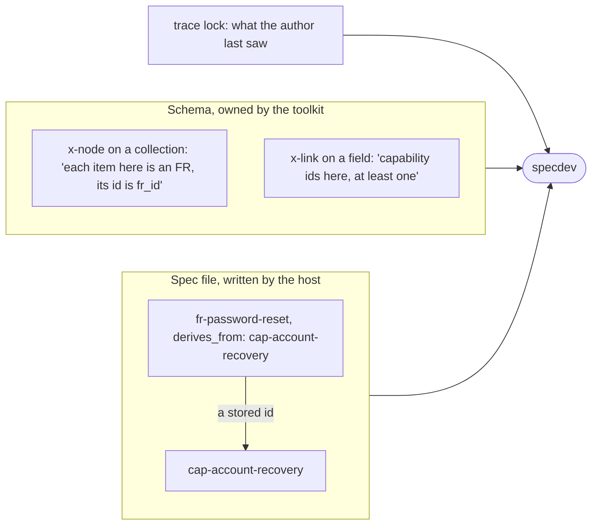
*Figure 3. Schema rules, spec data and the trace lock, joined by the tool.*

**Schema side** (a fragment of `schema/04_fr_list.schema.json`; the annotations are new, key names illustrative):

```json
{
  "functional_requirements": {
    "type": "array",
    "x-node": {
      "kind": "fr",
      "id": "fr_id",
      "contract": ["statement", "priority", "preconditions", "postconditions"]
    },
    "items": {
      "properties": {
        "acceptance_criteria": {
          "type": "array",
          "x-node": { "kind": "criterion", "id": "criterion_id", "contract": ["text"] }
        },
        "derives_from": {
          "type": "array",
          "items": { "$ref": "vc:core:atoms#kebabId" },
          "x-link": { "kinds": ["capability"], "required": true, "built": true }
        },
        "depends_on": {
          "type": "array",
          "items": { "$ref": "vc:core:atoms#kebabId" },
          "x-link": { "kinds": ["fr"], "required": false, "built": false }
        }
      }
    }
  }
}
```

| Rule | What it means | Status |
|---|---|---|
| Declaration | `x-link: {kinds, required}` on each link field, plus a flag for whether the verb carries "built" (the "Carries built" column in section 4.4) | Ruled (shape) / Definition ("built" flag) |
| Dependency matrix | The `kinds` lists across all schemas are the dependency matrix; the step order is generated from them | Ruled |
| Contract | `x-node.contract` names the fields the content hash covers | Definition |
| Prerequisite | JSON Schema ignores `x-` keywords, but `schema_nav` drops keywords beside `$ref` and must be fixed first (DEVSPEC-211) | Problem filed |

**Data side** (a node in `spec/04_fr_list.json`):

```json
{
  "fr_id": "fr-password-reset", "scope": "in",
  "statement": "The system shall let a registered member set a new password by redeeming a single-use reset token emailed to the account address, which expires 30 minutes after it is issued.",
  "acceptance_criteria": [
    { "criterion_id": "ac-password-reset-3", "scope": "in",
      "text": "Given a reset token that has expired or was already used, when a new password is submitted with it, then the request is rejected and the stored password is unchanged." }
  ],
  "derives_from": ["cap-account-recovery"]
}
```

The value shape is always `<verb>: [<id>, …]`: bare ids, no `type` (**Ruled**). No hash, path, line range, copied
text or relation note is stored.

### 4.2 How the tool resolves a link

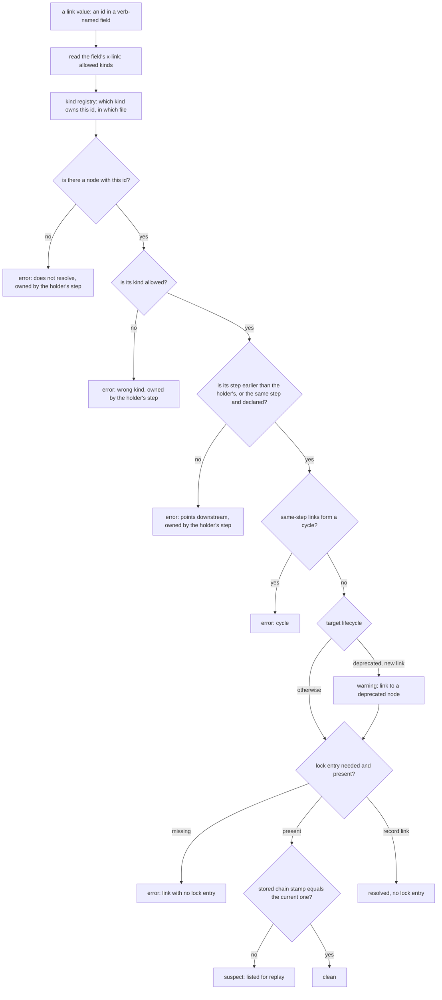
*Figure 4. Resolving one link value. The kind is computed from the id. `replaces` and `removes` skip this flow: they
name a deleted id on purpose. Record links stop before the lock. Error codes are settled in planning.*

**Same-step links** (**Definition**): "upstream" means an earlier step or the same step. Same-step links are allowed
where declared: 00 risk → assumption; 00 metric, scope item or constraint → stakeholder need; `assumes` among 00 nodes; FR → FR and API → API
`depends_on`; connection → component or third party; third-party `part_of`; task and job `depends_on`. Milestones hold no ordering link. A cycle among same-step links is an error.

### 4.3 Per-step links

Every link field the design stores, by step. A field not named here is not a link. Fields named after a verb hold
bare ids. `assumes` is open to any obligation or context node at steps 00–11 (**Ruled**), except a glossary term, whose only link is to a seed (**As built**), and is not repeated per row.

| Step | Kind | Link field → target kinds | Status |
|---|---|---|---|
| 00 | scope item, risk, constraint, segment, metric, assumption, stakeholder need | `derives_from` → seed (routed to 00) | Ruled |
| 00 | risk | `derives_from` → the assumption whose failure it describes | Ruled |
| 00 | metric, scope item, constraint | `derives_from` → stakeholder need | Ruled |
| 01 | capability | `derives_from` → 00 scope item (and, *illustrative*, segment) | Definition |
| 02 | component | `derives_from` → capability, or a 00 constraint | Definition / Ruled (constraint) |
| 02 | connection | `derives_from` → its source component; `connects_to` → its target component or third party | Definition |
| 02 | third party | `derives_from` → seed (the choice) or a 00 constraint; `part_of` → third party | Ruled |
| 02a | gate | `derives_from` → component or 00 constraint | Definition |
| 02a | secret | `derives_from` → the connection it authenticates, or the component that uses it, or a 00 constraint | Definition / Ruled (constraint) |
| 02a | environment | `derives_from` → the seed routed to 02a that names it, or a 00 constraint or scope item that requires it | Definition |
| 01 to 12, 14, 15 | capability, component, connection, gate, secret, term, FR, API, API error, invariant, NFR, fixture, design milestone, rule, threat, edge case, CI job, roadmap milestone, scaffold row | `derives_from` → a seed routed to the node's step, for content taken straight from the seed. Listed beside the links of the kind's own row, never in their place: a required `derives_from` that holds only seeds is an error (**As built**) | Ruled (operator, 2026-11-23) |
| 03 | term | No node links to it: used by label. It may list a seed (the row above) (**As built**) | Ruled |
| 04 | FR | `derives_from` → capability; `depends_on` → FR | Ruled |
| 05 | API | `derives_from` → FR; `provided_by` → component; `relies_on` → third party; `depends_on` → API | Ruled |
| 05 | API error | `derives_from` → 04 criterion | Ruled |
| 06 | invariant | `constrains` → FR, API, component, connection | Ruled |
| 07 | NFR | `constrains` → FR, API, component, connection; `relies_on` → third party; (*illustrative*) `derives_from` → metric | Ruled |
| 08 | fixture | `verifies` → criterion, API, invariant, NFR; a removal fixture carries `removes` → a deleted id, which justifies it | Ruled |
| 09 | design milestone | `schedules` → FR or criterion, API, invariant, NFR, component, environment, charter risk | Definition |
| 10 | rule | `derives_from` → 00 constraint, risk or scope item, 02a gate or environment, or an approver-only stakeholder. Enforcer: a 12 job's `realises`, a `cli_command`, or type `review` | Ruled (stakeholder: Definition) |
| 11 | threat | `derives_from` → 00 risk; `threatens` → API, component, connection, third party; `mitigated_by` → obligations, fixtures | Ruled |
| 11 | edge case | `threatens` → API, component or FR; `mitigated_by` → obligations, fixtures | Ruled |
| 12 | CI job | `realises` → 02a environments, gates and secrets it provisions or runs, step-10 rules it enforces; `verifies` → the NFR its run proves; `depends_on` → job | Ruled / Definition (environments, secrets) |
| 13 | extension | `justified_by` → its upstream nodes (when first-class) | Ruled |
| 14 | task criterion | `refines` → any obligation kind with ids; `verified_by` → its verifier (a fixture, a CI job, or a step-10 rule the criterion refines (**As built**)); `removes` → a deleted id (removal tasks) | Ruled |
| 14 | task | `depends_on` → task | Definition |
| 14 | milestone | none stored: its 09 milestones are computed | Ruled |
| 15 | scaffold row | `realises` → API | Definition |
| 16 | anchor row | `about` → 14 milestone | Ruled |
| 16a | plan item | `realises` → task criteria | Ruled |
| any | successor of a deleted node | `replaces` → the deleted id | Ruled |
| records | ambiguity item, review record, evidence record | `about` → any node (evidence → verification record: *illustrative*) | Ruled |
| records | verification record | `verifies` → fixtures, or the CI job or toolkit command whose run it binds | Ruled (verb for jobs and commands: *illustrative*) |

### 4.4 The verbs

One closed vocabulary; a field name never changes meaning between steps (**Ruled**; `connects_to` is **Definition**).
"Carries built" is the `x-link` flag of section 4.1 (**Definition**).

| Verb | Meaning | Carries built |
|---|---|---|
| `derives_from` | Exists because of the target | Yes (from derived obligations to a coarse one) |
| `refines` | Narrows a stated obligation | Yes |
| `realises` | Implements the target | Yes, when a 12 job holds it: it builds 02a environments, gates and secrets, and step-10 rules once the job has passing evidence. A scaffold row's or plan item's `realises` builds nothing |
| `mitigated_by` | What contains a threat or edge case | Yes (for threats and edge cases) |
| `assumes` | Depends on a stated assumption | No |
| `constrains` | States a rule or target over it | No |
| `provided_by` | An operation provided by one of our components | No |
| `relies_on` | Behaviour depends on a third party | No |
| `connects_to` | A connection's target; counts as use of the target | No |
| `verifies`, `verified_by` | Proves it; the case that proves this | No |
| `threatens` | What a threat or edge case targets | No |
| `schedules` | A design increment places it | No |
| `justified_by` | An extension exists because of it | No |
| `depends_on` | Ordering within a kind | No |
| `part_of` | Bundling of third parties | No |
| `replaces`, `removes` | Successor of a deleted id; removal of a deleted id's behaviour (on removal task criteria and removal fixtures). Exempt from resolution and the lock | No |
| `about` | A record concerns a node | No |

| Rule | What it means | Status |
|---|---|---|
| Minimal links | One relation, one field. Store the finest node. Store only selections, never a set the tool can compute. Artifact-level `trace` and `links` are removed | Ruled |
| Dependencies between obligations | FR → FR (04) and API → API (05) `depends_on`; components through 02 connections; no task-level `uses`. Milestone order is not stored at step 09 or 14: it follows from these links and task `depends_on`, and a 14 milestone's `target_date` carries the schedule | Ruled |
| Ids in prose | No node ids in spec prose. A mention that states a relation becomes that link; others are reworded out. Contract values (paths, error codes, field names) stay; third-party versions are not restated | Ruled |

Why: 2,005 (node, id) pairs at W and 596 at P are stated only in prose, held by no structured link (S13, V2).

### 4.5 The trace lock

`spec/extras/trace.lock.json` is tool-owned and committed, like a package lock: one entry per link, holding source,
field, target and two values (**Ruled**). Links stay in the spec nodes, the source of truth. A link with no entry, or
an entry with no link, is an error. The FR-centred matrix is a query (`specdev coverage --by fr`).

```json
{
  "source": "tc-confirm-expired-token",
  "field": "refines",
  "target": "ac-password-reset-3",
  "content_hash": "sha256:9f2c41d0",
  "chain_stamp": "sha256:51ab7e03"
}
```

| Value | What it hashes | Used for | Status |
|---|---|---|---|
| Content hash | The target's contract, as the link's author last saw it | Coverage and realisation status | Ruled |
| Chain stamp | The target's whole upstream chain, as the author last saw it | Suspicion | Ruled |

| Rule | What it means | Status |
|---|---|---|
| Which links get entries | Links held by spec and plan nodes. Record links (`about`, a verification record's `verifies`) are resolved but have no entry; `replaces` and `removes` are exempt from resolution and have no entry | Definition |
| Content hash contents | The contract fields; the node's own outgoing link ids (re-pointing is a change); for an FR and a task, their criteria too. A seed's hash is its file's hash with whitespace normalised. Text is normalised (Unicode, whitespace, quotes, dashes); status, notes, tags and owner are left out. A parent's contract change makes links into its children suspect | Definition |
| Writing on link creation | `specdev step create` and `specdev json … --id` resolve the target, show it, and write the entry with both values | Definition |
| Writing in the trinity loop | The tool writes entries for trinity links | Ruled |
| Re-attesting | `specdev attest` shows old and new target text, then updates the chain stamp and the content hash, and marks the affected plan items' recorded executions stale. Refused while one of that node's own targets is itself suspect, and on historical links | Ruled (chain stamp, node-level ordering) / Definition (content hash, stale executions, historical links) |
| Migration | Existing links are stamped `baseline` and re-attested in each step's pass; afterwards markers remain only on historical links | Ruled / Definition (end state) |
| Orphans | `specdev attest --prune` removes entries with no link; CI runs the orphan check | Definition |
| Merging | A merge driver installed by `init_project` and `specdev update` (`specdev lock install-driver` in a clone) merges per entry, with an integrity check per entry; on conflict the entry of the common ancestor is kept, and with no ancestor entry the smaller chain stamp, so the link stays suspect (**As built**) | Definition |
| Writes and location | An advisory lock covers the spec-plus-lock write. Every tool-owned file lives under `spec/extras/`, which the spec loader skips, with no extension a host ignores in git | Definition |

An agent never supplies a hash: agent-written plan pins at W were wrong for 253 of 333 items (V1).

Why contract fields: over W and P history, whole-node hashing made 34.6 % (W) and 59.3 % (P) of one-hop suspects
false; contract-field hashing made 13 of 1,312 (W) and 0 of 133 (P) false (S11, V3). Folding criteria into the FR
avoids missing about 6.5 % of real changes (V3).

**Why two values.** The chain stamp carries every change to everything below it, even after a level in between has
confirmed.

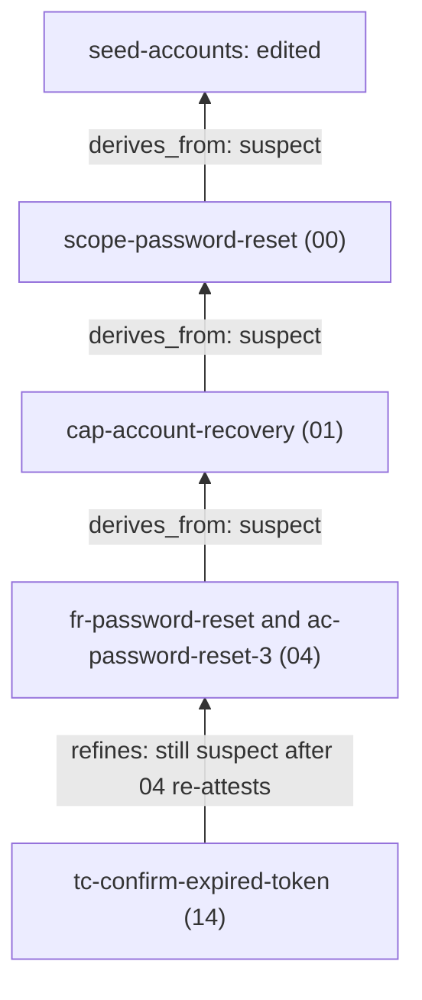
*Figure 5. A seed edit. The content hashes of the scope item, capability and FR do not move, but every chain stamp
below the seed does. Re-attesting the FR's link updates only that entry; the task criterion stays suspect until step
14 checks it.*

### 4.6 Stored and computed

| Stored | Where |
|---|---|
| Links, as bare ids in verb-named fields | The spec nodes |
| Content hash, chain stamp, `baseline` | The trace lock |
| `lifecycle`, `scope`, `replaces`, `aliases`, `removes` | On the node |
| Task `disposition` | Step 14, outside the hash |
| Milestone status, deferral reason, close record | The anchor row |
| Open items | The artifact that raised them |
| Plan items, execution records, review record | The 16a plan file |
| Verification and evidence records | `spec/extras/verification/` |
| Sign-off, release tag | A sign-off record naming the milestone and tree, with its git author; an annotated release tag |

| Computed, never stored | From |
|---|---|
| A link target's kind | The id, through the kind registry |
| Impact, coverage, suspects, replay list | Links and lock values |
| Built, proven, realisation status, release status | Links, lock content hashes, evidence, tags |
| A plan item's task, milestone, fixture and NFRs | Containment and the links of the task criteria it realises |
| Task progress | Its plan items |
| A 14 milestone's 09 milestones | The 09 milestones that `schedules` what its task criteria refine (**Ruled**) |
| 09 capability placement | The FRs a 09 milestone schedules |
| 14 milestone `fr_refs` and `capability_refs`; task `fr_refs` and `invariant_refs` | Task `fr_refs` from directly refined 04 nodes; `invariant_refs` from refined invariants plus fixture targets (**Definition**) |
| A component's reliance on a third party | Its connections' `connects_to` |
| Glossary use | Label matching |
| Step order | The `x-link` declarations, plus a short list of declared edges for reads that no stored link derives (steps 13, 16a, 16b, 16c, and the pairs 09→14 and 14→16) (**As built**) |
| Context packs | Links, per role recipe |

## 5. Roles

Each kind declares one role in its schema; one rule per role applies to every repo, with no per-repo policy file
(**Ruled**).

### 5.1 The role rules

| Role | Must | When checked | Status |
|---|---|---|---|
| obligation (system) | Be used; be built (section 5.3), then proven (section 8.6) | Built when the milestone that schedules it closes; every in-scope obligation at release | Ruled |
| obligation (delivery) | Be built and proven through the CI job that provisions or runs it | Same | Ruled |
| verifier | Be used, and have valid evidence for the stage its binding declares (section 8.2) | Dev at close; dev and CI at merge; staging at the production deploy; production by the next release | Ruled |
| plan | Exempt from no-dangling. Be realised: a milestone has tasks, a task criterion has plan items, a plan item has executed. At merge a plan node need only resolve and be justified | At close | Ruled |
| context | Be used (no-dangling) | At merge | Ruled |
| record | Exempt from no-dangling; its `about` must resolve | Always | Ruled |

Seeds are the top of the graph, not a role; their checks are the route checks (section 6). Extension kinds declare a
role when they become first-class. Error objects carry their owner and the node id (**Definition**).

### 5.2 Use and no-dangling

**No-dangling** (**Ruled**, P2): every node must have a use, except records, plan nodes and nodes out of play. A
node nothing uses is a sign of a wrong design.

| Rule | What it means | Status |
|---|---|---|
| What counts as use | A stored link, a computed link (a 14 milestone's computed 09 milestones), use by label (terms), and use by a deferred or `scope: later` node. Use by a `scope: out` node does not count: it will never be built. The check that the 14 milestones reach what a 09 milestone schedules asks only about kinds a task criterion can refine; a scheduled risk, component or environment is outside it (**As built**) | Ruled / Definition (`scope: out`) |
| Exempt | Records; plan nodes (09 and 14 milestones, tasks, task criteria, 16a plan items), whose realised-at-close rule replaces it; nodes out of play (`not_applicable`, `scope: later`, `scope: out`, and verifiers whose bindings are all retired) | Ruled |
| Owner | The furthest step that can use the kind. Until that step has run, the error shows as pending, so an early step is never blocked by a consumer that does not exist yet | Ruled |
| Which obligations need a verifier | The kinds a fixture's `verifies` may name: criterion, API, invariant, NFR. An API error, a threat, an edge case and a rule are proven another way (through the criterion the error derives from, through mitigations, by the rule's enforcer). The missing-verifier error is owned by step 08 (**As built**) | Definition |
| At merge versus backlog | No-dangling asks only that something downstream uses the node, not that it is built. An in-scope node nothing uses must, before merge, be linked, scheduled, or marked `scope: later` or `out`. A node that is used but not yet built is ordinary backlog | Definition |
| Partial examples | An example that shows one feature need not satisfy no-dangling for every node; it must say which nodes the parts it leaves out would use. The shipped worked example says it in its README and in the error catalogue: 17 nodes nothing uses, 5 without a verifier, 1 cross-cutting gap, 1 FR no task criterion reaches (**As built**) | Definition |

**Who uses what.** For context kinds and for kinds at the end of a chain, "use" is defined per kind:

| Kind | Used by | Status |
|---|---|---|
| 00 segment, success metric | A later node's link; which later kinds link them (for example capability → segment, NFR → metric) is *illustrative* and settled in planning | — |
| 00 assumption | Any obligation or context node at 00–11 that `assumes` it; a risk that `derives_from` it | Ruled |
| 00 stakeholder need | A metric, scope item or constraint that `derives_from` it | Ruled |
| 00 stakeholder | Any of its needs being used, or a step-10 rule that `derives_from` it (approver-only stakeholders) | Definition |
| 02 component | APIs (`provided_by`), invariants and NFRs (`constrains`), threats, a connection's `connects_to`, a gate's or secret's `derives_from` | Definition |
| 02 connection | NFRs and invariants (`constrains`), threats (`threatens`), the 02a secret that authenticates it. A connection nothing uses is raised in the step-11 pass | Ruled |
| 02 third party | `relies_on`, `part_of`, or a connection's `connects_to` | Ruled |
| 02a environment, gate, secret | The 12 job that `realises` it (also its built path) | Definition |
| 03 term | Use by label | Ruled |
| 08 fixture | A task criterion's `verified_by`, or a verification or evidence record that names it | Definition |
| 11 threat, edge case | A task criterion that `refines` it | Definition |
| 00 risk | A threat that `derives_from` it, a step-10 rule, a 09 milestone that `schedules` it | Ruled / Definition |
| 00 constraint | Third-party nodes, components, 02a nodes and step-10 rules that `derives_from` it | Ruled |
| 12 CI job | Through the gate or rule it `realises` (the reverse of the link), a task criterion's `verified_by`, or a verification or evidence record that names it | Definition |
| 15 scaffold row | Code: its path is a tracked file, git submodules included. Checked at close and release, and at merge only for rows whose API is built. Owned by step 15 | Ruled |
| Every other kind | A stored or computed link from below; record links do not count | Definition |

### 5.3 Built

An obligation is **built** when a closed milestone's task criterion refines it with a matching content hash, or when
all its in-scope children are built (**Ruled**). One refined child is not enough, and a changed obligation is unbuilt
until refined again. Some kinds are built another way:

| Obligation | Built when | Status |
|---|---|---|
| Any obligation | A closed milestone's task criterion `refines` it, and the lock's content hash still matches | Ruled |
| A parent (an FR with criteria) | All its in-scope children are built, each with a matching hash. A child keeps its own `scope`: an FR set to `scope: later` or `out` does not park its criteria (**As built**) | Ruled |
| A coarse obligation | At least one in-scope obligation is derived from it, and all of those are built; none means not built. A risk is built through the threats and rules that derive from it; a constraint through the 02a nodes and rules that derive from it, through a third party that derives from it once its pin matches and a built obligation relies on it, and through a component that derives from it once a built obligation uses it (`provided_by`, `constrains`, or a connection it is the source of) | Ruled |
| An API | Only when refined directly; its errors are separate obligations | Ruled |
| A threat or edge case | It has at least one mitigation; every obligation that mitigates it is built, and every fixture that mitigates it is bound with valid evidence. Zero mitigations means not built. One that a task criterion refines is covered by its `mitigated_by` fixtures or by a verifier of a mitigating obligation; a fixture never `verifies` a threat (**As built**) | Ruled / Definition (fixtures, zero) |
| A 02a environment, gate or secret | Through the 12 job that `realises` it, once that job has passing evidence | Ruled |
| A step-10 rule | Its enforcer exists and runs: a 12 job that `realises` it with passing evidence; a `cli_command` in the generated command list; or, for a `review` rule, an `attestation` evidence record at release | Ruled / Definition (attestation record) |
| — | Context nodes and out-of-play nodes below are ignored | Ruled |

**At the tag**: a node whose build waits only on staging or production proof is *relieved*: it counts as satisfied
for its ancestors (**Ruled**, round 18) and for itself (**Definition**). The production-deploy gate and the next-release check re-check
every relieved node (section 8.1).

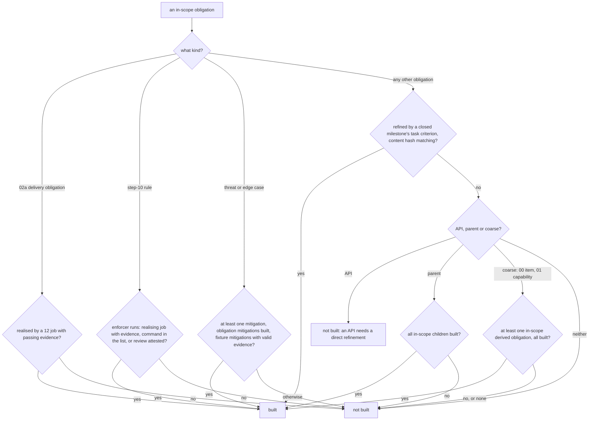
*Figure 6. The built rule. Context and out-of-play nodes below an obligation are ignored.*

Merge checks justification and no-dangling, not "built", so backlog is allowed while working; a release needs every
in-scope obligation built and proven (**Ruled**). Deferred and won't-do task criteria give no coverage.

### 5.4 The exemption field

Every obligation carries `scope`, with a reason required for `later` and `out` (**Ruled**). The gates read only this
field. It replaces capability `scope: future/out`, FR won't-have and the 05 and 08 `out_of_scope` lists as exemption
signals. The charter's `in_scope` and `out_of_scope` lists merge into one list of scope items, each with `scope`
(**Definition**).

| `scope` | Must be built? | Needs a use itself? | Counts as use of what it links? | At release |
|---|---|---|---|---|
| `in` | Yes | Yes | Yes | Must be built and proven |
| `later` | No | No | Yes | Listed |
| `out` | No | No | No | Listed |

### 5.5 Kind → role table

| Step | Kind | Role | Status |
|---|---|---|---|
| seed | seed document | none: the top of the graph | Ruled |
| 00 | scope item, risk, constraint | obligation (system), coarse | Ruled |
| 00 | segment, success metric, assumption, stakeholder, stakeholder need | context | Definition |
| 01 | capability | obligation (system), coarse | Ruled |
| 01 | capability `error_states` | content | Definition |
| 02 | component, connection | context | Ruled |
| 02 | third-party node | context | Ruled |
| 02a | environment (map key), gate, secret | obligation (delivery) | Ruled |
| 03 | glossary term | context | Definition |
| 04 | FR, acceptance criterion | obligation (system) | Definition |
| 05 | API, API error | obligation (system) | Definition |
| 06 | invariant | obligation (system) | Definition |
| 07 | NFR | obligation (system) | Definition |
| 08 | fixture | verifier | Definition |
| 09 | design milestone | plan | Definition |
| 10 | governance rule | obligation (system) | Definition |
| 11 | threat, edge case | obligation (system) | Definition |
| 12 | CI job | verifier | Definition |
| 12 | job step | content (ids dropped) | Definition |
| 13 | extension kinds | declared when first-class | Ruled |
| 14 | roadmap milestone, task, task criterion | plan | Definition |
| 15 | scaffold row | context | Ruled |
| 16 | anchor row | record | Definition |
| 16a | plan item | plan | Definition |
| 16b | execution record | record | Definition |
| 16c | review record | record | Definition |
| any | ambiguity item | record | Definition |
| extras | verification record, evidence record | record | Definition |

## 6. Seeds

| Rule | What it means | Status |
|---|---|---|
| Source of truth (D10) | A product decision is written into the seed it concerns. Seeds stay the source of truth. The decisions seed must not exist (no check enforces it; the migration lists one for the operator (**As built**)) | Ruled |
| Distillation (revised D11) | Each aspect of a seed is distilled once, at the step where it belongs, and that node links the seed with `derives_from`. One seed may feed several steps, each taking different parts. Later steps read the distilled node, never the raw seed | Ruled |
| Routing | The manifest's `step_requirements` decides which seeds a step reads and may link to. Seeds are never routed to the trinity steps | Ruled |
| Route checks | Apply to `derives_from` links only. A `derives_from` link to a seed not routed to the node's step is an error (a seed with no route at all gets only the listed-seed error below). Every (seed, step) route must be used by at least one node of that step; a node with `scope: later` or `out` does not count. A node of any step from 00 to 15 can hold the link, except an extension (13), which holds no links; a route to step 13 or a trinity step can never be used and is reported (**As built**) (replaces W140, today's token-overlap warning between an artifact and its routed seeds). Every listed seed must be routed somewhere. A seed nothing should read is simply not listed (W551, today's warning for a seed file on disk that the manifest does not list, is dropped) | Ruled |
| Record links | An ambiguity's `about` may name any listed seed, routed or not | Definition |
| Seed-link minimality | A node stores a seed link only for content it took straight from the seed, not through an upstream node | Definition |
| Seed edits | Every node that links the seed, and everything below it, becomes suspect. Whitespace-only edits change nothing (section 13.8) | Ruled |
| Seed hash | The file's hash, with whitespace normalised | Definition |

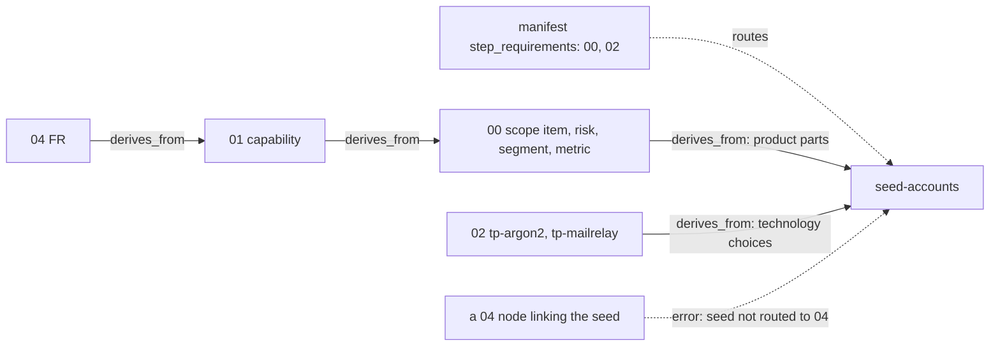
*Figure 7. Distillation. Each route is used by a node of its step. Steps without a route reach the seed only through
distilled nodes.*

Why seeds need node-level links: at W, seeds are cited only in prose (2,020 citations, none structured), so a seed edit
cannot say which nodes came from it (S5).

## 7. Ambiguities

| Rule | What it means | Status |
|---|---|---|
| One shape | One item shape in `schema/core`, unifying today's two step-16 shapes, plus a typed `about` list. The existing `decision` field holds the answer | Ruled |
| Where | In the artifact that raised it. Steps 00–15 get an optional `ambiguities` list. The trinity artifacts keep theirs: plan `plan.ambiguities` and `execution.emergent_ambiguities`, anchor `plan.ambiguities`. No separate file | Ruled |
| Open only | An item is deleted when its answer is applied. A `Resolves: amb-…` commit trailer is optional provenance, checked by nothing | Ruled |
| When raised | Only when step N cannot settle a question in its own turn | Ruled |
| `about` | Every highest node whose content causes the ambiguity (a listed node below another listed node should be dropped: a reviewer's point, no check); within that step, the specific node. An item cannot be about a node of the step that holds it: that node is simply corrected (**As built**). A seed means a product decision, written into the seed. A spec node means a correction, made at its own step | Ruled |
| Silent spec | When the spec says nothing, the item records the missing kind and the parent that should contain it, and is grouped under that kind's step | Definition |
| Clarify answers | A choice step N owns stays in N. Any other answer, known or not, becomes an open item: `about` names the seed or node, `decision` holds a known answer, the batch pass applies it | Ruled |
| Batch | `upstream-backlog` groups open items by the step of their `about` nodes. One pass applies every answer, then replays only the suspects | Ruled |
| Gates | Warnings within their step ("waiting on amb-…"). They fail the merge check, and in a plan they block milestone close | Ruled |
| Legacy items | Open items in frozen plans do not fail the merge check; they are on the triage list | Ruled |
| Today | Clarify answers reach only the asking step and are saved nowhere (DEVSPEC-286); `upstream-backlog` buckets by the first `impact[]` entry (DEVSPEC-283) | Problem filed |

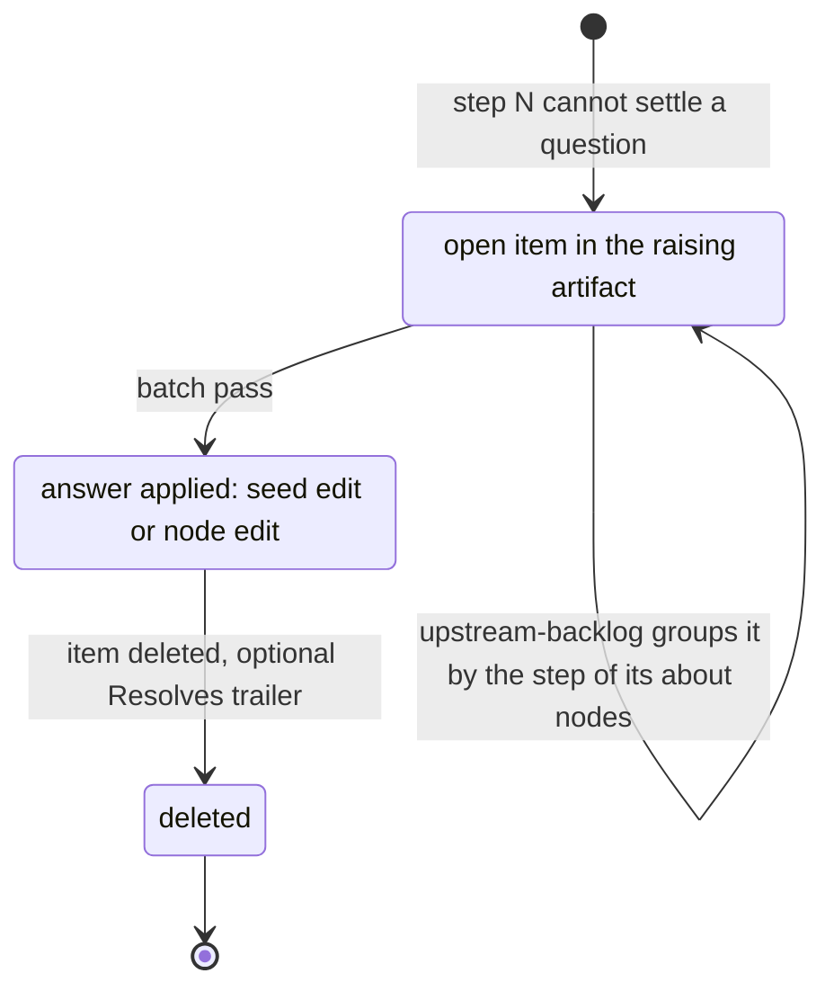
*Figure 8. An open item's life. While open it is a warning in its step and fails the merge check (and blocks close, in a plan).*

Why open-only with a typed `about`: at W, 213 resolved emergent ambiguities have no link to the edit that resolved
them, and 125 of 306 backlog records cannot be classified (S5).

## 8. Gates, trinity, proof and release

### 8.1 Gates

Every check that can block runs in one of these gates. Other sections refer here instead of restating them. A
verifier's stage is the stage its binding declares (section 8.2).

| Gate | Run by | Checks | Proof stage (section 8.2) | Blocks |
|---|---|---|---|---|
| Step gate: `spec-check --step N` | Step authors and step skills; the pre-commit hook for the steps a commit touches and for seed paths | Step N's own errors and new errors in earlier steps (since the merge-base) block; old upstream errors show as upstream debt, later steps' errors as pending; N's errors below an open item show as "waiting on amb-…", however many nodes that is: an item about a seed makes every error of the nodes derived from it wait, the step gate then says clear, and the merge check fails the item, so nothing merges (**As built**) | — | Finishing step N; the commit |
| Merge gate: merge check | The toolkit's merge-check workflow template (or a `specdev` step in the host's PR test workflow), on every PR and on every push to the default branch. It is `spec-check --merge`: every check of a plain `spec-check`, then the merge checks for open items and for bindings; the base is `--base-ref` or the merge-base (**As built**) | Zero errors in every step; no open items (the migration removes the open items of legacy-closed plans and lists them for triage (**As built**)); no suspect links on non-historical nodes; no orphan lock entries; pins equal the repo-declared sources; the dev- and CI-stage bindings of the milestones the branch closes pass in this run | dev, ci | The merge check fails |
| Close gate: `specdev milestone close` | The 16c skill (an agent may run it) | Every task done (criteria proven by dev-stage evidence on the branch's code tree for the milestone's dev and CI bindings, plan items executed; deferred and won't-do tasks excluded with their reason); 16c verdict `verified`; no open items in the plan; no suspect links on the milestone's chain; a sign-off record for the milestone (section 8.3). Staging and production bindings, and actions marked "at deploy", do not hold close up | dev | Status `done` |
| Release gate: `specdev release` | The agent, after the operator approves (section 8.4), on the current commit (the merge commit of a release-prep PR) | A state check of that commit: errors, open items, suspects, pins; every closed milestone has a sign-off record; every in-scope obligation built, with relieved nodes (section 5.3) counted as satisfied for their ancestors; dev and CI proof (the CI evidence the release-prep PR committed for this code tree); every outdated or removed realisation's change milestone closed; every `review` rule attested; the previous release has production evidence or a rollback record. `scope: later` and `out` are listed, not blocking. Then it creates an annotated tag matching the host's release-tag pattern | dev, ci | The release tag |
| Production-deploy gate: `specdev release check --stage prod` | The host's production deploy job, first. Staging deploys run no release check, so trial tags deploy freely | Staging bindings have evidence for the release's code tree; staging delivery obligations are built; every node relieved at the tag is re-checked. A candidate tag's staging evidence counts when its code tree matches | staging | The production deploy |
| Deploy check: third-party pins | Every deploy job | The installed version of each third party equals the spec pin of what it deploys; recorded as evidence | — | The deploy |
| Next-release check (part of the release gate) | `specdev release`, for the previous release | Production bindings have evidence, production delivery obligations are built and "at deploy" actions are recorded, or a rollback record exists; a release cut before the host's migration to 1.2.0 needs nothing. A node with both a CI and a production binding is judged by its own release's gate and is not re-checked at production here (**As built**) | prod | The next release tag |

| Rule | What it means | Status |
|---|---|---|
| Release-tag pattern | The host declares it. Other tags (candidates, such as a host's `-stage` tags) are outside the release gate | Ruled |
| Previous release | The nearest release-pattern tag that is an ancestor of the release commit. Its production evidence is merged into a branch the next release descends from. A release cut before the host's migration to 1.2.0 declared no production bindings and no "at deploy" actions, so the next-release check requires nothing of it, and no rollback record is written for it | Ruled |
| Retired stages | A gate skips a stage whose 02a environment is `scope: out` (section 8.2) | Ruled |
| Enforcement | Each gate is a `specdev` command that reports errors on the commit it runs on; the merge check runs on every push and pull request. Required checks or branch protection, where a host offers them, are optional | Ruled |

Status: the gates are **Ruled** (`release check --stage prod` command and the chain: **Definition**). New checks are errors from day one; what blocks depends on ownership (**Ruled**).

**Error ownership.** Every error has exactly one owner: a step, the merge check, the close gate or the release gate
(**Ruled**). A step's author can finish the step without fixing anyone else's errors. `specdev status` shows
the gate-owned ones.

| Error | Owner | Status |
|---|---|---|
| A bad link: does not resolve, wrong kind, points downstream, same-step cycle, no lock entry | The step of the node holding the link | Ruled (cycle: Definition) |
| A node not justified upstream | The node's own step | Ruled |
| A dangling node (nothing uses it), third-party nodes included | The furthest step that can use its kind; pending until that step runs | Ruled |
| An obligation not built, or a verifier with no valid evidence | The consumer step | Ruled |
| A missing verifier | The step that should bind it | Ruled |
| An unused verifier | Step 14 | Definition |
| A scaffold row whose path is not a tracked file | Step 15 | Ruled |
| A node id in prose | The node's own step | Ruled |
| A `derives_from` link to a seed not routed to the node's step | The node's own step | Ruled |
| A listed seed routed to no step | Step 00 | Definition |
| A pin that differs from the repo-declared sources | Step 02 | Ruled |
| A cross-cutting obligation a task it applies to does not refine | Step 14 | Definition |
| An orphan lock entry | The merge check | Definition |
| No sign-off record; 16c verdict not `verified`; plan items not executed; open items in the plan | The close gate | Ruled |
| An unattested `review` rule; the previous release not verified in production and no rollback record; a removed realisation without a closed removal milestone; a staging binding with no evidence at the production deploy | The release gate | Definition |

What tooling cannot see: a valid id of the right kind that is the wrong choice. At W, 629 of 631 criterion id pairs
within edit distance 2 sit under the same FR (S14, V4). The tool shows the target's text on every link write; judging
it is review (P1).

### 8.2 Proof stages

Stages are ordered `dev` < `ci` < `staging` < `prod`; each evidence record states its stage (**Ruled**).

| Rule | What it means | Status |
|---|---|---|
| Stage per binding | Each verification record declares its stage, default `dev`. A fixture whose targets need different stages gets one binding per stage | Ruled |
| Later satisfies earlier | Later-stage evidence on the same code tree satisfies an earlier-stage binding, never the reverse | Ruled |
| Code tree | Everything except `spec/`, every seed path in the manifest, and a host-declared list. Two runs are on the same code tree when that tree is identical | Ruled / Definition (same tree) |
| Retired bindings | A binding whose stage's environment is `scope: out` is retired. A verifier whose bindings are all retired is out of play; links to it still resolve | Ruled |
| One-time actions | Teardowns and data migrations are plan executions, not verifiers | Ruled |
| "At deploy" actions | A plan action may be marked "at deploy". It does not hold up close. The deploy job records it with `specdev plan record --at-deploy <action> --env <env>`, which writes an execution record under `spec/extras/verification/` and needs no approval; the record reaches the repo through the evidence PR. An action a person performs is recorded with `verify attest` instead. The next release requires it; a per-environment action has one record per environment. A plain `plan record` on an "at deploy" action is accepted and never counts (**As built**) | Ruled |

| Binding stage | Evidence produced by | Reaches the repo | Required by |
|---|---|---|---|
| dev | `specdev verify run` in 16b and 16c, on the branch | Evidence records committed on the branch | Close |
| ci | The merge check's `specdev` step | At merge: nothing, the run is the proof. For a release: a release-prep PR's `specdev` step runs every dev- and CI-stage binding and commits the evidence records to the PR branch, once per code tree | Merge; the release |
| staging | The deploy job's `specdev verify run` after the tag-triggered (or candidate-tag) deploy | Evidence records, through a reviewed PR | The production deploy |
| prod | The deploy job's `specdev verify run` after the production deploy | Evidence records, through a reviewed PR | The next release |
| (attestation) | `specdev verify attest <node-id>`, approved by the operator (section 8.4), for a manual fixture, a `review` rule or an "at deploy" action a person performs | An evidence record of type `attestation` naming the node and the tree, with its git author | The gate of the binding's stage; `review` rules at release |

### 8.3 Milestone status and closure

| Rule | What it means | Status |
|---|---|---|
| Status store | Stored once, on the anchor row, which step-16 authoring creates. Written only by `specdev milestone start\|defer\|close`; `pending` at creation; `done` only through close | Ruled (creator: Definition) |
| Start | The trinity skill runs `milestone start` on the person's "Proceed" at the plan-phase gate. Preconditions: the anchor row exists; no suspect link on the milestone's chain (**As built**) | Definition |
| Defer | A person decision (section 8.4). The reason is stored on the anchor row | Ruled |
| Dispositions | A task's `disposition` stays authored at step 14, outside the hash. Plan items carry no disposition: a dropped item is removed when 16a re-plans, and deferring a task goes to step 14 through an open item. `plan.status` goes; the anchor holds milestone deferral. Task progress is computed from plan items | Ruled |
| Executed | Every action naming a verifier has passing evidence; every other action has a recorded execution, written by the 16b skill through `specdev plan record`. Re-attesting a plan item's link marks its executions stale: the link's chain stamp is part of what an execution record is checked against (**As built**) | Definition |
| Review record | 16c writes its verdict through `specdev review record` into the plan's review block; `verified` is required for close | Definition |
| Sign-off | A person decision (section 8.4). It writes a record naming the milestone and the tree it approves. The close does not require that tree: it prints a note when the tree at close differs, and a plan edited after sign-off is not detected (**As built**). It replaces today's C3 Y/N question | Ruled |
| Who closes | An agent (the 16c skill) may run `close`, which refuses without a sign-off record for the milestone | Ruled |
| Close gate | Section 8.1 | Ruled |
| Freeze | After close, the plan file changes only through recorded migrations | Ruled |

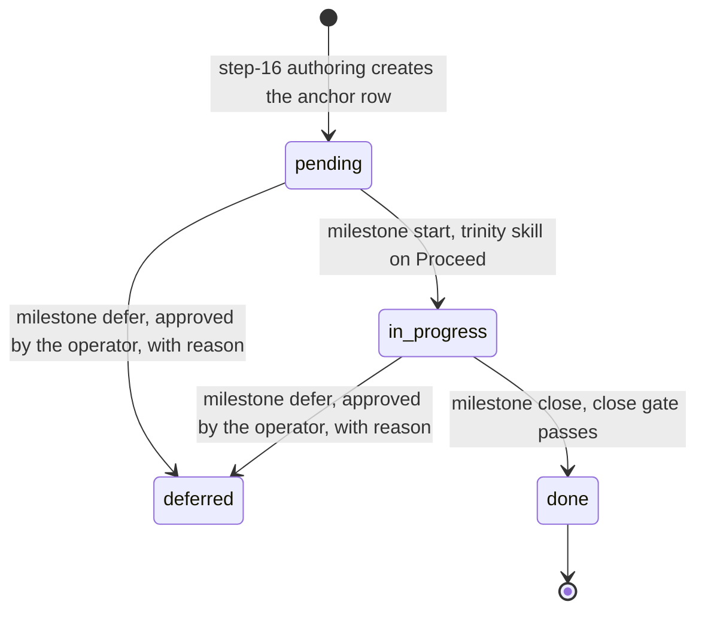
*Figure 9. Milestone status, stored once on the anchor row. How a deferred milestone resumes is settled in planning.*

### 8.4 Person decisions

Four commands record a person's decision: `specdev milestone sign-off`, `specdev milestone defer`, `specdev release`
and `specdev verify attest` (manual fixtures and `review` rules). The agent runs them only after the operator approves
(**Ruled**). `init` and `specdev update` install one Claude Code `ask` rule per command into the host's
`.claude/settings.local.json`, and the skills tell the agent to show `specdev status` first. This is a convenience, not
a guarantee (principle Z0). Each record carries its git author for the audit trail, except a deferral: its reason is stored on the anchor row, and git has the author (**As built**).

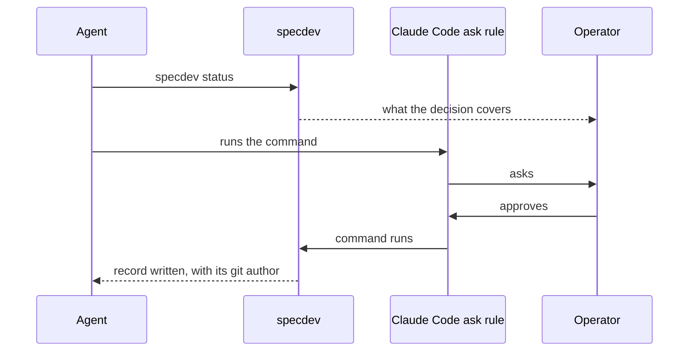
*Figure 10. A person decision: status, command, ask, approve, record.*

### 8.5 What the trinity loop writes and reads

| Rule | What it means | Status |
|---|---|---|
| P9 by field | The loop writes only its own plan and record files, plus milestone status and the close record through the milestone commands. Never seeds, steps 00–15 or other anchor fields. The tool writes lock entries for trinity links | Ruled |
| Plan item | One stored link, `realises` → task criteria. Task, milestone, fixture and NFRs are computed. The plan names its milestone in a file-level key; `DESIGN_STATE.md` does not make it a link field | Ruled |
| Missing spec found in the loop | An open item in the plan, never a plan-minted node (for example a library a test needs) | Ruled |
| Deferral in the loop | Deferring a task is a step-14 disposition, so the loop raises an open item instead | Definition |
| Plan re-attest | When 16a re-plans, the trinity skill re-attests the plan items' links | Definition |
| Context packs | Rendered per role (16a, 16b, 16c) from the links: core criteria; their obligations; APIs and errors; lineage; constraints and threats; delivery (scaffold rows, gates, secrets, connections, CI jobs, environment); dependencies; third parties relied on; a universal set (governance, scaffold layout, glossary terms). 16a and 16b packs add the assumptions their obligations assume; 16a's adds the stakeholder needs in the lineage. 16b also gets a report of dependency changes in the code it touched | Ruled (assumptions, needs, report: Definition) |
| Completeness | The role rules and no-dangling (section 5), a static check that every kind is reachable by some role's pack or is universal, and a report of any ambiguity about a node outside the item's pack | Ruled |

Why P9 needs enforcing: today prompt_16a tells the planner to "update the relevant spec files", the trinity-impl agent
may run `specdev json patch` on spec, and 16c patches status into 09, 14 and the anchor (Problem filed, DEVSPEC-264).

### 8.6 Proof and evidence

Each obligation is proven through the verifier the spec declares for it (**Ruled**):

| Obligation | Proven through |
|---|---|
| 04 FRs and criteria, 05 APIs and errors, 06 invariants | The 08 fixtures that verify them |
| 07 NFRs | The fixture or 12 job that `verifies` them, whose binding declares the stage the NFR's 07 `stage` needs |
| 11 threats and edge cases | All their mitigations proven |
| 02a environments, gates, secrets | The 12 job that provisions or runs them |
| 10 rules | Their enforcer: a 12 job, a toolkit command, or a `review` attested at release with `verify attest` |
| 00 items, 01 capabilities | Everything derived from them |
| 14 task criterion | Its own verifier (fixture, CI job or enforcer), which must verify the obligation it refines |

| Rule | What it means | Status |
|---|---|---|
| Verification record | Binds a command (or a short list) to what it proves: fixtures, a CI job's run or a toolkit command's run, and declares its stage (default `dev`; one binding per stage). The typed fixture → test link. Written by `specdev verify bind` at 16a or 16b; reviewed by 16c | Ruled (command: Definition) |
| Evidence record | Written only by `specdev verify run`, or by `specdev verify attest` (type `attestation`, naming the node and the tree). Records exit code, output-guard result, output hash, tested tree id, stage, and installed versions of the third parties the verified nodes rely on | Ruled / Definition (attestation) |
| Output guard | A pattern the binding declares, which the run's output must match (the test's own name, a non-zero pass count). No runner reports are parsed | Definition |
| Evidence validity | Valid while the code tree (section 8.2: everything except `spec/`, seed paths and a host-declared list) equals the tested tree; spec content is guarded by the fixture's and obligation's content hashes matching those recorded. So spec, seed, plan, anchor, lock and record writes never invalidate evidence. Evidence under a different third-party version is out of date for nodes that rely on it | Ruled (code tree) / Definition |
| Where | `spec/extras/verification/`, tool-owned and committed. Separate from spec (a fixture cannot hold a test written later, by P9) and from plans (evidence outlives a plan) | Definition |
| Manual checks and `review` rules | Fixture mode `manual`, only where step 08 declares it, with a required reason why it cannot be automated. The evidence is recorded with `specdev verify attest <node-id>`, a person decision (section 8.4); the same command attests `review`-enforced step-10 rules. The manual share is listed at sign-off | Ruled / Definition (command) |
| Missing verifier | A coverage error during speccing, owned by the step that should bind it | Ruled |

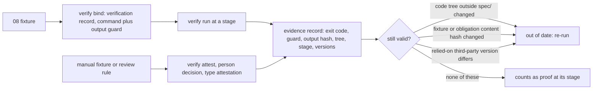
*Figure 11. From fixture to proof. Which stage each gate needs is in section 8.2.*

Why: today the criterion → task criterion → fixture → test → evidence chain closes for 45 of 280 W criteria and 30 of
67 P (V3); E530 (today's linked-test-file check) fires 0 times while 6 linked tests are broken; 91 of 128 W evidence
hashes hash their own evidence string (V3).

### 8.7 Releases

| Rule | What it means | Status |
|---|---|---|
| Release | `specdev release`, a person decision (section 8.4), runs the release gate (section 8.1) on the current commit, the merge commit of a release-prep PR (same code tree as the committed CI evidence), and creates an annotated tag matching the host's release-tag pattern; the tag push triggers deploy | Ruled |
| Scope | Unlinked legacy work and unscheduled in-scope obligations with no disposition block the release until linked, scheduled or deferred | Ruled |
| Status | "Released" at the tag; "verified in production" once production evidence is merged; the next release needs it, or a rollback record written by `specdev release rollback <tag> --reason …` | Ruled |
| Diff | `specdev diff <tagA> <tagB>` gives the node-level diff and the version bump | Definition |
| Removal work | A removed node needs a removal task in a change milestone. Its criterion carries `removes: <old-id>`, which justifies it; the fixture that proves the behaviour is gone also carries `removes` and is justified by it | Ruled |

## 9. Third-party systems

| Rule | What it means | Status |
|---|---|---|
| Node | One `third-party` kind at step 02, role context. It replaces the `tech_stack` lists in 02, 09 and 14 and the 02 external component (one node, not two) | Ruled |
| Grain | One node per separately versioned or contracted thing; `part_of` for bundled pieces; runtimes are nodes when versioned | Ruled |
| Which ones | Only third parties some spec node relies on. Transitive libraries stay in lockfiles. A library added in 16b that the spec should rely on becomes an open item | Ruled |
| Links | `relies_on` from any node at step 02 or later whose behaviour depends on it; `threatens` from threats; a connection's `connects_to`. A component's reliance is computed from its connections | Ruled |
| Versions | Always an exact pin; an unversioned SaaS pins the API or contract version it uses. The 02 node owns the pin; the seed states the choice. An inexact pin is an error of step 02 in every `spec-check`, and so is a pin that differs from the repo-declared sources (one check, not a second one at merge); a third party with no pin is the schema's error (**As built**) | Ruled |
| Spec first | At merge the pin must equal the repo-declared sources (lockfile, image tag, CI pin, as the host declares them); a mismatch is an error owned by step 02. At deploy the deploy job checks that the installed version equals the pin of what it deploys and records it. No ongoing environment checks | Ruled |
| Pin change | `specdev third-party pin <id> <version>` edits the pin and flags the whole downstream closure. The code change is made in the same branch, through a change milestone whose task criteria refine the obligations that rely on the third party | Ruled (same branch, refined obligations: Definition) |
| Other | No code anchors into vendor source. Retirement as for any node. Migrating today's tech-stack lists is judgement work in step 02's pass | Ruled |
| E311 | Today's enum-provenance check forces `enum_provenance` on every API with errors; it should apply only to externally sourced enums. E311 no longer fires for an API's errors; it fires for an API that has a parameter enum and names a third party in `relies_on`, so a first-party value set needs no provenance (**As built**) | Problem filed (DEVSPEC-289) |

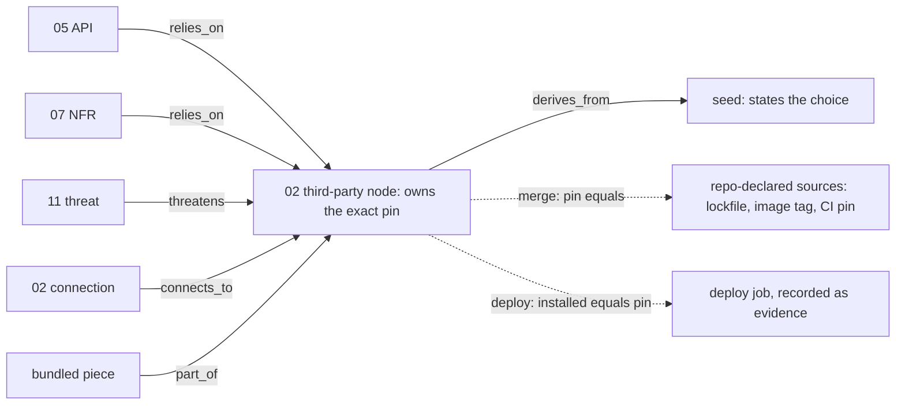
*Figure 12. A third-party node, its links and its two checks.*

## 10. Steps and structure

| Rule | What it means | Status |
|---|---|---|
| Step 13 | The extension generator stays; extension kinds become first-class later. Fixed in 1.2.0: in 1.1.1 a declared extension failed E590 without a governance label in step 10 and E210 with one; now the label resolves through canon and is not listed in step 10 (**As built**) | Ruled |
| Step 13a | Retired as a step and a file. Its three coverage numbers not involving step 14 are printed by `specdev coverage` (information, no threshold), and the gaps themselves are the role errors E740 to E745 of `spec-check` (**As built**); its two milestone numbers become checks in step 14's validator | Ruled |
| prompt_14's root-trace rules | Retired; the role rules and no-dangling (section 5), owned by step 14, replace them | Ruled |
| Step order | Generated from the link declarations; `tools/step_order.json` also keeps declared edges for the context reads that no stored link derives (**As built**) | Ruled |
| Exit conditions | Folded into task criteria | Ruled |
| Glossary | Terms are matched by label lint, not stored links | Ruled |
| Capabilities | Spec capability and canon capability are two things | Ruled |
| Parallel branches | The merge check on every PR and every default-branch push, plus the trace-lock merge driver | Ruled |
| `refines` targets | Any obligation kind with ids; when several state the same thing, the most downstream system or delivery node | Ruled |
| Cross-cutting obligations | Every task an obligation applies to carries a task criterion that refines it; the tool checks this. A task falls under it if any obligation it refines reaches the constrained capability (FR → capability) or component (API → component). Closed milestones' tasks are excluded | Ruled (reach: Definition) |
| Step 10 enforcers | Three types: a 12 job that `realises` the rule; a toolkit command named in `cli_command`, checked at step 10 (E530) against the CLI command list `registry-generate` writes (not canon); the value is a command path without flags, such as `release check` (**As built**); or `review`, built when attested at release with `specdev verify attest`, a person decision | Ruled (`cli_command` check: Definition) |
| Step 10 content | Today's `review_policy` text becomes `review` rules. `commit_message_rules` and `versioning` stay artifact content. `reviewers` is removed | Ruled |
| 14 task fields | `depends_on` stays; `assumptions` strings go (tasks inherit assumptions); `status` becomes `disposition` plus `lifecycle` | Definition |

**The dependency rule** (**Ruled**). A step stores a link only if all four tests hold:

| Test | Question | Note |
|---|---|---|
| Binding | Is this node tied to that specific node (exists because of it, constrains, refines, realises, verifies, mitigates or schedules it)? | A statement about every node of a kind ties to nothing per node |
| Grain | Is it the node the decision is actually about? | Coarser ancestors follow by containment |
| Derivability | Could the tool compute the link from other links? If yes, it is computed, not stored | A semantic test: is there a real choice? |
| One relation per field | Each field carries one verb | Verb-named fields make this hold by construction |

"Most downstream" in the `refines` target rule means system or delivery obligations only, never verifiers.

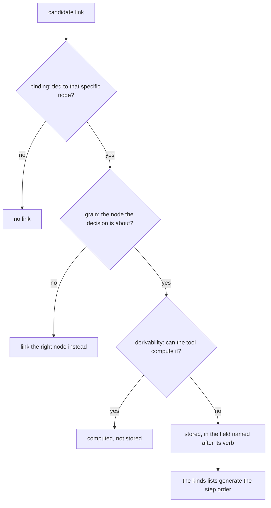
*Figure 13. The four-test dependency rule; its outcome is the per-step link table (section 4.3).*

Why generate the order: today's `tools/step_order.json` disagrees with the rule in 34 hard cases, 19 of them stored
links the hand list misses (V5).

## 11. Tooling

Commands are **Ruled** in principle; flags and output formats are settled in planning. "Status" compares with today's
CLI: **New**, **Extended** (exists, gains the duties listed) or **Retired**.

### 11.1 Commands

| Command | Status | Responsibility | Who runs it | When |
|---|---|---|---|---|
| `registry-generate` | Extended | Builds the kind registry from every `x-node` (nested arrays and map-keyed collections included) and writes the CLI command list; both byte-gated in CI | Toolkit maintainers | After a schema or CLI change |
| `spec-check --step N` | Extended | The step gate (section 8.1) | Step authors, step skills, pre-commit | While authoring; on every commit |
| `spec-check`, merge mode | Extended | The merge gate (section 8.1): static checks, the pin check, and the dev- and CI-stage bindings of milestones the branch closes | The toolkit's merge-check workflow template, or a `specdev` step in the host's PR test workflow | Every PR; every push to the default branch |
| `specdev step create NN --from <draft>` | New | First authoring: validates, mints sub-item ids, shows every link target, writes lock entries | Step skills | When a step is first authored |
| `specdev json patch\|insert\|delete --id` | Extended | Id-keyed writes: resolve, validate, mint, show targets, write lock entries. `delete` retires a node | Step authors, fix agents, the batch pass | Any edit to an existing step |
| `specdev step ready NN` | New | Upstream steps present; no pending replay and no coverage gap in the steps NN links to. Its last line says what to do first. The trinity skill runs it for 16a only: the code phase is gated by `milestone start`, the end by the close gate (**As built**) | Step skills | Before authoring NN |
| `specdev node <id>` | New | Shows one node: content, file, path, lifecycle | Anyone | Reading |
| `specdev node candidates` | New | Lists valid targets for a link field | Authoring agents | Before writing a link |
| `specdev node status <id> active\|deprecated\|not_applicable` | New | The one lifecycle command: `json patch --id … .lifecycle` is refused and points here. `not_applicable` is refused on any node but a closed milestone's step-14 node (that the built target was deleted is not checked) (**As built**) | Step authors; `not_applicable` in step 14's replay | Lifecycle changes |
| `specdev node rename <old> <new>`; `node rename --label <term-id> "<new label>"` | New | Changes the id, adds the old id to `aliases`, rewrites every inbound link in the same change. With `--label`, changes a glossary term's label and rewrites every exact use of the old label in the same change, listing each (**Definition**) | Step authors | Rename |
| `specdev trace --up\|--down` | New | Lineage and impact of a node | Anyone | Reading, impact analysis |
| `specdev trace --recipe <role>` | New | Renders a context pack for 16a, 16b or 16c | Trinity skill | Before each 16a, 16b, 16c unit |
| `specdev attest` | New | Re-attests a link or a checked group (section 4.5) | Step authors; the trinity skill for plan links when 16a re-plans | During replay |
| `specdev attest --prune` | New | Removes orphan lock entries | Whoever resolves a lock conflict; CI runs the orphan check | After deletions and merges |
| `specdev stale` | New | Pending replay, by step | Anyone | After an upstream change |
| `specdev coverage` | New | Coverage views, including the FR-centred matrix (`--by fr`) | Anyone | Reading, release prep |
| `specdev status` | New | Pending replay, open items, milestones awaiting sign-off, outdated or removed realisations, the release's production verification, the next step that may start | Anyone | Any time |
| `specdev verify bind` | New | Writes a verification record | 16a or 16b | When a test is planned or written |
| `specdev verify run` | New | Runs a binding and writes the evidence record | 16b and 16c (dev); the deploy job (staging, prod) | Per binding stage (section 8.2) |
| `specdev verify attest <node-id>` | New | Writes an `attestation` evidence record naming the node and the tree | The agent, after the operator approves | Manual fixtures; `review` rules at release; "at deploy" actions a person performs |
| `specdev plan record` | New | Records the execution of a plan action that names no verifier | 16b skill | As 16b executes |
| `specdev plan record --at-deploy <action> --env <env>` | New | Records an "at deploy" action as an execution record under `spec/extras/verification/`; no approval | The deploy job | After each deploy |
| `specdev review record` | New | Writes 16c's verdict into the plan's review block | 16c skill | End of review |
| `specdev milestone start` | New | `pending` → `in_progress`, after its preconditions (section 8.3) | Trinity skill, on "Proceed" | After plan approval |
| `specdev milestone defer` | New | Status `deferred`, reason on the anchor row | The agent, after the operator approves | Deferring |
| `specdev milestone sign-off` | New | Writes the sign-off record naming the milestone and the tree it approves | The agent, after the operator approves | Before close |
| `specdev milestone close` | New | The close gate (section 8.1); writes `done` and the close record; freezes the plan | 16c skill | After sign-off |
| `specdev third-party pin` | New | Changes a pin and starts the replay | A step-02 author | Version change |
| `specdev release` | New | The release gate (section 8.1) as a state check on the current commit, then an annotated tag matching the release pattern | The agent, after the operator approves | Release |
| `specdev release rollback <tag> --reason …` | New | Writes the rollback record that lets the next release proceed without the previous one's production proof | A plain record-writing command | After a failed or reverted release |
| Release-prep `specdev` step | New | In a release-prep PR: runs every dev- and CI-stage binding and commits the evidence records to the PR branch, once per code tree (needs workflow write permission) | The merge-check workflow | Before a release |
| Merge-check workflow template | New | Full-history checkout with submodules, toolkit install, the host-declared setup command, then the bound commands | Shipped by the toolkit, installed in the host | Every PR and default-branch push |
| `specdev release check --stage prod --tag TAG` | New | The production-deploy gate (section 8.1), for the release the tag names (**As built**): staging verifiers' evidence and staging delivery obligations, skipped if the staging environment is `scope: out` | The host's production deploy job, first | Before every production deploy |
| `specdev diff <tagA> <tagB>` | New | Node-level diff and version bump | Anyone | Release notes |
| `upstream-backlog` | Extended | Open items across all artifacts, grouped by the step of their `about` nodes | Operator, batch pass | Before a batch pass |
| Migration runner | New | Mechanical scripts, dry-run first, no commits; the triage list | Operator | Once per host per toolkit upgrade |
| Trace-lock merge driver | New | Per-entry merge with integrity checks; older chain stamp wins | Git (installed by `init_project`) | Every merge |

There is no `node retire` (retiring is deletion) and no evidence import command.

### 11.2 Hook points

| Hook | What runs | Blocks |
|---|---|---|
| Pre-commit | `spec-check --step` for touched steps and seed paths; no post-merge hook | The commit |
| Step skills | `step ready`, `step create`, `json … --id`, `spec-check --step`, `attest`, `stale`, `node status`, `node rename` | Finishing the step |
| Trinity skill | `trace --recipe`, `verify bind`, `milestone start` (on "Proceed"), `verify run`, `plan record`, `review record`, `attest` (plan links), `milestone close` | Close |
| The operator | Plan approval ("Proceed"); approving the ask prompts for `milestone sign-off`, `milestone defer`, `release` and `verify attest`; seed edits | — |
| Merge-check workflow | The `specdev` merge-mode step on every PR and every default-branch push; orphan-entry check; in a release-prep PR, commits the CI evidence. A host may additionally require the check | A failed merge check; the release refuses |
| Deploy job | Every deploy: installed version equals the pin. Production: `release check --stage prod` first. Staging and production: `verify run` for their bindings; `plan record --at-deploy`; a reviewed PR with the records | The deploy |

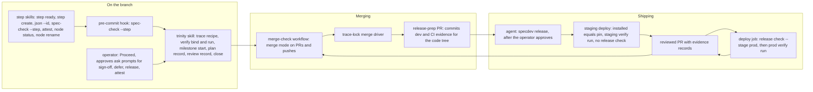
*Figure 14. Where checks run, in order: the waterfall pass and trinity on the branch, then the merge check, then
release and deploys. Evidence from deploys returns through a reviewed PR, which the merge check gates like any other.*

### 11.3 Schema and tooling changes

A generated checklist, one row per design item that changes a schema (**Definition**). Its minimum content:

| Area | Change |
|---|---|
| Annotations | `x-node` (with `contract`; map-keyed collections) and `x-link` (`kinds`, `required`, "built" flag) on every kind and link field |
| Node fields | `lifecycle` on every node; `scope` (with reason) on every obligation; `replaces`, `aliases`; `removes` on task criteria and removal fixtures; verb-named link fields everywhere, including `derives_from` on threats (→ risk) and on third parties, components and 02a nodes (→ constraint) (section 4.3) |
| New nodes and ids | Ids on 00 scope items (one list), risks, assumptions, stakeholders, stakeholder needs; the new 00 `constraints` list; ids on 02 connections, 02a gates and secrets, 05 errors; step-10 rules as objects with ids and enforcers; the 02 `third-party` kind |
| Steps 08, 10, 11, 14, 16 | `manual` fixture mode with its reason; step-10 enforcer type `review`; edge-case `threatens` and `mitigated_by`; 14 task `disposition`; the anchor deferral reason |
| Host declarations | See section 11.6 |
| Records | One ambiguity item shape with `about` (in `schema/core`); verification records with a declared `stage` (default `dev`); evidence records, including type `attestation`; lock and close record schemas |

**Fields removed** (**Definition**):

| Removed | Why |
|---|---|
| `*_refs_ingested` | Replaced by the trace lock |
| `tech_stack` (02, 09, 14), the 02 external component | Replaced by third-party nodes |
| `linked_test_expectation`, hand-written `fixture_status.test_results`, `implementation.status: verified` | Replaced by verification and evidence records |
| `spec_ref.line_range` and `commit_hash` | Positions; wrong for 253 of 333 W items (V1) |
| Anchor `fr_refs` and `context_path`; checklist `milestone_ref` | Copies; computed |
| 09 and 14 milestone `status`; 14 task `status` and `assumptions` | One status store; `disposition`; inherited assumptions |
| 14 milestone `source_milestones` and `deliverables`; 09 milestone `depends_on`; 09 and 14 `dependencies` and `dependency_ref` | 14 → 09 computed; milestone order is not stored (it follows from FR, API and task `depends_on`); outside reliance is the third-party node's links |
| 05 `example_refs` | A downstream link |
| Connection `schema_ref` and `interface_ref` | Downstream links to 05 |
| 12 job-step ids | Job steps are content |
| Capability `scope: future`, FR won't-have, 05/08 `out_of_scope` lists as exemption signals | Replaced by `scope` |
| Artifact-level `trace` and `links` | Not coverage |
| 16a `plan.security.spec_mutations` and `plan.security.new_fixtures` | Spec changes and plan-minted fixtures from the trinity loop, against P9; they become ambiguity items |
| 16b `execution_results[].evidence_binding` | An authored hash; replaced by verification and evidence records |
| 16a `plan.status`; checklist `checklist_status`, `deferred_reason`, `wont_do_reason` | Plan items carry no disposition; the anchor holds milestone deferral |
| 10 `review_policy`, `reviewers` | `review_policy` becomes `review` rules; `reviewers` is removed |

### 11.4 Retired checks and steps

| Retired | Replaced by |
|---|---|
| Step 13a and its file | `spec-check` coverage before 14 and checks in step 14's validator |
| The stored trace matrix | The trace lock and `specdev coverage --by fr` |
| E555 removal check | Deletion caught by broken links |
| W140 (low token overlap with routed seeds) | The route-use check (section 6) |
| W551 (seed file on disk not listed in the manifest) | Dropped |
| prompt_14's root-trace rules | The role rules and no-dangling |
| The trinity skill's C3 Y/N question | `specdev milestone sign-off`, approved through its ask rule |
| Step-10 rules `validate-all`, `matrix` | `spec-check`, `coverage` (migration mapping) |

### 11.5 Prompt, skill and agent changes

| Where | Change | Source |
|---|---|---|
| prompt_16a ("update the relevant spec files"), the trinity-impl agent's spec writes, 16c's status writes into 09, 14 and the anchor | Removed: P9 by field; status only through milestone commands | Ruled (DEVSPEC-264) |
| Step skills' "scoped gate" (today a whole-repo `spec-check`) | `spec-check --step N` | Problem filed (DEVSPEC-285) |
| Step skills: Clarify answers | Answers a step does not own become open items | Ruled (DEVSPEC-286) |
| Step skills and agents: writing spec files | `step create` and `json … --id` only | Definition |
| Trinity skill | Starts on "Proceed", re-attests plan links, records executions and reviews; shows `specdev status` and runs sign-off, defer, release and `verify attest` through the ask prompt; runs close after sign-off | Ruled / Definition |
| prompt_14 | Root-trace rules removed; task criteria `refines` and `verified_by` | Ruled |
| Hook and CI templates | Must reach existing hosts (today P still runs `validate-all`; plan files are skipped) | Problem filed (DEVSPEC-287) |

spec-check takes 41.5 s at W, about 95 % of it JSON-schema `$ref` re-crawling (DEVSPEC-257); building the graph itself
takes a fraction of a second (S3).

### 11.6 Host changes

What each host sets up. `init_project` installs the toolkit-owned pieces.

| Change | What | Status |
|---|---|---|
| Merge-check workflow | Install the toolkit's template (full-history checkout with submodules, toolkit install, the setup command, the bound commands), or add the `specdev` step to an existing PR test workflow | Ruled |
| Optional prevention | A host may additionally require the merge check or protect branches. The design never assumes it | Ruled |
| Workflow permissions | Write permission, so the release-prep step and the deploy job can commit evidence to PR branches | Ruled |
| Deploy jobs | Every deploy job checks installed versions against the spec pins and records them. The production deploy job first runs `specdev release check --stage prod`; staging deploys run no release check. Deploy jobs run `specdev verify run` for staging and production bindings, record "at deploy" actions with `specdev plan record --at-deploy`, and open a reviewed PR with the evidence | Ruled |
| Declarations | The release-tag pattern; the setup command; the code-tree exclusion list; the repo-declared pin sources (lockfile, image tag, CI pin) | Ruled |
| Ask rules | One Claude Code `ask` rule per person-decision command, installed by `init` and `specdev update` into the host's local `.claude/settings.local.json` | Ruled |
| Git hooks and merge driver | The pre-commit hook (`spec-check --step`) and the trace-lock merge driver, installed by `init_project` | Definition |

## 12. Worked example: a member resets a forgotten password

One small feature, carried from the seed to the evidence. The shipped copy is `tests/fixtures/graph_example`; it differs
from the listings here in five ways (**As built**): every plan action carries an `id`; a lock entry also holds
`target_containers`; an evidence record lists every third party the node relies on, computed ones too; the canon ids
and the NFR unit are others, because the ones shown are not in core canon; and it carries no `spec/specdev_version`.
Its README lists the gaps `spec-check` reports on it. For each node:
- **New** is the node in the new shape: verb-named link fields, bare ids (**Ruled**). Key names for new fields are
  *illustrative* throughout this section.
- **Today** is the same node in today's schema shape, shown only where the shape changed.
- Every obligation carries `scope` (section 5.4); blocks described "as today, with …" add `"scope": "in"` as well.

The example follows one path: the confirm endpoint rejects an expired token. Nodes for the other paths (requesting a
reset, sending the email, deploying) exist in a real spec but are left out; section 12.21 says which shown nodes they
would use.

### 12.1 Seed

The seed is plain text a person writes (P6). The manifest lists it and routes it.

```text
docs/seed/seed_accounts.md (excerpt)

Members who forget their password reset it themselves through a link we email them.
The link works once and stops working 30 minutes after we send it.
We count on a member's email account being under their own control.
Support wants password tickets to stop landing on them.
No reset by SMS for now.
Every change goes through dev, CI and staging before production.
We hash passwords with argon2. Email goes out through MailRelay.
```

```json
{
  "seeds": [
    { "seed_id": "seed-accounts", "path": "docs/seed/seed_accounts.md",
      "description": "Account lifecycle: sign-up, login, password recovery.",
      "required": true, "source_type": "doc" }
  ],
  "step_requirements": { "00": ["seed-accounts"], "02": ["seed-accounts"] }
}
```

The shape is unchanged. What is new is the rule: each route must be used by at least one node of that step. Here
step 00 distils the product parts and step 02 distils the technology choices (argon2, MailRelay; MailRelay is a
made-up name).

### 12.2 Step 00: charter

**Today** (scope items, risks and assumptions are plain strings, stakeholder needs are strings inside a stakeholder;
nothing can link to them):

```json
{
  "in_scope": ["A registered member can reset a forgotten password through an emailed single-use link."],
  "out_of_scope": ["Password reset by SMS."],
  "assumptions": ["A member's email account is under the member's control."],
  "risks": ["Reset links could be replayed or guessed to take over accounts."],
  "stakeholders": [ { "role": "Support lead", "needs": ["Fewer password-reset tickets"] } ],
  "user_segments": [
    { "segment_id": "seg-registered-member", "description": "People with an account and a verified email address.",
      "jobs_to_be_done": ["Get back into my account quickly"], "pains": ["Waiting a day for support"],
      "gains": ["Self-service recovery"] }
  ],
  "success_metrics": [
    { "metric_id": "metric-recovery-time", "name": "Time To Recover", "target": "<= 5 min", "unit": "min",
      "measurement_method": "Median time from reset request to successful login, from the auth service log.",
      "unit_ref": { "id": "cn:core:unit:min", "kind": "unit" } }
  ]
}
```

**New:**

```json
{
  "scope_items": [
    { "scope_id": "scope-password-reset", "scope": "in",
      "text": "A registered member can reset a forgotten password through an emailed single-use link.",
      "derives_from": ["seed-accounts", "need-fewer-reset-tickets"] },
    { "scope_id": "scope-sms-reset", "scope": "out", "scope_reason": "Not offered in this product version.",
      "text": "Password reset by SMS.", "derives_from": ["seed-accounts"] }
  ],
  "assumptions": [
    { "assumption_id": "asm-member-controls-email",
      "text": "A member's email account is under the member's control.",
      "derives_from": ["seed-accounts"] }
  ],
  "risks": [
    { "risk_id": "risk-reset-link-takeover", "scope": "in",
      "text": "Reset links could be replayed or guessed to take over accounts.",
      "derives_from": ["seed-accounts", "asm-member-controls-email"] }
  ],
  "stakeholders": [
    { "stakeholder_id": "sh-support-lead", "role": "Support lead",
      "needs": [ { "need_id": "need-fewer-reset-tickets", "text": "Fewer password-reset tickets",
                   "derives_from": ["seed-accounts"] } ] }
  ],
  "user_segments": [
    { "segment_id": "seg-registered-member", "description": "People with an account and a verified email address.",
      "jobs_to_be_done": ["Get back into my account quickly"], "pains": ["Waiting a day for support"],
      "gains": ["Self-service recovery"], "derives_from": ["seed-accounts"] }
  ],
  "success_metrics": [
    { "metric_id": "metric-recovery-time", "name": "Time To Recover", "target": "<= 5 min", "unit": "min",
      "measurement_method": "Median time from reset request to successful login, from the auth service log.",
      "unit_ref": { "id": "cn:core:unit:min", "kind": "unit" },
      "derives_from": ["seed-accounts", "need-fewer-reset-tickets"] }
  ],
  "constraints": [
    { "constraint_id": "con-staged-delivery", "scope": "in",
      "text": "Every change goes through dev, CI and staging before production.",
      "derives_from": ["seed-accounts"] }
  ]
}
```

Changed:
- Scope items, assumptions, risks and stakeholder needs become nodes with ids. Every charter node links the seed it was
  distilled from.
- `in_scope` and `out_of_scope` merge into one `scope_items` list. Obligations (scope items, risks, constraints) carry
  `scope`. The SMS item is `out`, with a reason: it is exempt from "must be built" and listed at release.
- The risk `derives_from` the assumption whose failure it describes. The need is used by the scope item and the metric
  that `derives_from` it.
- A `constraints` list is added; `con-staged-delivery` is used by the four environments that derive from it. The
  stakeholder and each of its needs have ids; the stakeholder is used because its need is used.

### 12.3 Step 01: capability

**Today:**

```json
{
  "capability_id": "cap-account-recovery", "verb": "recover", "scope": "in", "owner": "product",
  "description": "A registered member can regain access to their account without contacting support.",
  "trace": [ { "type": "charter-goal", "id": "seg-registered-member" } ],
  "capability_ref": { "id": "cn:project:capability:account-recovery", "kind": "capability" }
}
```

**New:**

```json
{
  "capability_id": "cap-account-recovery", "verb": "recover", "scope": "in", "owner": "product",
  "description": "A registered member can regain access to their account without contacting support.",
  "derives_from": ["scope-password-reset", "seg-registered-member"],
  "assumes": ["asm-member-controls-email"],
  "capability_ref": { "id": "cn:project:capability:account-recovery", "kind": "capability" }
}
```

Changed: `trace` with a borrowed `charter-goal` type becomes `derives_from` with bare ids, and can now name the scope
item. `assumes` names the assumption the capability depends on. `scope` takes only `in`, `later` or `out`.
`capability_ref` stays: the spec capability and the canon capability are two things (**Ruled**).

### 12.4 Step 02: component, connection and third-party nodes

**Today** (the email provider is an "external" component; versions sit in `tech_stack`, copied again into 09 and 14):

```json
{
  "components": [
    { "component_id": "identity-service", "type": "service", "owner": "engineering",
      "responsibilities": ["Issues and redeems password reset tokens", "Stores password hashes"],
      "trace": [ { "type": "capability", "id": "cap-account-recovery" } ] },
    { "component_id": "email-provider", "type": "external", "owner": "engineering",
      "responsibilities": ["Delivers transactional email"], "tags": ["external-dependency"],
      "trace": [ { "type": "capability", "id": "cap-account-recovery" } ] }
  ],
  "connections": [
    { "from": "identity-service", "to": "email-provider", "protocol": "http", "trust_boundary": "partner",
      "trace": [ { "type": "capability", "id": "cap-account-recovery" } ] }
  ],
  "tech_stack": { "languages": ["TypeScript 5.x"], "frameworks": ["argon2 0.41"],
                  "infrastructure": ["MailRelay"], "tools": [] }
}
```

**New:**

```json
{
  "components": [
    { "component_id": "identity-service", "type": "service", "owner": "engineering",
      "responsibilities": ["Issues and redeems password reset tokens", "Stores password hashes"],
      "derives_from": ["cap-account-recovery"] }
  ],
  "connections": [
    { "connection_id": "conn-identity-to-mailrelay",
      "derives_from": ["identity-service"], "connects_to": ["tp-mailrelay"],
      "protocol": "http", "trust_boundary": "partner" }
  ],
  "third_parties": [
    { "third_party_id": "tp-argon2", "name": "argon2 (npm package)", "pin": "0.41.1",
      "derives_from": ["seed-accounts"] },
    { "third_party_id": "tp-mailrelay", "name": "MailRelay transactional email API", "pin": "api-v3",
      "derives_from": ["seed-accounts"] }
  ]
}
```

Changed:
- The external component and the third-party node are one node. `tech_stack` goes, in 02, 09 and 14. Each pin is
  exact; the unversioned SaaS pins its API version. The seed states the choice; the 02 node owns the pin (**Ruled**).
- The connection gets an id, and `from`/`to` become verb-named links: `derives_from` its source component and
  `connects_to` its target. `connects_to` counts as use of `tp-mailrelay`, and `identity-service`'s reliance on
  MailRelay is computed from it, not stored. Fields pointing down to 05 (`schema_ref`, `interface_ref`) are removed.
- The component `derives_from` its capability (**Definition**).

### 12.5 Step 02a: delivery baseline

**Today:**

```json
{
  "environments": { "dev": {}, "ci": {}, "staging": {}, "prod": {} },
  "ci_gates": ["contract-tests"],
  "secrets": ["RESET_TOKEN_SIGNING_KEY", "MAILRELAY_API_KEY"]
}
```

**New:**

```json
{
  "environments": {
    "dev": { "scope": "in", "derives_from": ["con-staged-delivery"] },
    "ci": { "scope": "in", "derives_from": ["con-staged-delivery"] },
    "staging": { "scope": "in", "derives_from": ["con-staged-delivery"] },
    "prod": { "scope": "in", "derives_from": ["con-staged-delivery"] }
  },
  "ci_gates": [
    { "gate_id": "contract-tests", "scope": "in", "derives_from": ["identity-service"] }
  ],
  "secrets": [
    { "secret_id": "secret-reset-token-signing-key", "name": "RESET_TOKEN_SIGNING_KEY", "scope": "in",
      "derives_from": ["identity-service"] },
    { "secret_id": "secret-mailrelay-api-key", "name": "MAILRELAY_API_KEY", "scope": "in",
      "derives_from": ["conn-identity-to-mailrelay"] }
  ]
}
```

Changed: gates and secrets become nodes. Gates keep their kebab name as id; secrets get a minted id and keep the
env-var name as content (**Definition**). Environments are map-keyed nodes: the key is the id; all four are delivery
obligations with `scope`. The gate `derives_from` a component; the MailRelay key `derives_from` the connection it
authenticates (which uses the connection); the signing key belongs to no connection, so it `derives_from` the component
that uses it. Each environment `derives_from` the charter constraint that requires it (**Definition**).

### 12.6 Step 03: glossary term

```json
{ "term_id": "term-reset-token", "term": "reset token",
  "definition": "A single-use secret, sent by email, that authorises one password change for one account until it expires.",
  "term_ref": { "id": "cn:project:term:reset-token", "kind": "term" } }
```

Unchanged. A term stores no links. Its use is found by label (a lint), and that use is what satisfies no-dangling.

### 12.7 Step 04: FR and criteria

**Today:**

```json
{
  "fr_id": "fr-password-reset", "priority": "must-have",
  "statement": "The system shall let a registered member set a new password by redeeming a single-use reset token emailed to the account address, which expires 30 minutes after it is issued.",
  "acceptance_criteria": [
    { "criterion_id": "ac-password-reset-3",
      "text": "Given a reset token that has expired or was already used, when a new password is submitted with it, then the request is rejected and the stored password is unchanged." }
  ],
  "trace": [ { "type": "capability", "id": "cap-account-recovery" } ],
  "capability_ref": { "id": "cn:project:capability:account-recovery", "kind": "capability" }
}
```

**New:** as today, with `"derives_from": ["cap-account-recovery"]` in place of `trace`, and `"scope": "in"` on the
FR and on each criterion. A `priority` of won't-have no longer exempts anything; only `scope` does. The criteria become linkable
nodes through `x-node`; their data does not change. An FR that needs another FR would add `depends_on`.

### 12.8 Step 05: API and error

**Today:**

```json
{
  "api_id": "api-password-reset-confirm", "name": "Confirm Password Reset", "version": "v1",
  "protocol": "http", "path": "/v1/password-resets/{token}", "method": "POST", "owner": "api",
  "errors": [
    { "code": "token-expired", "severity": "error",
      "message": "HTTP 410: the reset token has expired or was already used." }
  ],
  "example_refs": ["fix-password-reset-expired-token"],
  "trace": [ { "type": "fr", "id": "fr-password-reset" }, { "type": "component", "id": "identity-service" } ],
  "interface_ref": { "id": "cn:project:interface:password-reset", "kind": "interface" }
}
```

**New:**

```json
{
  "api_id": "api-password-reset-confirm", "name": "Confirm Password Reset", "version": "v1",
  "protocol": "http", "path": "/v1/password-resets/{token}", "method": "POST", "owner": "api",
  "errors": [
    { "error_id": "err-password-reset-confirm-token-expired", "code": "token-expired", "severity": "error",
      "message": "HTTP 410: the reset token has expired or was already used.", "scope": "in",
      "derives_from": ["ac-password-reset-3"] }
  ],
  "scope": "in",
  "derives_from": ["fr-password-reset"],
  "provided_by": ["identity-service"],
  "relies_on": ["tp-argon2"],
  "interface_ref": { "id": "cn:project:interface:password-reset", "kind": "interface" }
}
```

Changed: one `trace` field carrying two relations splits into `derives_from` and `provided_by`. Errors get minted ids.
`example_refs` goes (it pointed downstream at 08). `relies_on` names the hashing library, because the API stores the
new password hash. Each error `derives_from` the 04 criterion it serves (**Ruled**); it is a separate obligation from
the API.

### 12.9 Step 06: invariant

**Today:**

```json
{
  "inv_id": "inv-reset-token-single-use", "language": "text", "severity": "error", "enforcement_point": "service",
  "description": "The system ensures that a reset token changes a password at most once.",
  "expression": "redeem(token) succeeds only if token.used_at == null; a successful redeem sets token.used_at",
  "scope": { "components": ["identity-service"], "apis": ["api-password-reset-confirm"] },
  "trace": [ { "type": "fr", "id": "fr-password-reset" } ],
  "policy_ref": { "id": "cn:project:policy:auth-required", "kind": "policy" }
}
```

**New:** as today, with `scope` and `trace` replaced by one field,
`"constrains": ["fr-password-reset", "api-password-reset-confirm", "identity-service"]`. One relation, one field.

### 12.10 Step 07: NFR

**Today:**

```json
{
  "nfr_id": "nfr-latency-reset-email", "category": "latency", "metric": "reset email delivery time p95",
  "target": "<= 60 s", "unit": "s", "stage": "staging", "owner": "ops",
  "measurement_method": "Synthetic reset request every 15 minutes in staging; time to receipt in a test inbox.",
  "trace": [ { "type": "fr", "id": "fr-password-reset" }, { "type": "charter-goal", "id": "metric-recovery-time" } ],
  "metric_ref": { "id": "cn:project:metric:email-delivery-time", "kind": "metric" },
  "unit_ref": { "id": "cn:core:unit:s", "kind": "unit" },
  "environment_ref": { "id": "cn:core:environment:staging", "kind": "environment" }
}
```

**New:** as today, with `trace` replaced by `"constrains": ["fr-password-reset"]`,
`"derives_from": ["metric-recovery-time"]` and `"relies_on": ["tp-mailrelay"]`. `stage` stays and decides where its
proof must run.

### 12.11 Step 08: fixtures

**Today:**

```json
{
  "fixture_id": "fix-password-reset-expired-token", "mode": "contract",
  "description": "The confirm endpoint rejects a token issued 31 minutes earlier and leaves the password unchanged.",
  "targets": [ { "type": "api", "id": "api-password-reset-confirm" } ],
  "input": { "method": "POST", "path": "/v1/password-resets/tok-fixture-expired",
             "body": { "new_password": "N3w-Passw0rd!" } },
  "expected": { "status": 410, "body": { "error": "token-expired" } },
  "tag_ref": { "id": "cn:core:tag:critical-path", "kind": "tag" }
}
```

**New:** as today, with `targets` replaced by
`"verifies": ["ac-password-reset-3", "api-password-reset-confirm"]`. A criterion can now be verified directly.
A second fixture, `fix-password-reset-reused-token`, verifies `inv-reset-token-single-use`. A fixture names no test
and no command: that would point down into code. The test binding is a verification record (section 12.20).

### 12.12 Step 09: design milestone

**Today:**

```json
{
  "milestone_id": "milestone-account-recovery", "name": "Account Recovery", "status": "pending",
  "deliverables": [ { "type": "fr", "id": "fr-password-reset" } ]
}
```

**New:**

```json
{
  "milestone_id": "milestone-account-recovery", "name": "Account Recovery",
  "schedules": ["fr-password-reset", "risk-reset-link-takeover"]
}
```

Changed: `status` goes (status lives only on the anchor row). Deliverables become `schedules` and may name FRs or
criteria, APIs, invariants, NFRs, components, environments and charter risks. The migration converts a typed 1.1.1
deliverable whose kind `schedules` accepts; capabilities, unknown ids and free text stay on one worklist item (**As built**). The capability is computed from the FRs. `depends_on` between milestones goes: milestone order is not stored.

### 12.13 Step 10: governance

**Today:**

```json
{ "pr_rules": ["validate-all", "governance-check"], "spec_first_policy": true,
  "commit_message_rules": { "require_spec_ids": false },
  "reviewers": ["@asha-rao"] }
```

**New:**

```json
{
  "rules": [
    { "rule_id": "rule-contract-tests-on-every-pr", "scope": "in",
      "text": "Every pull request runs the contract test suite before merge.",
      "derives_from": ["contract-tests"] },
    { "rule_id": "rule-spec-check-on-every-pr", "scope": "in",
      "text": "Every pull request passes the spec merge check.",
      "derives_from": ["risk-reset-link-takeover"], "cli_command": "spec-check" },
    { "rule_id": "rule-security-review-of-token-handling", "scope": "in", "enforcer": "review",
      "text": "A person reviews every change to reset-token handling before release.",
      "derives_from": ["risk-reset-link-takeover"] }
  ],
  "commit_message_rules": { "require_spec_ids": false }
}
```

Changed: each rule is a node with an id, an upstream reason (a 00 constraint, risk or scope item, a 02a gate or
environment, or an approver-only stakeholder) and an enforcer of one of three types (**Ruled**):
- the first is enforced by `job-contract-tests`, which `realises` it (step 12);
- the second names its command in `cli_command`, checked against the CLI command list `registry-generate` writes
  (**Definition**);
- the third is a `review` rule, built when it is attested at release with `specdev verify attest`, a person decision.
  Today's `review_policy` text becomes rules like it.

`commit_message_rules` and `versioning` stay as artifact content. `reviewers` is removed.

### 12.14 Step 11: threat

**Today:**

```json
{
  "threat_id": "threat-reset-token-replay", "category": "authn", "severity": "high",
  "description": "An attacker who obtains a used or expired reset link replays it to set the account password.",
  "target_ids": [ { "type": "api", "id": "api-password-reset-confirm" } ],
  "mitigations": [
    { "type": "inv", "id": "inv-reset-token-single-use", "note": "Rejects any second redemption." },
    { "type": "fixture", "id": "fix-password-reset-expired-token", "note": "Proves the late case is rejected." }
  ],
  "risk_category_ref": { "id": "cn:project:risk_category:authn", "kind": "risk_category" }
}
```

**New:** as today, with `"derives_from": ["risk-reset-link-takeover"]`, `"threatens": ["api-password-reset-confirm"]`
and `"mitigated_by": ["inv-reset-token-single-use", "fix-password-reset-expired-token"]`, in place of `target_ids` and
`mitigations`. Deriving from the risk is what lets the risk be built (section 5.3).

An edge case, **today** `{ "id": "ec-token-at-expiry-second", "description": "A token redeemed in the second it expires.", "trigger": "Clock reaches issued_at + 30 min." }`,
gains the same two links:

```json
{ "id": "ec-token-at-expiry-second", "scope": "in",
  "description": "A token redeemed in the second it expires.",
  "trigger": "Clock reaches issued_at + 30 min.",
  "threatens": ["api-password-reset-confirm"],
  "mitigated_by": ["ac-password-reset-3", "fix-password-reset-expired-token"] }
```

Both are built and proven through their mitigations (sections 5.3, 8.6), and used by a task criterion that refines
them (section 5.2).

### 12.15 Step 12: CI job

**Today:**

```json
{
  "job_id": "job-contract-tests", "name": "Contract Tests",
  "steps": [ { "id": "run-contract-suite", "name": "Run Contract Suite", "command": "npm run test:contract" } ],
  "environment_ref": { "id": "cn:core:environment:ci", "kind": "environment" }
}
```

**New:**

```json
{
  "job_id": "job-contract-tests", "name": "Contract Tests",
  "steps": [ { "name": "Run Contract Suite", "command": "npm run test:contract" } ],
  "environment_ref": { "id": "cn:core:environment:ci", "kind": "environment" },
  "realises": ["ci", "contract-tests", "rule-contract-tests-on-every-pr"]
}
```

Changed: the job `realises` the environment it runs in, the gate it runs and the rule it enforces. That link uses
all three, is the job's own use, and is their built path once the job has passing evidence (sections 5.2, 5.3). Job
steps are content, so their ids are dropped. Today's `requires` becomes `depends_on`. A job whose run proves an NFR (a load test, say) also holds `verifies` naming that NFR.

### 12.16 Step 13: extensions

Unchanged in the example (`extension_decision.status: none-required`).

### 12.17 Step 14: roadmap milestone, task and task criteria

**Today:**

```json
{
  "milestone_id": "ms-account-recovery", "name": "Account Recovery", "target_date": "2026-12-15", "status": "pending",
  "user_story": "As a registered member, I want to reset a forgotten password so that I can get back in without support.",
  "source_milestones": ["milestone-account-recovery"],
  "fr_refs": ["fr-password-reset"], "capability_refs": ["cap-account-recovery"],
  "deliverables": [ { "type": "fr", "id": "fr-password-reset" } ],
  "tasks": [
    { "task_id": "task-implement-password-reset-confirm", "status": "pending",
      "description": "Implement the confirm endpoint that redeems a reset token and sets the new password.",
      "fr_refs": ["fr-password-reset"], "invariant_refs": ["inv-reset-token-single-use"],
      "acceptance_criteria": [
        { "criterion_id": "ac-implement-password-reset-confirm-1",
          "text": "POST /v1/password-resets/{token} with a token issued 31 minutes earlier returns HTTP 410 with error token-expired and leaves the password hash unchanged.",
          "fixture_ref": "fix-password-reset-expired-token" }
      ] }
  ]
}
```

**New:**

```json
{
  "milestone_id": "ms-account-recovery", "name": "Account Recovery", "target_date": "2026-12-15",
  "user_story": "As a registered member, I want to reset a forgotten password so that I can get back in without support.",
  "tasks": [
    { "task_id": "task-implement-password-reset-confirm",
      "description": "Implement the confirm endpoint that redeems a reset token and sets the new password.",
      "acceptance_criteria": [
        { "criterion_id": "tc-confirm-expired-token",
          "text": "POST /v1/password-resets/{token} with a token issued 31 minutes earlier returns HTTP 410 with error token-expired and leaves the password hash unchanged.",
          "refines": ["ac-password-reset-3"],
          "verified_by": ["fix-password-reset-expired-token"] },
        { "criterion_id": "tc-confirm-reused-token",
          "text": "A second redemption of a token that already changed the password returns HTTP 410, even within 30 minutes.",
          "refines": ["inv-reset-token-single-use"],
          "verified_by": ["fix-password-reset-reused-token"] }
      ] }
  ]
}
```

Changed:
- Each task criterion `refines` the obligation it narrows. The second refines the invariant, not the 04 criterion:
  when several nodes state the same rule, the target is the most downstream system or delivery node (**Ruled**). The
  first refines the 04 criterion, not the 05 error: the error states only the code, while the criterion also states
  that the stored password is unchanged.
- `fixture_ref` becomes `verified_by`.
- Task-criterion ids no longer reuse 04 ids (`tc-` is a suggested prefix).
- Milestone `status`, `fr_refs`, `capability_refs`, `source_milestones` and `deliverables` go. Status lives on the
  anchor row. The 09 milestones are computed: those that `schedules` the obligations the task criteria refine. That
  computed link counts as use of the 09 milestone (**Ruled**).
- Task `status` gives way to two fields: `disposition` (`deferred` or `wont_do`, with a reason, absent here) and
  `lifecycle`. Progress is computed. Task `fr_refs` and `invariant_refs` are computed. Task `depends_on` stays; task
  `assumptions` strings go, because tasks inherit assumptions through what they refine (**Definition**).
- There is no deploy-stage field: each test binding declares its stage (section 8.2).

### 12.18 Step 15: scaffold row

**Today:**

```json
{ "interface_ref": "api-password-reset-confirm", "path": "src/routes/password-resets/confirm.ts", "method": "POST" }
```

**New:**

```json
{ "row_id": "scaffold-password-reset-confirm", "realises": ["api-password-reset-confirm"],
  "path": "src/routes/password-resets/confirm.ts" }
```

Changed: the row links the API with `realises` (**Definition**) and gets an id. `method` goes; it copied the API.
The row is used when its path is a tracked file (git submodules included). Step 15 owns that check; it runs at close
and release, and at merge only for rows whose API is built (**Ruled**).

### 12.19 Step 16: anchor row and plan

**Anchor row, today:**

```json
{ "milestone_id": "ms-account-recovery", "context_path": "spec/impl_context/ms_account_recovery_plan.json",
  "status": "in_progress", "fr_refs": ["fr-password-reset"], "checklist_id_prefix": "PWRESET",
  "summary": "Confirm endpoint in progress." }
```

**Anchor row, new:**

```json
{ "anchor_id": "anchor-ms-account-recovery", "about": ["ms-account-recovery"], "status": "in_progress",
  "checklist_id_prefix": "PWRESET",
  "summary": "Confirm endpoint in progress." }
```

The row is a status record about its milestone, with its own id. `context_path` and `fr_refs` go; the plan names its
milestone instead.

**Plan item, today:**

```json
{
  "id": "PWRESET_CONFIRM_EXPIRED_01",
  "spec_ref": { "type": "task", "id": "task-implement-password-reset-confirm",
                "line_range": "L1-L40", "commit_hash": "4f1c2d9" },
  "description": "The confirm handler returns 410 token-expired for a token older than 30 minutes.",
  "type": "behavior", "layer": "api", "checklist_status": "active",
  "fixture_ref": "fix-password-reset-expired-token", "milestone_ref": "ms-account-recovery",
  "nfr_refs": [], "linked_test_expectation": "tests/contract/password-reset-confirm.test.ts",
  "implementation": { "status": "pending",
    "actions": [ { "type": "file_edit", "target": "src/routes/password-resets/confirm.ts",
                   "description": "Reject expired tokens before the password update." } ] }
}
```

**Plan file and plan item, new** (`milestone` is a file-level key, not a link field):

```json
{
  "milestone": "ms-account-recovery",
  "plan": { "spec_alignment": { "checklist": [
    { "id": "PWRESET_CONFIRM_EXPIRED_01",
      "realises": ["tc-confirm-expired-token"],
      "description": "The confirm handler returns 410 token-expired for a token older than 30 minutes.",
      "type": "behavior", "layer": "api",
      "implementation": { "actions": [
        { "type": "file_edit", "target": "src/routes/password-resets/confirm.ts",
          "description": "Reject expired tokens before the password update." } ] } }
  ] } }
}
```

Changed: the item stores one link, `realises` (**Ruled**). Task, milestone, fixture and NFRs are computed. The pins
(`line_range`, `commit_hash`) go: at W they were wrong for 253 of 333 items, 167 of them placeholder `L1-…` ranges
(V1). `linked_test_expectation` gives way to the verification record. 16b records each executed action through
`specdev plan record`, and 16c writes its verdict through `specdev review record` into the plan's review block.

### 12.20 Verification record, evidence record and lock entries

**Verification record** (written by `specdev verify bind` at 16a or 16b, reviewed by 16c):

```json
{
  "verification_id": "ver-password-reset-expired-token",
  "verifies": ["fix-password-reset-expired-token"],
  "stage": "dev",
  "commands": ["npx vitest run tests/contract/password-reset-confirm.test.ts -t \"expired token\""],
  "output_guard": "expired token .*passed"
}
```

The NFR's fixture (in the email path, not shown) gets its own binding at the stage its target needs:

```json
{
  "verification_id": "ver-reset-email-delivery-staging",
  "verifies": ["fix-reset-email-delivery-time"],
  "stage": "staging",
  "commands": ["./scripts/synthetic-reset.sh --env staging --max-seconds 60"],
  "output_guard": "delivered in [0-9]+ s"
}
```

Each binding declares its stage (default `dev`). Staging evidence on the same code tree would also satisfy a `dev`
binding, never the reverse.

The output guard is a pattern the run's output must match, here the test's own name. A run that exits 0 having
selected no test fails the guard. Nothing parses runner reports.

**Evidence record** (written by 16b's `specdev verify run` on the branch; the `about` link is *illustrative*):

```json
{
  "evidence_id": "evd-20261202-0007",
  "about": ["ver-password-reset-expired-token"],
  "exit_code": 0,
  "guard_matched": true,
  "output_hash": "sha256:c0ffee5e",
  "tested_tree": "9a41c7e2",
  "stage": "dev",
  "installed_versions": { "tp-argon2": "0.41.1" }
}
```

It records what the design lists: exit code, guard result, output hash, tested tree id, stage, and the installed
versions of the third parties the verified nodes rely on (the API relies on argon2). Close needs this dev-stage
record; the CI-stage proof is the merge check's own run and is not stored (section 8.2).

**Some lock entries for the example** (hashes shortened to 8 hex digits):

```json
[
  { "source": "scope-password-reset", "field": "derives_from", "target": "seed-accounts", "content_hash": "sha256:7d01a3c2", "chain_stamp": "sha256:7d01a3c2" },
  { "source": "tp-argon2", "field": "derives_from", "target": "seed-accounts", "content_hash": "sha256:7d01a3c2", "chain_stamp": "sha256:7d01a3c2" },
  { "source": "cap-account-recovery", "field": "derives_from", "target": "scope-password-reset", "content_hash": "sha256:2b9e10f4", "chain_stamp": "sha256:a4106e9b" },
  { "source": "fr-password-reset", "field": "derives_from", "target": "cap-account-recovery", "content_hash": "sha256:e4c87a12", "chain_stamp": "sha256:3f77c0d1" },
  { "source": "api-password-reset-confirm", "field": "derives_from", "target": "fr-password-reset", "content_hash": "sha256:5a3f0c9d", "chain_stamp": "sha256:c19d2e40" },
  { "source": "api-password-reset-confirm", "field": "relies_on", "target": "tp-argon2", "content_hash": "sha256:88e2b5a1", "chain_stamp": "sha256:0b6a91fe" },
  { "source": "fix-password-reset-expired-token", "field": "verifies", "target": "ac-password-reset-3", "content_hash": "sha256:9f2c41d0", "chain_stamp": "sha256:51ab7e03" },
  { "source": "tc-confirm-expired-token", "field": "refines", "target": "ac-password-reset-3", "content_hash": "sha256:9f2c41d0", "chain_stamp": "sha256:51ab7e03" },
  { "source": "tc-confirm-expired-token", "field": "verified_by", "target": "fix-password-reset-expired-token", "content_hash": "sha256:41aa07e2", "chain_stamp": "sha256:d2e0f6b8" },
  { "source": "PWRESET_CONFIRM_EXPIRED_01", "field": "realises", "target": "tc-confirm-expired-token", "content_hash": "sha256:3c6e9b77", "chain_stamp": "sha256:6a1f30cd" },
  { "source": "cap-account-recovery", "field": "assumes", "target": "asm-member-controls-email", "content_hash": "sha256:b7c3d904", "chain_stamp": "sha256:e09245aa" },
  { "source": "secret-mailrelay-api-key", "field": "derives_from", "target": "conn-identity-to-mailrelay", "content_hash": "sha256:1d4f8c30", "chain_stamp": "sha256:77a812e6" }
]
```

Links to the same target carry the same values, because each recorded the target as it was when attested. For a seed
the two values coincide: nothing sits above it. The verification record's `verifies` link and the evidence record's
`about` link are record links: resolved, but with no lock entry.

### 12.21 The whole example as a graph

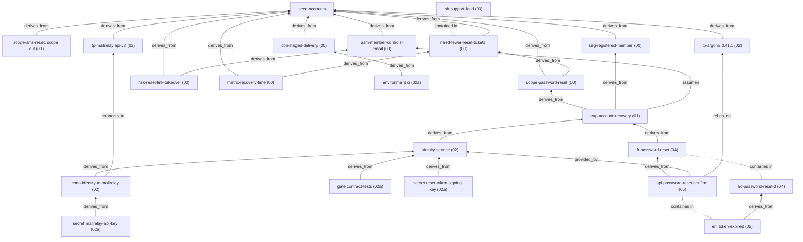
*Figure 15. The example, steps 00 to 05, in storage direction. Dotted lines are containment, never stored. The other
three environments link `con-staged-delivery` the same way as `ci`.*

```mermaid
flowchart BT
  RK["risk-reset-link-takeover (00)"]
  MT["metric-recovery-time (00)"]
  CMP["identity-service (02)"]
  TPM["tp-mailrelay (02)"]
  ENV["environment ci (02a)"]
  GT["gate contract-tests (02a)"]
  FR["fr-password-reset (04)"]
  AC3["ac-password-reset-3 (04)"]
  API["api-password-reset-confirm (05)"]
  INV["inv-reset-token-single-use (06)"]
  NFR["nfr-latency-reset-email (07)"]
  FX1["fix expired-token (08)"]
  FX2["fix reused-token (08)"]
  PM["milestone-account-recovery (09)"]
  RULE["rule-contract-tests-on-every-pr (10)"]
  RULE2["rule-spec-check-on-every-pr (10)"]
  RULE3["rule-security-review-of-token-handling (10)"]
  TH["threat reset-token-replay (11)"]
  EC["ec-token-at-expiry-second (11)"]
  JOB["job-contract-tests (12)"]
  MS["ms-account-recovery (14)"]
  TC1["tc-confirm-expired-token (14)"]
  TC2["tc-confirm-reused-token (14)"]
  SCF["scaffold row (15)"]
  ROW["anchor row (16)"]
  PI["PWRESET_CONFIRM_EXPIRED_01 (16a)"]
  VR["ver expired-token"]
  EV["evd-20261202-0007"]
  INV -- "constrains" --> FR
  INV -- "constrains" --> API
  INV -- "constrains" --> CMP
  NFR -- "constrains" --> FR
  NFR -- "derives_from" --> MT
  NFR -- "relies_on" --> TPM
  FX1 -- "verifies" --> AC3
  FX1 -- "verifies" --> API
  FX2 -- "verifies" --> INV
  PM -- "schedules" --> FR
  PM -- "schedules" --> RK
  RULE -- "derives_from" --> GT
  RULE2 -- "derives_from" --> RK
  RULE3 -- "derives_from" --> RK
  TH -- "derives_from" --> RK
  TH -- "threatens" --> API
  TH -- "mitigated_by" --> INV
  TH -- "mitigated_by" --> FX1
  EC -- "threatens" --> API
  EC -- "mitigated_by" --> AC3
  EC -- "mitigated_by" --> FX1
  JOB -- "realises" --> ENV
  JOB -- "realises" --> GT
  JOB -- "realises" --> RULE
  MS -.->|"computed: 09 milestones"| PM
  TC1 -.-|"contained in a task of"| MS
  TC2 -.-|"contained in a task of"| MS
  TC1 -- "refines" --> AC3
  TC1 -- "verified_by" --> FX1
  TC2 -- "refines" --> INV
  TC2 -- "verified_by" --> FX2
  SCF -- "realises" --> API
  ROW -- "about" --> MS
  PI -- "realises" --> TC1
  VR -- "verifies, record link" --> FX1
  EV -- "about" --> VR
```
*Figure 16. The example, steps 06 to 16 and the records, in storage direction. Dotted lines are containment or a
computed link, never stored. The term `term-reset-token` is used by label.*

**What the rules say about this graph** (the example is partial, section 5.2):

| Node | State in the example | Used or built by the parts left out |
|---|---|---|
| `ac-password-reset-3`, `inv-reset-token-single-use` | Used and, once the milestone closes, built: refined directly | — |
| `fr-password-reset` | Used; built only when all its in-scope criteria are | Task criteria refining criteria 1 and 2 |
| `cap-account-recovery`, `scope-password-reset` | Used; built only when everything derived from them is | The rest of the feature |
| `api-password-reset-confirm` | Used; not built: an API needs a direct refinement | A task criterion refining the API |
| `err-password-reset-confirm-token-expired` | No use shown | A task criterion refining the error |
| `nfr-latency-reset-email` | No use shown | A task criterion refining the NFR (in the email path) |
| `threat-reset-token-replay`, `ec-token-at-expiry-second` | No use shown; built through their mitigations | A task criterion refining each |
| `risk-reset-link-takeover` | Used (09 `schedules`, the threat, two rules); built when everything derived from it is built | The threat's and the rules' builds |
| `rule-spec-check-on-every-pr` | No use shown; built once `spec-check` is in the generated command list | A task criterion refining it |
| `rule-security-review-of-token-handling` | No use shown; built when attested at release with `verify attest` | A task criterion refining it |
| Environments `dev`, `staging`, `prod`; both secrets | No use shown (`ci` is used by the job). Staging and production ones are gated at the production deploy and the next release | The deploy and provisioning jobs that `realise` them |
| `contract-tests`, `ci`, `rule-contract-tests-on-every-pr` | Used by `job-contract-tests`; built once the job has passing evidence | — |
| `con-staged-delivery` | Used by the four environments; built when all of them are. At the tag, `staging` and `prod` count as satisfied (section 5.3) | — |
| Assumption, need, stakeholder, connection, third parties, segment, metric | Used as Figures 15 and 16 show; `scope-sms-reset` is out of play | — |

In a real spec, each "no use shown" node gets its user before merge, or is marked `scope: later` or `out`
(section 5.2).

### 12.22 The context pack 16b receives

Rendered by the tool from the links when 16b starts `PWRESET_CONFIRM_EXPIRED_01` (output format *illustrative*):

```text
$ specdev trace PWRESET_CONFIRM_EXPIRED_01 --recipe 16b
core criteria      tc-confirm-expired-token (task-implement-password-reset-confirm, ms-account-recovery)
obligations        ac-password-reset-3 (in fr-password-reset)
APIs and errors    api-password-reset-confirm, err-password-reset-confirm-token-expired
lineage            fr-password-reset -> cap-account-recovery -> scope-password-reset
assumptions        asm-member-controls-email (assumed by cap-account-recovery)
constraints        inv-reset-token-single-use, nfr-latency-reset-email
threats            threat-reset-token-replay, ec-token-at-expiry-second
delivery           scaffold-password-reset-confirm, gate contract-tests, environment ci,
                   secret-reset-token-signing-key, secret-mailrelay-api-key,
                   conn-identity-to-mailrelay, job-contract-tests
dependencies       none (no depends_on on the FR or the API)
third parties      tp-argon2 0.41.1, tp-mailrelay api-v3
verifiers          fix-password-reset-expired-token, ver-password-reset-expired-token
universal          governance rules, scaffold layout, glossary terms used (term-reset-token)
dependency report  changes in dependencies of the code this item touched
```

The pack lists ids; the agent reads each node through the tool, never whole spec files. Today's reads range from the
whole spec (16a is told to ingest 19 files, up to 664k tokens at W) to the plan item alone (16b); directed packs at W
have a median of 39 nodes per task for 16a and 13 per item for 16b (S14, V4).

## 13. Scenarios, step by step

Each scenario uses the example from section 12. The tables say who acts, which command runs, which check fires and
what blocks; the gates themselves are in section 8.1.

### 13.1 An upstream criterion changes

**Trigger.** Product decides that `ac-password-reset-3` must also reject a token issued for a different account.

| # | Who | Command | What happens | Blocks |
|---|---|---|---|---|
| 1 | Step-04 author | `specdev json patch --id ac-password-reset-3 …` | The criterion's content hash changes, and so does the FR's (it folds in its criteria). Every chain stamp below changes | — |
| 2 | Anyone | `specdev stale` | Lists pending replay by step: the API error (05), the fixture (08), the API, invariant, NFR, threat and scaffold row through the FR and API, the 09 milestone, the task criteria (14), the open plan items (16a) | — |
| 3 | Step-05 author, then 06, 07, 08 … in step order | Replay of the step: suspects shown with the upstream diff; `specdev attest` for a group confirmed after reading, or an edit | An edit makes its own closure suspect. A re-attest updates the content hash and the chain stamp | A re-attest is refused while one of that node's own targets is still suspect, so replay works upward-first, node by node; historical links are never re-attested |
| 4 | Step-14 author | Same | `tc-confirm-expired-token` is suspect; its author edits the text or re-attests | — |
| 5 | 16a; the trinity skill | Re-plan the suspect open plan items; the trinity skill re-attests their links | The plan item's `realises` link is suspect until checked. Re-attesting it marks the item's recorded executions stale, so 16b executes again | Close |
| 6 | Merge-check workflow | Merge gate | Fails while any non-historical node has a suspect link | The merge check fails; the release refuses |

Closed work is not touched: links held by a closed milestone's step-14 nodes and frozen plans are not in the suspect
set (section 13.4 covers what happens to them).

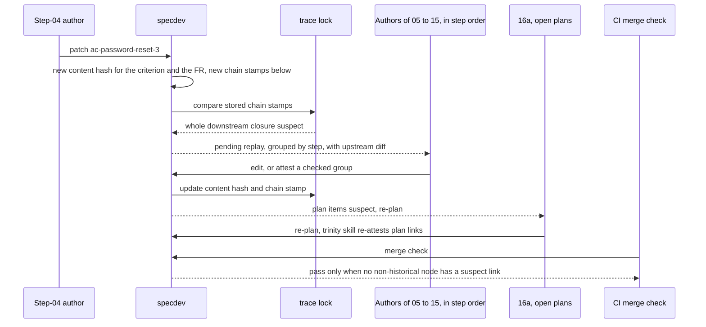
*Figure 17. Full-closure propagation and per-step replay. Every node below a change is checked, even if a level in
between did not change.*

Why full closure: in W and P history, 15 % (W) and 56 % (P) of dependants that should have followed a substantive
upstream change were never edited (V1); at W a step-14 criterion still contradicts the fixture rewritten under it.

### 13.2 Clarify questions at two steps, resolved in one batch

**Trigger.** Two questions come up while authoring the same feature branch:
- At step 05: "after a reset, are the member's other sessions signed out?" This is a product decision.
- At step 08: the API says HTTP 410, but `ac-password-reset-3` only says "rejected". The cause is the 04 criterion.

| # | Who | Command | What happens |
|---|---|---|---|
| 1 | Step-05 agent asks; the operator answers "yes, sign out all sessions" | `specdev json insert` into 05's `ambiguities` | An open item `about: ["seed-accounts"]` with `decision` holding the known answer. A product decision goes to the seed |
| 2 | Step-08 agent asks | Insert into 08's `ambiguities` | An open item `about: ["ac-password-reset-3"]`: a correction goes to the highest node whose content causes it |
| 3 | `spec-check --step 05` / `--step 08` | Step gate | 05 and 08 errors on nodes below the `about` nodes show "waiting on amb-…": warnings in the step that fail the merge check |
| 4 | Operator or batch agent | `upstream-backlog` | Groups the open items by the step of their `about` nodes: one under the seed, one under 04 |
| 5 | A person edits the seed; the step-04 author edits the criterion | Seed edit, `json patch --id` | The answers are applied. Each item is deleted once applied (an optional `Resolves: amb-…` commit trailer records provenance; nothing checks it) |
| 6 | Step authors | Replay | Only the suspects of the two changes are replayed, node by node: a node can be re-attested as soon as none of its own targets is still suspect (section 4.5), whichever step it is in |

A choice that step N owns stays in step N and is settled in its own turn; only questions it cannot settle become open
items (**Ruled**). An open item (illustrative keys):

```json
{ "id": "amb-reset-signs-out-sessions",
  "description": "Does a successful reset sign out the member's other sessions?",
  "about": ["seed-accounts"],
  "decision": "Yes: a successful reset ends every other session of the account." }
```

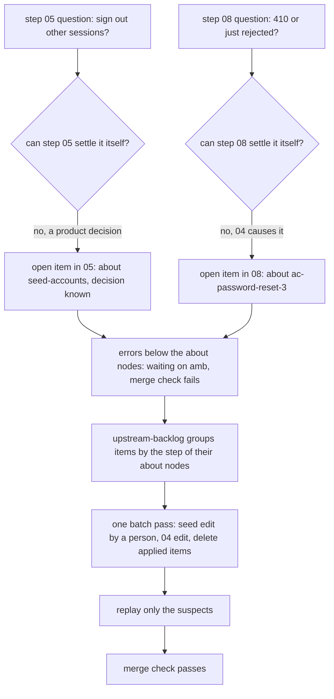
*Figure 18. Two Clarify questions collected as open items and resolved in one batch.*


### 13.3 A node retired and replaced

**Trigger.** `fr-password-reset` is replaced by `fr-account-recovery-link`, which also covers magic-link sign-in.

| # | Who | Command | What happens |
|---|---|---|---|
| 1 | Step-04 author | `specdev json delete --id fr-password-reset` | The node is deleted; git keeps its history. There is no retire command. When the delete would leave a required list empty it is refused, and step 2 goes first (**As built**) |
| 2 | Step-04 author | `specdev step create` or `json insert` | The successor carries `replaces: ["fr-password-reset"]`. It must not name a node still present; the tool may check it against git history |
| 3 | Tool | Step gates | Every link into the old FR and its criteria no longer resolves: errors owned by the holders' steps (05 API, 06, 07, 08 fixtures, 09, 14 task criteria) |
| 4 | Each holder | Re-point to the successor, or delete | The new links get new lock entries |
| 5 | Closed milestones | — | See section 13.4 |

A rename is different: `specdev node rename <old> <new>` changes the id, adds the old id to the node's `aliases`,
and rewrites every inbound link to the new id in the same change. An accidental
deletion is caught the same way: by the broken links it leaves (**Ruled**). No ledger, no tombstone, no commit trailer.

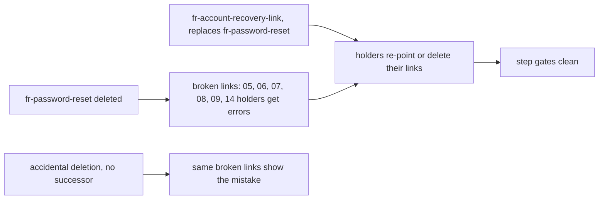
*Figure 19. Retirement by deletion. Broken links do the work a tombstone would have done.*

Why: hosts edit in place, rarely rename and delete without follow-through. In W history only 15 of 35 removals with
surviving referrers were cleaned in the same commit (V1).

### 13.4 A closed milestone whose built node changes or is deleted

**Setup.** `ms-account-recovery` is closed: its anchor status is `done` and its plan is frozen.

| Case | What the tool computes | What someone must do | Blocks |
|---|---|---|---|
| `ac-password-reset-3` changes | Realisation status **outdated**: the lock's content hash for the closed `refines` link no longer matches. The closed link is not suspect and never re-attested. The criterion is uncovered (only refinements whose content hash matches count) | Step 14 adds a change milestone whose task criterion refines the changed criterion | The release, until that change milestone closes |
| `fr-password-reset` is deleted | Realisation status **removed** | In step 14's replay, `specdev node status <id> not_applicable` on the closed task criteria that refined it. A change milestone gets a removal task whose criterion carries `removes: ["fr-password-reset"]`, verified by a fixture that proves the behaviour is gone | The release, until the removal milestone closes |
| A later closed milestone realises the current version | Realisation status **superseded** | Nothing | — |
| Nothing changed | **current** | Nothing | — |

`not_applicable` and recorded migration edits are the only edits allowed on a closed milestone's step-14 nodes
(**Ruled**). The frozen plan is never edited. Outside a migration the id-keyed commands refuse such a node
(`json patch|insert|delete --id`, `node rename`), and `node status` takes only `not_applicable`, or `active` to take
it back. The file form of `json patch` is an edit by hand and is not guarded (**As built**).

A removal task criterion and its fixture. `removes` names the deleted id and justifies each of them, so neither needs
another upstream link (**Ruled**, round 17 for the fixture):

```json
{ "criterion_id": "tc-remove-password-reset-confirm",
  "text": "POST /v1/password-resets/{token} returns HTTP 404: the endpoint no longer exists.",
  "removes": ["fr-password-reset"],
  "verified_by": ["fix-password-reset-confirm-gone"] }
```

```json
{ "fixture_id": "fix-password-reset-confirm-gone", "mode": "contract",
  "description": "The old confirm endpoint is gone.",
  "input": { "method": "POST", "path": "/v1/password-resets/tok-any" },
  "expected": { "status": 404 },
  "removes": ["fr-password-reset"],
  "tag_ref": { "id": "cn:core:tag:critical-path", "kind": "tag" } }
```

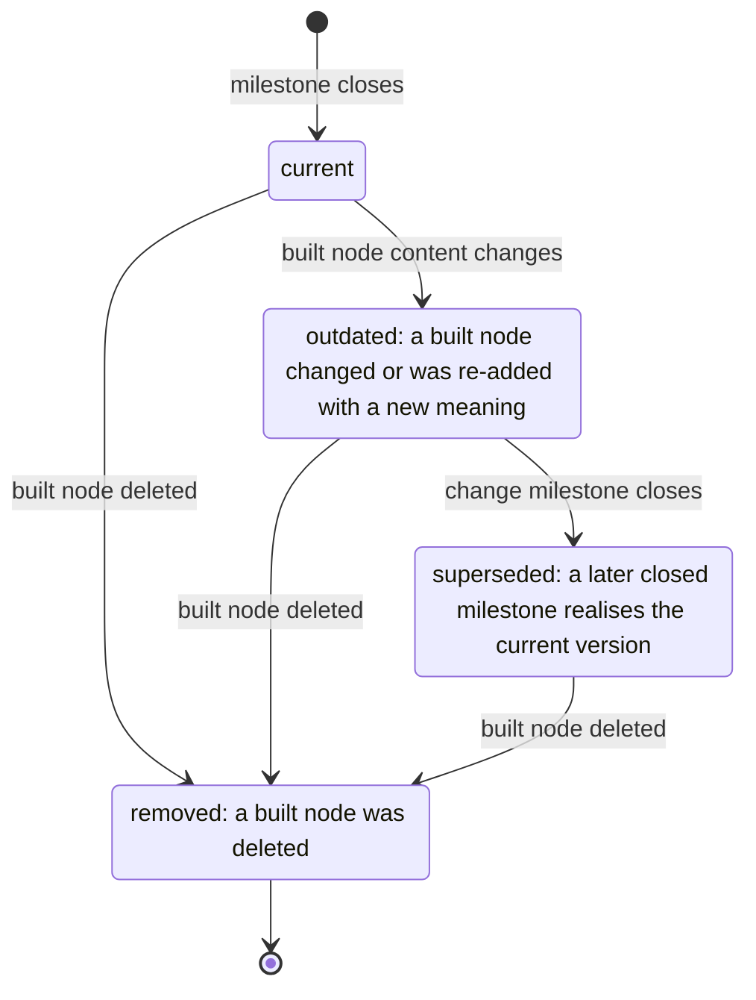
*Figure 20. Realisation status of one closed milestone. It is computed from the lock's content hashes against the
current graph and never stored. `removed` stays `removed`: a deleted node has no current version to supersede. A
release needs the change milestone of every outdated realisation and the removal milestone of every removed one
closed.*

Why: all 8 closed W plans received commits after closure (44 commits), 7 of them with node-content edits (V1).

### 13.5 A milestone closing

| # | Who | Command | Check |
|---|---|---|---|
| 1 | Step-16 authoring | — | Creates the anchor row, status `pending` |
| 2 | 16a | Plan; `specdev verify bind` for each fixture | Plan items `realises` task criteria; verification records written |
| 3 | Trinity skill, on the person's "Proceed" at the plan-phase gate | `specdev milestone start ms-account-recovery` | Preconditions: the anchor row exists, no suspect link on the milestone's chain. Status `pending` → `in_progress` |
| 4 | 16b | Code; `specdev verify run`; `specdev plan record` | Evidence for actions naming a verifier; recorded execution for the rest |
| 5 | 16c | Review; `specdev review record` | Verdict `verified` written into the plan's review block |
| 5a | 16a, in the plan | A plan action marked "at deploy" (for example, rotate `RESET_TOKEN_SIGNING_KEY` in staging and in production) | It does not hold up close; the deploy job records it later with `plan record --at-deploy`, once per environment (scenario 13.6) |
| 6 | The agent, after the operator approves (section 8.4) | `specdev status`, then `specdev milestone sign-off ms-account-recovery` | Status shows the milestone, the code tree, proof status, the manual share, deferred and won't-do tasks and open items. The command writes the sign-off record, with its git author |
| 7 | 16c skill (an agent may run it) | `specdev milestone close ms-account-recovery` | The close gate (section 8.1): dev-stage evidence for the milestone's dev and CI verifiers. the binding for `nfr-latency-reset-email` declares `staging`, so it does not hold close up |
| 8 | Tool | — | Status `done`; close record on the anchor row; the plan is frozen |
| 9 | CI, on the PR that closes the milestone | Merge gate | CI-stage proof for the dev and CI verifiers (section 8.2) |

```mermaid
sequenceDiagram
  participant A as 16a
  participant P as Person
  participant SK as Trinity skill
  participant B as 16b
  participant C as 16c
  participant T as specdev
  A->>T: verify bind, plan items realise task criteria
  P->>SK: Proceed, at the plan-phase gate
  SK->>T: milestone start, anchor row exists, no suspect link on its chain
  B->>T: verify run, plan record
  T-->>B: evidence records with stage and tested tree
  C->>T: review record, verdict verified
  SK->>T: specdev status
  SK->>T: milestone sign-off
  P->>SK: approves the ask prompt
  T-->>SK: sign-off record, with its git author
  SK->>T: milestone close
  T->>T: close gate, section 8.1
  T-->>SK: status done, close record, plan frozen
```
*Figure 21. Closing a milestone. Only milestone commands write status. The person approves the plan and the sign-off
prompt; an agent runs start, sign-off and close.*

Why one store and a gate: at P all 8 milestones are `done` in 14 but `pending` in 09 and the anchor; at W 37 tasks are
`pending` under 5 of the 7 `done` milestones (V1, REVIEW7).

### 13.6 A release, then production verification

| # | Who | Command | What happens |
|---|---|---|---|
| 1 | A person opens a release-prep PR | The merge-check workflow's release-prep `specdev` step | Runs every dev- and CI-stage binding and commits the evidence records to the PR branch, once per code tree |
| 2 | Reviewer | Merge the release-prep PR | The merge commit has the same code tree as the committed evidence |
| 3 | The agent | `specdev status` | Shows the operator what the release covers |
| 4 | The agent, after the operator approves | `specdev release` on the merge commit | The release gate (section 8.1), a state check of that commit. Creates an annotated tag matching the host's release pattern. Status "released" |
| 5 | Git hosting | Tag push | Triggers the deploy to staging |
| 6 | Staging deploy job | Installed-version check; `specdev verify run` for the staging bindings; `specdev plan record --at-deploy … --env staging` | No release check runs. Installed versions equal the pins. Evidence and execution records written; a candidate tag's staging deploy counts when its code tree matches |
| 7 | Deploy job, then a reviewer | A PR with the records, reviewed and merged | Staging proof is in the repo |
| 8 | Production deploy job | `specdev release check --stage prod --tag TAG`, first | Fails unless the staging bindings have evidence for the release's code tree, the staging delivery obligations are built and every relieved node holds. Skipped if the staging environment is `scope: out` |
| 9 | Production deploy job, then a reviewer | Production deploy; installed-version check; `verify run` for the production bindings; `plan record --at-deploy … --env prod`; a reviewed PR with the records, merged into a branch the next release descends from | Release becomes "verified in production" |
| 10 | The next `specdev release` | Next-release check | The previous release (the nearest ancestor release tag) needs production evidence and recorded "at deploy" actions, or a rollback record (`specdev release rollback <tag> --reason …`); a release cut before the host's migration needs nothing |

```mermaid
sequenceDiagram
  participant A as Agent
  participant O as Operator
  participant T as specdev
  participant G as Git hosting
  participant D as Deploy job
  participant R as Reviewer
  A->>G: release-prep PR commits dev and CI evidence, merged after review
  A->>T: specdev status
  A->>T: specdev release
  O->>T: approves the ask prompt
  T->>G: state check passes, annotated release tag
  G->>D: tag push triggers the staging deploy
  D->>R: staging evidence PR
  R->>G: review and merge
  D->>T: release check --stage prod
  T-->>D: pass
  D->>R: production evidence PR
  R->>G: review and merge, release verified in production
```
*Figure 22. A release. The tag needs a clean state check; staging proof is checked before production; production proof
by the next release.*

```mermaid
stateDiagram-v2
  state "released: release tag cut on a clean state check" as rel
  state "verified in production: production proof and at-deploy actions merged" as vip
  state "rolled back: release rollback record" as rb
  [*] --> rel: specdev release, approved by the operator
  rel --> vip: production evidence after deploy
  rel --> rb: specdev release rollback
  vip --> [*]: next release allowed
  rb --> [*]: next release allowed
```
*Figure 23. A release's production status. Production proof cannot exist when the tag is cut, because the tag
triggers the deploy.*

Why: W pushes a `v*` tag to deploy to stage and dispatches production later from the same tag, tags every staging
candidate (77 `-stage` tags), and once cut `v1.1.0` on a branch that never reached `main`; P's production deploy is a
manual dispatch and P tore down staging at go-live (REVIEW4_F2, REVIEW7, REVIEW9).

### 13.7 A third-party pin bump

**Trigger.** argon2 0.41.1 → 0.41.2, a patch.

| # | Who | Command | What happens | Blocks |
|---|---|---|---|---|
| 1 | Step-02 author | `specdev third-party pin tp-argon2 0.41.2` | The node's content changes; the whole downstream closure is suspect | — |
| 2 | Step 14, same branch | Change milestone | Its task criteria refine the obligations that rely on the third party (here `api-password-reset-confirm`) | — |
| 3 | 16b | Lockfile change in the same branch | Code now installs 0.41.2 | — |
| 4 | Merge-check workflow | Merge check | Pin must equal the repo-declared sources (lockfile, image tag, CI pin, as the host declares). A mismatch is an error owned by step 02 | The merge check fails until both agree; the release refuses |
| 5 | 16b, 16c; merge-check workflow | `specdev verify run`; the merge check re-runs the bound commands on the PR head | Evidence recorded under 0.41.1 is out of date for nodes that rely on argon2; it is re-run | Close; the merge check fails until re-run |
| 6 | Deploy job | Installed-version check | Installed equals the pin of what is deployed; recorded as evidence. No ongoing environment checks | Deploy |

```mermaid
flowchart TD
  PIN["specdev third-party pin tp-argon2 0.41.2"] --> SUS["whole downstream closure suspect"]
  PIN --> CM["change milestone: task criteria refine the obligations that rely on argon2"]
  CM --> LF["same branch: lockfile updated"]
  LF --> MC{"merge check: pin equals repo-declared sources?"}
  MC -- "no" --> E02["error owned by step 02, merge check fails"]
  MC -- "yes" --> EV["evidence re-run under the new version"]
  SUS --> RP["replay by step"]
  RP --> MC
  EV --> DEP["deploy job: installed equals pin, recorded as evidence"]
```
*Figure 24. A pin bump. Every version change, even a patch, is a spec change that flags the whole closure.*

Why: one W commit bumped a third party from 6.24 to 6.45 in three `tech_stack` copies and left 11 APIs saying 6.24.x; 10
still did at W's snapshot, because nothing linked an API to the version (V4). The replay cost is accepted (**Ruled**).

### 13.8 A seed edit

**Trigger.** The product owner shortens the reset link's life from 30 to 15 minutes.

| # | Who | Command | What happens |
|---|---|---|---|
| 1 | A person | Edits `docs/seed/seed_accounts.md` | The seed's hash changes. Whitespace-only edits change nothing |
| 2 | Pre-commit hook | `spec-check --step` | Fires on seed paths too |
| 3 | Tool | `specdev stale` | Every node that links the seed (charter items, third-party nodes) and everything below them is suspect |
| 4 | Step authors, 00 first | Replay | Step 00 re-reads the seed and edits or re-attests; later steps read the distilled nodes, never the seed |

```mermaid
flowchart TD
  ED["person edits seed-accounts"] --> WS{"only whitespace?"}
  WS -- "yes" --> NOP["no change"]
  WS -- "no" --> H["seed hash changes"]
  H --> S00["00 nodes linking the seed: suspect"]
  H --> S02["02 third-party nodes linking the seed: suspect"]
  S00 --> DOWN["their whole closure: suspect"]
  S02 --> DOWN
  DOWN --> RP["replay by step, 00 first"]
```
*Figure 25. A seed edit. The hash covers the whole file, so the whole closure of every node that links the seed is
replayed.*

The cost is accepted (**Ruled**): W's feature seeds are 22 to 45 KB, routed to 6 to 14 steps, and one was edited in 15
commits (REVIEW4_F2). Since product decisions go into seeds (D10), seed edits are frequent.

### 13.9 A feature branch through the step gate

| # | Who | Command | Check | Blocks |
|---|---|---|---|---|
| 1 | Step author | `specdev step ready NN` | Upstream steps present; no pending replay in steps it links to | Starting NN |
| 2 | Step author (agent) | `specdev step create NN --from <draft>` | Validates, mints sub-item ids, shows every link target, writes lock entries | — |
| 3 | Step author | `spec-check --step NN` | Own errors and new upstream errors block; upstream debt and pending shown; "waiting on amb-…" warned. A node no later step has used yet shows as pending until the furthest step that can use its kind has run | Finishing NN |
| 4 | Pre-commit hook | `spec-check --step` for the steps a commit touches, and on seed paths | Same gate | The commit |
| 5 | The pass | Steps in generated order, then trinity for any milestone the branch closes | — | — |
| 6 | Merge-check workflow, on the PR and on every default-branch push | Merge gate (section 8.1) | Errors, open items, suspects, orphan entries, pins, dev and CI proof for milestones the branch closes | The merge check fails. A host may additionally require the check |
| 7 | Git | Trace-lock merge driver | Per-entry merge; older chain stamp wins on conflict | — |
| 8 | CI, on direct pushes to the default branch | Same check | Fails loudly | — |

```mermaid
flowchart TD
  BR["feature branch"] --> RDY["step ready NN"]
  RDY --> CR["step create NN --from draft"]
  CR --> G{"spec-check --step NN"}
  G -- "own or new upstream errors" --> FIXN["fix in NN, or raise an open item"]
  FIXN --> G
  G -- "clean, maybe upstream debt, pending, waiting on" --> NEXT{"more steps in the pass?"}
  NEXT -- "yes" --> RDY
  NEXT -- "no" --> PR["pull request"]
  PR --> MG{"CI merge check"}
  MG -- "errors, open items, suspects or missing proof" --> BACK["back to the owning step"]
  BACK --> G
  MG -- "pass" --> MERGE["merge, lock merge driver"]
```
*Figure 26. A feature branch merges only after its whole waterfall pass is complete.*

Today the agents' "scoped gate" is a whole-repo `spec-check`, and agents must not return until it is clean (Problem
filed, DEVSPEC-285).

## 14. Migration of existing hosts

| Rule | What it means | Status |
|---|---|---|
| Runner | Mechanical scripts first: dry-run, no commits. Then a normal waterfall pass under step gating. Judgement work is done in that pass, asking the operator | Definition |
| Gate during migration | On a branch whose toolkit version differs from its merge-base, the step gate's "new upstream errors" compares against the steps already passed in this migration pass, not against the merge-base. A step counts as passed when it holds no baseline marker, so a step with no converted link counts as passed from the start (**As built**) | Definition |
| Legacy close | A milestone is legacy-closed if 14 status, anchor status or a `verified` verdict says so. The runner writes a close record marked `signed_off_by: legacy-migration`, naming its source. Where the sources disagree, the milestone also goes on the triage list. A legacy close records a close that happened earlier, so the merge check does not re-run its bindings | Ruled (conflicts to triage: Definition) |
| Legacy open items | Open items in frozen plans do not fail the merge check; they are on the triage list, to be raised again in the right artifact or dropped | Ruled |
| Legacy links | The step-14 pass adds `refines` to every legacy task criterion: the tool proposes, the agent confirms, the operator is asked where unclear. A recorded migration edit on frozen nodes. Legacy plans keep their task link as read-only history. "Built" is then computed for legacy work as for new work. A task criterion with neither `refines` nor `removes` is refused by the step-14 schema, so nothing is left unrefined there; backlog is an in-scope obligation that no task criterion reaches (**As built**). Proof is not exempt either: before the host's first release, legacy fixtures get real test bindings the same way (the tool proposes verification records from the test references the old plans hold, one command may cover several fixtures; the agent confirms; a check that cannot be automated becomes a `manual` fixture) | Ruled (binding pass mechanics: Definition) |
| Frozen-node edits | Recorded migration edits may rename fields and ids in closed step-14 nodes (mechanical) and reword prose ids there (judgement, reviewed in the step-14 pass). Each milestone whose nodes the pass edits gets one migration record on its close (**As built**) | Ruled |
| Triage list | The decisions seed (folded into its owning seeds and removed); open items in the anchor and in frozen plans; status conflicts between steps; seeds routed to trinity steps; tasks still `pending` or `in_progress` inside legacy-closed milestones (before the old status field goes) | Ruled (task list: Definition) |
| Assumptions | Bundled assumptions are split; assumptions that are really decisions move to the 00 `constraints` list | Ruled |
| Step-10 rules | `validate-all` and `matrix` map to `spec-check` and `coverage`; rules that are not toolkit commands (`test`, `lint`, `build`) become 12 jobs | Definition |
| Step-10 content | `review_policy` text becomes `review` rules; `reviewers` is removed; `commit_message_rules` and `versioning` stay | Ruled |
| Ask rules | `specdev update` installs the ask rules into the host's local settings | Ruled |
| Mixed jobs | 12 jobs that mix a one-time action (a teardown, a data migration) with a re-runnable check are split: the action becomes a plan execution, the check stays a verifier | Ruled |
| Plan dispositions | `plan.status` and plan-item dispositions go; the anchor holds milestone deferral, and a task to defer goes to step 14 as an open item | Ruled |
| Lock baseline | Existing links are stamped `baseline` and re-attested in each step's pass. Once a host's pass is done, markers remain only on historical links (which are never re-attested) | Ruled (end state: Definition) |
| Removed fields | Section 11.3 | Definition |

```mermaid
flowchart TD
  M1["migration runner: mechanical scripts, dry-run, no commits"] --> M2["operator reviews diffs and commits"]
  M2 --> M3["lock stamped: every existing link marked baseline"]
  M3 --> M4["legacy close records, signed_off_by legacy-migration"]
  M4 --> TL["triage list to the operator"]
  M4 --> M5["waterfall pass under step gating, steps in order"]
  M5 --> M6["each step: judgement edits, re-attest baseline entries"]
  M6 --> M7["step 14: refines added to legacy task criteria; legacy fixtures bound before the first release"]
  M7 --> M8["done: no baseline markers, gates clean"]
```
*Figure 27. Migrating a host. The runner never commits; the step gate compares against steps already passed in this
migration pass.*

Why a new runner: today's `align apply --auto` commits in the host repo, force-moves a backup branch and reformats whole
files, and no data-migration script exists (V3; DEVSPEC-248, DEVSPEC-249). Why the step-14 pass needs judgement: by
text similarity, `refines` can be inferred safely only at a high threshold (cosine 0.6: 30 of 30 W and 14 of 14 P
correct, but covering 12 % of W and 61 % of P), and shared 04/14 ids are right only half the time (V3).

## Appendix A. Tickets

### A.1 Summary

Problem tickets record problems only, under DEVSPEC-40 (R-tickets). Design and implementation tickets come out of
planning, which is next; exact flags, output formats and error codes are settled there too. The existing 1.2.0 tickets
map onto the design areas as follows:

| Design area | Tickets |
|---|---|
| Ids, kinds, registry | 154, 246, 247, 251, 267 |
| Link declarations and resolution | 148, 237, 268 |
| No copies, trace lock, replay | 90, 164, 166, 185, 201, 208, 218, 224, 274 |
| Lifecycle and change | 184, 186, 202, 259, 273, 275 |
| Coverage and roles | 147, 161, 200, 272 |
| Ids in prose | 146, 158, 176, 188, 212, 213, 266 |
| Seeds | 136, 169, 180, 182, 226, 290 |
| Ambiguities | 126, 163, 283, 286 |
| Trinity, status, close | 151, 230, 242, 264, 270, 276 |
| Proof and evidence | 145, 277, 278 |
| Read and write tooling | 178, 258, 260, 265 |
| Third parties and extensions | 198, 244, 263, 289; 245 (kinds declared by an extension) is later, not in this release (**As built**) |
| Migration | 248, 249 |
| Definition home | 108 (this design is its definition) |

### A.2 Problem tickets filed in this study

49 tickets, DEVSPEC-242 to DEVSPEC-290, filed 2026-10-19 to 2026-10-22 (fix version 1.2.0; 44 under DEVSPEC-40, the
rest under DEVSPEC-143 and DEVSPEC-171), plus 89 comments on existing tickets. They record problems only.

**Ids, kinds and links**

| Ticket | Problem |
|---|---|
| 246 | Foreign-key ids register themselves as definitions, so checklist `spec_ref.id` and other link fields never resolve |
| 247 | The same id is defined in two steps (30 `ac-*`, 2 milestone ids); tools silently keep the first |
| 251 | `registry-generate` skips arrays under objects and plan files, and registers `{type,id}` lists as kinds |
| 253 | 14 forward references from upstream steps to later steps |
| 254 | `step_order.json` under-declares real step inputs |
| 266 | Ids in prose are untyped and unchecked; `impact[]` is an edge list in free text |
| 267 | 24 of 42 spec kinds cannot be targeted by any link field; per-node obligations sit in artifact-level trace |
| 268 | Link fields and target kinds are declared only in prose descriptions |
| 269 | Task criteria have no link to what they refine; about 30 % match no 04 criterion |
| 270 | Plan items cannot link to the task criteria they realise |
| 271 | The same relation is stored in two or three fields, and the copies drift |
| 284 | No field for FR → FR or API → API dependencies |
| 288 | Cross-cutting obligations link one FR; other bound tasks never reach them |
| 290 | prompt_00 routes technology constraints into risks and assumptions; there is no constraints field |

**Coverage and checks**

| Ticket | Problem |
|---|---|
| 250 | E541 never fires: its suppression hides 994 (W) and 336 (P) candidates |
| 255 | Trace-matrix coverage is transitive through APIs, ignores most files, and its committed copy goes stale |
| 259 | E555/W598 count dropped references as removed ids |
| 272 | Most link and coverage rules exist only in prompts; exemptions differ across matrix, closure and 13a |
| 279 | No check for near-duplicate spec nodes |
| 280 | Step-14 task criteria contradict or tighten upstream obligations, and nothing detects it |
| 281 | Upstream steps state the same obligation twice and can disagree (an invariant says 404, its fixture 422) |
| 282 | `10_governance` claims spec-first PR blocking that no code enforces |

**Change, status and process**

| Ticket | Problem |
|---|---|
| 273 | Spec nodes have no lifecycle state, and ids are reused |
| 274 | No node-level suspect-link detection |
| 275 | No system-change process |
| 276 | Milestone status is hand-written in three artifacts that disagree; nothing gates or freezes closure |
| 283 | `upstream-backlog` buckets items by the first `impact[]` entry |
| 285 | The step "scoped gate" is an unscoped whole-repo `spec-check` |
| 286 | Clarify answers are used only by the asking step and saved nowhere |
| 287 | Hook and CI template fixes never reach existing hosts |

**Trinity, proof and evidence**

| Ticket | Problem |
|---|---|
| 242 | Agentified 16c halts on plans that follow prompt_16a (`fr_coverage` filters `spec_ref.type == 'fr'`) |
| 252 | Plan `spec_ref` pins are required, never read, and wrong for 253 of 333 items |
| 264 | Trinity prompts and agents write into spec, against P9 |
| 277 | No fixture → test → evidence chain |
| 278 | Deterministic checks are run by LLM agents |

**Third parties and extensions**

| Ticket | Problem |
|---|---|
| 244 | A host declaring a step-13 extension cannot pass spec-check (E590 without the label, E210 with it) |
| 245 | Kinds declared by an extension are invisible to the registry, links, matrix, replay and align |
| 263 | Third-party systems have no node; an upgrade left 10 APIs on the old version |
| 289 | E311 forces `enum_provenance` on every API with errors |

**Tooling and migration**

| Ticket | Problem |
|---|---|
| 243 | `specdev json patch/delete` print Updated/Deleted and exit 0 when the path matches nothing |
| 248 | `align apply --auto` commits in the host repo, force-moves a backup branch and reformats whole files |
| 249 | `align` cannot run data migrations; the runner has no caller |
| 256 | Project-tier canon is ignored outside the matrix; four canon readers disagree |
| 257 | `spec-check` takes 41.5 s, about 95 % of it `$ref` re-crawling |
| 258 | `context scope` returns 717 ids for any FR and 1 for a threat |
| 260 | Findings are located by array index or file:line; fix edits can land on the wrong item |
| 261 | Agent and skill files cite an unshipped document and toolkit files by line number |
| 262 | `canon-accept` stores an absolute local path in `accepted_from` |
| 265 | No command extracts one item with its trace or shows valid link targets |

### A.3 History: the round-3 ticket map

`graph_study/REVIEW3_R8_ticket_map.md` read all 160 issues with fix version 1.2.0 (3 epics, 52 under DEVSPEC-40, 28
under DEVSPEC-143, 74 under DEVSPEC-171, 3 with no parent) against the design as it stood in review round 3. Rounds 10
to 22 settled most of the questions behind its "Partly" rows; correcting comments CM-57 to CM-89 were posted on the
"Superseded direction" tickets and on 156, 230, 264 and 282 (CM-86 to CM-89 correct CM-82 to CM-85 after the round-22
simplification). Round 23 added CM-90 to CM-98 and the twelve implementation tickets DEVSPEC-293 to 304 (one per milestone, M1 to M10, under DEVSPEC-40).

| Verdict at round 3 | Count | Meaning |
|---|---|---|
| Addressed | 25 | A design row fixes the stated problem |
| Partly | 44 | Part fixed, or the fix waited on an open question then |
| Superseded direction | 21 | The ticket text states a direction a ruling replaced; the problem is still real and addressed |
| Unaddressed | 2 | DEVSPEC-156 (no container for editorial or publishing policy), DEVSPEC-279 (no near-duplicate check) |
| Out of graph scope | 65 | Orchestration, agents, canon, formatting or CLI bugs |
| Epics | 3 | DEVSPEC-40, 143, 171 |

## Appendix B. Ideas retired from earlier designs

For readers of v1, v2, `QA_V2.md`, `REVIEW2.md` and `REVIEW3.md`. Today's toolkit fields and checks that go are in
sections 11.3 and 11.4.

| Earlier idea | Now |
|---|---|
| Attestation file with `written`/`confirmed` states and a digest; `h` on each link | The trace lock: content hash and chain stamp per link, plus a `baseline` marker |
| Ids unique within kind, never reused; `{type, id}` on multi-kind links | Ids unique across the spec, reuse allowed; bare ids |
| Generic `trace`, `targets`, `target_ids`, `mitigations`, `fixture_ref`, `scope.*` fields | Fields named after their verb |
| Direct and indirect suspects along three verbs only | Full downstream closure, through chain stamps |
| Tombstones, a `retired` status, `replaced_by`, a retire ledger or commit trailer; a `node retire` command | Deletion (`json delete --id`); the successor carries `replaces`; `node rename` keeps the old id in `aliases`; `node status` for lifecycle |
| "Built" when any one criterion reaches an obligation | Refined directly with a matching hash, or all in-scope children built |
| Capability `scope: future`, FR won't-have, 05/08 `out_of_scope` lists as exemption signals | One field, `scope: in \| later \| out` |
| 14 `source_milestones` and `deliverables` | 14 → 09 computed |
| A per-milestone deploy stage deciding which proof is needed | A stage declared on each test binding (section 8.2) |
| Connection `from`/`to` fields | Verb-named links: `derives_from` (source component) and `connects_to` (target); only `connects_to` counts as use |
| Separate charter `in_scope` and `out_of_scope` lists | One scope-items list, each item with `scope` |
| Merge needing staging proof; a `verify import` command for CI evidence | Merge needs dev and CI proof (the merge-check run); release CI evidence from a release-prep PR; staging at the production deploy; deploy evidence through a reviewed PR |
| `superseded` as a stored status | Computed realisation status |
| Only step 00 links seeds; or seed routing dropped; anchors inside seed text | Revised D11: distilled per step, routing kept, every route used; seeds stay plain text |
| A decisions seed; durable rulings stores | D10: decisions go into the seed they concern |
| `mutates` records; `spec_mutations`; plan-minted fixtures | P9 by field; open items flow back |
| 16c as the single status writer; only 16c closes; sign-off optional; the C3 Y/N question | Milestone commands; the operator approves sign-off through its ask rule; an agent may close |
| Status in 09 and 14 | Status only on the anchor row |
| Verification ladder (specified … verified-operational); expiring monitor records | Computed proof per obligation and stage; production evidence after deploy |
| `linked_test_expectation`, `evidence_binding`, hand-written test results, JUnit parsing | Verification and evidence records, exit code plus output guard |
| Pin ranges, `pin_granularity`, per-environment pins, "production may lag one pin", ongoing environment checks | Exact pins; merge and deploy checks only |
| `provided_by` or an `assumes` verb pointing at a third party; threats `targets`; vendor code anchors | `relies_on`; `threatens`; no vendor anchors |
| 13a as a step | Retired; its numbers move into `spec-check` and step 14 |
| prompt_14 root-trace rules; `exit_conditions` | The role rules and no-dangling; folded into task criteria |
| Exemption classes by kind (E1 to E9); an `or_else` ambiguity in place of a required link | Roles, no-dangling, and explicit out-of-scope or later markers |
| Legacy exemption and gap report | Legacy work linked through `refines` in migration, and legacy fixtures bound to their tests before the first release |
| New lints as warnings first, errors later | Errors from day one; ownership decides what blocks |
| Sign-off by PR approval | Rejected: authors cannot approve their own PRs on GitHub, so solo maintainers cannot use it, and it needs per-host code |
| An interactive-terminal confirmation | Rejected: a second path; the agent runs the command with the operator's approval |
| Enforcement machinery of rounds 17–21: a `signers` list (and `reviewers`), signed commits and keys, signer and author checks, release history checks, the deploy tag check, the `specdev preview` command, the commands' rule self-check, the rule-coverage test, the written-limits list, and the migration block on close until a signer exists | Retired by the round-22 reset: `specdev` is a correctness tool, not a security boundary (Z0). Person decisions run through one local ask rule per command, a convenience |
| Milestone ordering stored on milestones (09 `depends_on`; typed `dependencies` on 09 and 14) | Not stored: order follows from FR, API and task `depends_on`; `target_date` is the schedule (round 23) |
| A legacy close record standing in for proof at release; a rollback record for the last release before migration | Legacy fixtures are bound to their tests before the first release; a release cut before migration has nothing for the next-release check to require (round 23) |

## Appendix C. Changes made after the build

Changed on 2026-11-23, after release 1.2.0 was built and reviewed against this document. Each row is a place where the
build decided differently from the earlier wording, or where the earlier wording read two ways. The text above now says
what the toolkit does and marks each place **As built**. The rulings are in `WIP/1.2.0/impl/OPEN.md`; the earlier
version of this document is `WIP/1.2.0/impl/reviews/DESIGN/spec_graph_design.before_build_update.md`. Any row can be
overruled: the cost is the code change it names.

| Section | Earlier wording | Now | Why |
|---|---|---|---|
| 1 (id) | Prefixes are a suggested convention | An FR, invariant, NFR or fixture id without its prefix is still refused | A 1.1.1 rule, kept unchanged |
| 3 (lifecycle), 11 | `node status` is the one lifecycle command | Also: `json patch --id … .lifecycle` is refused; `not_applicable` is refused on any node but a closed milestone's step-14 node | Ruling D-R5, D-R7. Before, any node accepted `not_applicable` and gates skipped it |
| 4 (`assumes`) | Open to any obligation or context node | Not a glossary term | The link table said "term: none"; a term's only link is to a seed |
| 4 (14 task criterion) | `verified_by` names a fixture or a job | Also a step-10 rule the criterion refines | A review rule is its own verifier |
| 4 (lock merge) | On conflict the older chain stamp wins | The common ancestor's entry is kept; with none, the smaller stamp | Without an ancestor entry there is no age to compare; the link stays suspect either way |
| 4 (lock merge) | The driver is installed by `init_project` | By `init_project` and `specdev update`; `lock install-driver` in a clone | One installer for every host file |
| 4, 10 (step order) | Generated from the link declarations | Plus declared edges for context reads no link derives (13, 16a to 16c, 09→14, 14→16) | Ruling L6: remove only the pairs a link now derives |
| 5 (verifiers) | An obligation needs a verifier | Only the kinds a fixture can verify: criterion, API, invariant, NFR | Rulings R2, R3: the others are proven through another node |
| 5.2 (use) | A 09 milestone's scheduled nodes are reached by the 14 milestones | Checked only for kinds a task criterion can refine | Ruling R18 |
| 5.2 (partial examples) | An example says what its missing parts would use | The shipped example lists its gaps (17, 5, 1, 1) | Rulings R9, C15 |
| 5.3 (threat, edge case) | Built through its mitigations | Also: one that a criterion refines is covered by its mitigating fixtures | Ruling R10 |
| 5.3 (parent) | Built when its in-scope children are | A child keeps its own `scope` | Ruling R12 |
| 6 (source of truth) | The decisions seed must not exist | No check; the migration lists one | A check would be a rule for one file name |
| 6 (route checks) | A link to an unrouted seed is an error; every route must be used | A seed with no route gets one error, not two; a `later` or `out` node does not use a route | Ruling R16 |
| 4, 6 (seed links) | The link table named a seed only on the rows of step 00, the 02 third party and the 02a environment | A node of any step from 00 to 15 but 13 lists a seed routed to its step in `derives_from` (a glossary term too: its only link); beside its upstream link, never in its place (E701), except where the table already let a seed stand alone | Operator, 2026-11-23: "seeds should be allowed to be routed as necessary". The first build read the table as a prohibition and reported every route to a later step; that was corrected before the release |
| 7 (`about`) | A listed node below another is dropped; within that step, the specific node | No check drops it; an item cannot be about a node of its own step | A reviewer's point; a node of the same step is simply corrected |
| 7, 8.1 (step gate) | Errors below an open item wait | However wide: an item about a seed makes most of the spec wait; the merge check still fails | M6a review ruling |
| 8.1 (merge gate) | One check | `spec-check --merge`: the plain checks plus merge checks for open items and bindings | Ruling N12, D-R7 |
| 8.1, 13 (legacy open items) | Stay in frozen plans, on the triage list | The migration removes them from legacy-closed plans and lists them | Rulings P13, P27 |
| 8.1 (next-release check) | Every production binding has evidence | A node with a CI and a production binding is not re-checked at production | Ruling N14 |
| 8.1, 11, 13.6 (`release check`) | `--stage prod` | `--stage prod --tag TAG` | The check needs to know which release |
| 8.3 (start) | No pending replay upstream | No suspect link on the milestone's chain | Narrower: coverage gaps elsewhere do not hold a start |
| 8.3 (sign-off) | Names the tree it approves | The close does not require that tree, and prints a note when it differs | Ruling L24 |
| 8.3 (executed) | Re-attesting marks executions stale | Done through the chain stamp | Ruling D-R2: before, a re-attest left executions valid |
| 8.3 ("at deploy") | Recorded with `plan record --at-deploy` | A plain `plan record` on such an action is accepted and never counts | Ruling L21 |
| 8.4 (records) | Each record carries its git author | Not a deferral: its reason is on the anchor row | An author would be a new stored field; git has it |
| 9 (pins) | Exact; checked against sources at merge | Exactness and the comparison are errors of step 02 in every `spec-check` | Rulings D-R3, D-R7 |
| 9 (E311) | Only externally sourced enums | Only an API with a parameter enum that relies on a third party | `relies_on` names the third party |
| 10 (step 10 enforcers) | `cli_command` checked against the command list | At step 10; the value is a command path without flags | Design review round 1 |
| 10 (step 13) | "Fixed now: … fails E590 … and E210 …" | Says it is the 1.1.1 clash that is fixed | The sentence read as a rule to enforce |
| 10 (step 13a) | Its numbers become `spec-check` coverage | Printed by `specdev coverage`; the gaps are E740 to E745 | No threshold warns |
| 11 (`step ready`) | Before authoring any step | The trinity skill runs it for 16a only | Ruling L8 |
| 12 (worked example) | Listings as shown | The fixture differs in five ways | Rulings L3, S6, P7 |
| 12.9 (deliverables) | Become `schedules` | The migration converts the typed ones; the rest stay on a worklist item | Ruling D-R4 |
| 13.3 (replace an FR) | Delete, then add the successor | The successor first when the delete would empty a required list | The schema minimum refuses the delete |
| 13.4, 14 (closed step-14 nodes) | Only `not_applicable` and recorded migration edits | Enforced on the id-keyed commands; one migration record per milestone; the file form of `json patch` is not guarded | Rulings D-R1, D-R6 |
| 14 (legacy links) | Anything left unrefined is backlog | A criterion with neither `refines` nor `removes` is refused; backlog is an obligation no criterion reaches | Ruling N1 |
| 14 (gate during migration) | Compares against the steps already passed | "Passed" is "holds no baseline marker" | The pass has no other record of a finished step |
| Appendix A.1 | Lists 245 as covered | 245 is later | The plan classed it outside the release |

Not changed, and still different from the toolkit: `cli.py` and `host_install.py` are large single modules (a refactor
of working code was not done in the release).
