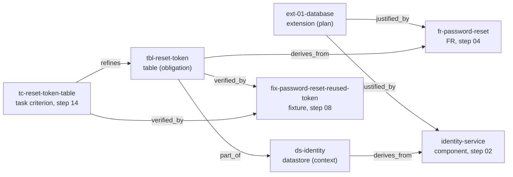

# Extension Schemas (Step 13)

An extension is a spec of the host's own for a domain the core steps do not describe: a database, a model, a queue.
The host writes its schema and its data. The items of the data are nodes of the spec graph: they link to the nodes
of earlier steps, a task criterion refines them, a verifier proves them, and the implementer reads them in the context
pack.

The commands below are run from the host root. The id and step forms, `step create`, `node`, `attest`, `stale`,
`trace`, `verify`, `status` and `spec-check` take `--repo-root ./devspec_toolkit --spec-root ./spec --git-root .`; a
`specdev json` command that is given a file path takes `--repo-root ./devspec_toolkit` only. The flags are left out
of the command lines of this guide.

## The parts

| Part | Place | Says who it is |
|---|---|---|
| The manifest entry | `spec/13_extension_manifest.json`, `.extensions[]` | `"extension_id": "ext-NN-<topic>"` |
| The schema file | `spec/extensions/ext_NN_<topic>.schema.json` | `"$id": "vc:ext-NN-<topic>"` (JSON Schema draft 2020-12) |
| The data file | `spec/extensions/ext_NN_<topic>.json` | `"$schema": "vc:ext-NN-<topic>"` |

The file names are the `extension_id` with its hyphens replaced by underscores. The tool finds the two files by a scan
of `spec/extensions/`: nothing is registered by hand, and nothing of a host enters `tools/schema_registry.json`. Step
13 owns every JSON file directly in that folder; a sub-folder and a file that is not `.json` are not read.

This is the example of the toolkit: `tests/fixtures/extension_example/` is laid over the worked example
`tests/fixtures/graph_example`. Its schema file, `spec/extensions/ext_01_database.schema.json`, is the model of a host
schema. Its deltas `declare_extension` and `refine_table` add the manifest entry and the task criterion; the other
deltas each break one rule of the table under "Findings".

## The manifest entry

An entry is a node of kind `extension`, role `plan`. Its `justified_by` is required and lists at least one node that
makes the extension necessary: a component, a third party, a capability, an FR or an NFR. The prose `justification`
says why and names no id (E752 reports an id in the text). The other fields and their bounds are in
`prompts/prompt_13_extension_manifest.md`.

## The schema file

The host writes it as a file; it is the host's own JSON Schema. What it may declare (kinds, roles, links, the keys
that are refused) is in [schema-annotations.md](schema-annotations.md), "An extension schema". In short:

| It declares | With | Rule |
|---|---|---|
| A kind | `x-node` on an array property: `kind`, `role`, `id`, `contract` | The role is `context` or `obligation-system`. The kind name is used by no toolkit kind and no other extension |
| A link | `x-link` on an array property of the item, named with a link verb: `kinds`, `required`, `built`, `same_step_kinds` | It names nodes of earlier steps; a kind of step 13 only when `same_step_kinds` lists it |
| The proof of an obligation | A `verified_by` link to `fixture` and `job` on the obligation kind | Each item names there what proves it |
| A seed as a source | `seed` in the `kinds` of a `derives_from` | The seed manifest routes the seed to step 13 (`step_requirements["13"]`); E749 otherwise |
| Open items | `"ambiguities": {"$ref": "vc:core:collections#ambiguityList"}` at the top | Without the property the data file may hold no such list |
| Shared shapes | `$ref` to `vc:core:*` and to another extension schema of the folder (`vc:ext-NN-<topic>#/...`) | A kind of a toolkit step schema may not be reached by `$ref` |

A kind may be nested in another kind (an index in a table). Each item declares `lifecycle`; an obligation item also
`scope`, `scope_reason` and the reason rule; an item that `specdev node rename` is to rename declares `aliases` (an
array of `vc:core:atoms#kebabId`).

## The life of an extension

| Stage | Command | What happens |
|---|---|---|
| Declare | `specdev step create 13 --from <manifest-draft>` | Writes the manifest with its entries and the lock entry of each `justified_by` |
| Write the schema | none: a file | The step gate reports an entry with no schema file |
| Write the data | `specdev step create 13 <extension-id> --from <data-draft>` | Checks the draft against the schema file, resolves every link, writes the data file and the lock entries |
| Gate the step | `specdev spec-check spec --step 13` | `RESULT: CLEAR` when the files, the schema and the links hold |
| Schedule (step 14) | `specdev json insert --id <task-id> .acceptance_criteria '<criterion>'` | A criterion `refines` the obligation and lists one of the obligation's verifiers. E740 for an obligation nothing refines, E745 for a verifier the obligation does not name |
| Plan, build, review | `specdev trace --recipe 16a <task-id>`, `--recipe 16b <plan-item-id>`, `--recipe 16c <milestone-id>` | The obligation is under `obligations` (a nested one with its parent in brackets); the section `extension context` lists the context nodes it links to |
| Prove | `specdev verify bind <verifier-id> --command "<command>" --guard "<regex>" --proves <node-id>`, `specdev verify run --milestone <milestone-id>` | The binding may name the obligation. The run of a milestone runs the verifiers its criteria name |
| Release | `specdev release prep` | Runs every binding still without evidence, so also a verifier that only the obligation names. The release gate asks that the obligation is built (a closed criterion refines it: E914 otherwise) and proven (E348 otherwise) |

Later changes:

| Change | Command |
|---|---|
| An entry more | `specdev json insert --step 13 .extensions '<entry>'`, then its two files |
| The first entry of a manifest that says `none-required` | The insert is refused (E767: `has more items than the schema allows`). Change the status, the rationale and the entry in one write, `specdev json patch spec/13_extension_manifest.json --batch <ops-file>`, then `specdev attest <extension-id> --yes` |
| A field or a link of an item | `specdev json patch --id <node-id> .<field> '<value>'`, `specdev json insert --id <node-id> .<list-field> '<value>'` |
| Remove an item | `specdev json delete --id <node-id>` |
| A new item at the top of a data file | `specdev json insert spec/extensions/ext_NN_<topic>.json .<section> '<item>'`, then `specdev attest <new-id> --yes` |
| A new item nested in an item | `specdev json insert --id <parent-id> .<list-field> '<item>'` |
| Rename an item | `specdev node rename <old-id> <new-id>` (the item's schema declares `aliases`) |
| Rename an entry | Not by id: E770 says how to do it by hand |
| The schema file | Edit the file, then `specdev spec-check spec --step 13` |

An edit of a contract field of an item makes the links that point at it suspect (E763): `specdev stale` lists them,
`specdev attest <node-id> --yes` accepts each after it is read. `specdev node show <id>`, `trace`, `stale`, `attest`
and `status` treat a node of an extension like any other node.

## Open items

An open item of step 13 is a question about a seed or about nodes of earlier steps; an item about a node of step 13
itself is refused (E702). It stands in the manifest (`specdev json insert --step 13 .ambiguities '<item>'`) or in the
`ambiguities` list at the top of a data file whose schema declares it (written by path; the two commands are in
`prompts/prompt_13_extension_manifest.md`, "Open Items"). Both are open items of step 13: W630 at the step gate, E631
at the merge gate, and `specdev upstream-backlog spec` lists them.

## Which folder a command reads

A command reads the spec folder it is told: `--spec-root`, else the folder it is handed.

| Command | Handed | Reads |
|---|---|---|
| `specdev spec-check spec`, `validate-all spec` | The spec folder | The extensions of that folder |
| `specdev validate spec/extensions/ext_01_database.json`, `json schema`, `context review` with no `--spec-dir` | One file | The path alone: the folder above a folder called `extensions` is taken for the spec folder |
| `canonical-integrity`, `canonical-autofix`, `spec-quality-lint`, `validate-all` on `spec/extensions` | The `extensions` folder | Needs `--spec-root ./spec`. Without it the folder is taken for a spec folder: `validate-all`, `canonical-integrity` and `canonical-autofix` report each data file as E520 `schema_uri_mismatch`, with the way out in the message |

`specdev validate` on a schema file prints what the step gate says of that schema (`OK` when it is accepted). A copy of a data file outside a folder called `extensions` is E520 `schema_uri_mismatch`: the schema of an extension judges its own data file and no other.

## Findings

Every text below is copied from a run on a copy of the example. Step 13 owns them unless the row says otherwise.

| Finding | Meaning | What to do |
|---|---|---|
| E520 `Extension 'ext-01-database' has no schema: expected extensions/ext_01_database.schema.json (a JSON Schema whose "$id" is "vc:ext-01-database")` | An entry without its schema file | Write the schema file |
| E520 `Extension 'ext-01-database' has no file: expected extensions/ext_01_database.json (its "$schema" is "vc:ext-01-database")` | An entry without its data file | `specdev step create 13 ext-01-database --from <draft>` |
| E520 `extensions/ext_03_queue.json: no entry of 13_extension_manifest.json declares it` | A JSON file of the folder that belongs to no entry; a name of another form adds `(an extension's files are named ext_NN_<topic>.schema.json and ext_NN_<topic>.json)` | Declare the entry, or move the file out of the folder |
| E520 `extensions/ext_01_database.json: the spec has no 13_extension_manifest.json to declare it` | Files of an extension and no manifest | Create the manifest |
| E520 `Extension schema extensions/ext_01_database.schema.json is not a valid JSON Schema: 'arrray' is not valid under any of the given schemas (at /properties/tables/type)` | The schema file is no JSON Schema | Correct the place the message names |
| E520 `Extension schema extensions/ext_01_database.schema.json has the "$id" "vc:ext-01-db"; its file name gives "$id": "vc:ext-01-database"` | A wrong `$id`; the `$id` of a toolkit schema reads `has the "$id" of a toolkit schema ("vc:core:atoms")` | Set the `$id` the message gives |
| E520 `Extension schema extensions/ext_02_cache.schema.json names the dialect "$schema": "..."; an extension schema is read as JSON Schema draft 2020-12: leave "$schema" out or set it to "https://json-schema.org/draft/2020-12/schema"` | Another draft | As the message says |
| E520 `schema_uri_mismatch the data file extensions/ext_01_database.json has the "$schema" "vc:ext-09-nowhere"; its file name gives "$schema": "vc:ext-01-database" (it is judged by extensions/ext_01_database.schema.json and by no other schema)` | The data file names another schema | Set the `$schema` the message gives |
| E520 `schema_not_found uri=vc:ext-01-database detail=Schema not found for vc:ext-01-database: it names an extension schema, which is read from extensions/ext_01_database.schema.json in the spec folder (a JSON Schema whose "$id" is "vc:ext-01-database"). Write that file, or correct it if `specdev spec-check` reports it.` | The data file has no usable schema: the file is missing or one of the rows above refuses it | Clear the finding of the schema file first |
| E520 `extensions/ext_01_database.json:tables/0/columns: 'x' is not of type 'array'` | The data does not validate | Correct the item, by node id |
| E320 `Extension 'ext-01-database' required_schema_sections[3] 'migrations' is not a property of its schema extensions/ext_01_database.schema.json` | The entry promises a section the schema does not declare | Declare the property, or correct the entry |
| E520 `the extension schemas of the spec folder (extensions/*.schema.json) declare node kinds or links the graph cannot use; no kind of an extension is loaded and the graph of this spec is not built until each line is corrected in the schema it names: ...` | One finding for all schemas; each line names a schema file and a place. The lines are listed in [schema-annotations.md](schema-annotations.md), "An extension schema" | Correct every line. Until then no node of any extension is in the graph |
| E740 `table tbl-reset-token is not used by any node; a node of this kind is used by task-criterion refines (step 14): link it, or set scope later or out with a scope_reason` (owner: step 14) | An obligation no criterion refines | Add the criterion at step 14, or park the item with `scope` and `scope_reason` |
| E745 `task criterion tc-reset-token-table refines tbl-reset-token but none of its verifiers (fix-password-reset-expired-token) is named in verified_by of tbl-reset-token; list in verified_by of tc-reset-token-table a verifier that tbl-reset-token names (fix-password-reset-reused-token), or add a verifier of tc-reset-token-table to verified_by of tbl-reset-token` (owner: step 14) | The criterion and the obligation name different verifiers | One of the two ways the message gives. For a kind with no `verified_by` the message says to declare the link in the schema first |
| E348 `table tbl-reset-token has no verifier to prove it: name a fixture or a job in verified_by of tbl-reset-token` (release gate) | The obligation names no verifier; for a kind with no such link: `the kind table declares no verified_by link; declare one to a fixture or a job in the schema of its extension, then name the verifier in verified_by of tbl-reset-token` | Name the verifier, after declaring the link when the kind has none |
| E210 `CROSS_ARTIFACT_DRIFT canonical_refs_used_missing ../spec/extensions/ext_01_database.json ids=['cn:project:term:reset-token']` (owner: `merge-check`) | An item of the data file uses a canonical reference that the file's `canonical_refs_used` does not list | List the reference in `canonical_refs_used` of the data file, as in a step file |
| E749 `tbl-reset-token derives from seed seed-accounts, which the seed manifest does not route to step 13; add seed-accounts to step_requirements["13"], or remove the link and run specdev attest --prune` | A seed that is not routed to step 13 | Route it, or remove the link |
| E767 from `step create 13 <extension-id>` | The draft is not written: the entry, the schema file or the manifest is missing, the data file exists, the draft names another `$schema`, does not validate or holds a link that does not resolve | The message names the command to run first; see [error-codes.md](error-codes.md), E767 |
| E770 from `specdev node rename <extension-id> <new-id>` | An entry is not renamed by id | Follow the message: move the two files, edit the `$id` and the `$schema`, then the id of the entry |
| E708 `the tree at ref 'main' cannot be read: the graph refuses the extension schemas that tree holds, as they are at that ref (...)` | A command that reads an old commit (`diff`, the base of the step gate, `trace --since`) found a schema there that the graph refuses | Nothing to correct at the head. Name a ref whose schema is right; the step gate goes on with `base: unavailable` and says so in a `note:` |

## A host that comes from 1.1.1

The steps are in [workflow_migrate_1_2_0.md](workflows/workflow_migrate_1_2_0.md), "Step 13: the files and the links
of an extension". A host whose manifest says `none-required` has nothing to do.

## Known limits

- No id form adds an item at the top of a data file: `specdev json insert --step 13 .<section>` knows only the
  collections of the manifest. Insert the item by path, then `specdev attest <new-id> --yes`.
- A context node that is reached only through another context node is not in a pack. Link the obligation to each
  context node its implementer must read.
- A command that is handed one file reads the path alone (see "Which folder a command reads"): a data file kept
  outside a folder called `extensions` is not judged by its extension schema.
- Only `.json` files are read. A schema or a data file in another format is not seen.
